<div align="center">

# Hermes Synapse

### Runtime governance and a human approval layer for AI agents

Agents plan on a DAG, inherit only the tools their parent allows, and stop on risky calls until a human approves **that exact payload** - once. The decision is hash-chained, exportable, and verifiable offline.

[Docs](https://pauloberezini.github.io/hermes-synapse/) · [Security](https://pauloberezini.github.io/hermes-synapse/guide/security.html) · [Integrations](https://pauloberezini.github.io/hermes-synapse/guide/integrations.html) · [Approvals guide](https://pauloberezini.github.io/hermes-synapse/guide/approvals.html)

[](LICENSE)
[](https://www.python.org/)
[](https://www.docker.com/)
[](https://github.com/pauloberezini/hermes-synapse/actions/workflows/test.yml)
[](https://github.com/pauloberezini/hermes-synapse/actions/workflows/deploy-docs.yml)
[](https://github.com/pauloberezini/hermes-synapse/stargazers)

```bash
git clone https://github.com/pauloberezini/hermes-synapse && cd hermes-synapse
cp .env.example .env   # add your LLM API key
docker compose up -d --build
# Open http://localhost:9119
```

</div>

---

## Why

Most multi-agent stacks are either **hardwired workflows** (n8n, Make) or **unbounded chat loops** (AutoGen-style). Hermes sits in the middle, and then adds a control plane the others leave as a TODO:

- A visual DAG of orchestrators and specialists. No cycles. Children cannot gain tools the parent does not have.
- Dynamic LLM planning, not a hardcoded pipeline.
- A real gate on risky tools: the operator reviews the claim and the source, approves a payload hash, then the agent must send the **same** call again before anything runs. A replay is a new `PENDING` request, not a free pass.
- An append-only, hash-chained decision log you can export and check with a stdlib Python script. No Hermes install, no network.

Self-hosted. MIT. Docker Compose. Built by [Pavel Bereznichenko](https://github.com/pauloberezini) at [SupplyAlpha.ai](https://supplyalpha.ai).

---

## Feature highlights

Rehearsal shots from 29 Oct 2026 on `main` (`f4f92d5`). The command is `df -h /`. No real secrets in these frames.

**1. A Sys Ops shell call stops at PENDING, and the Approvals badge goes live**

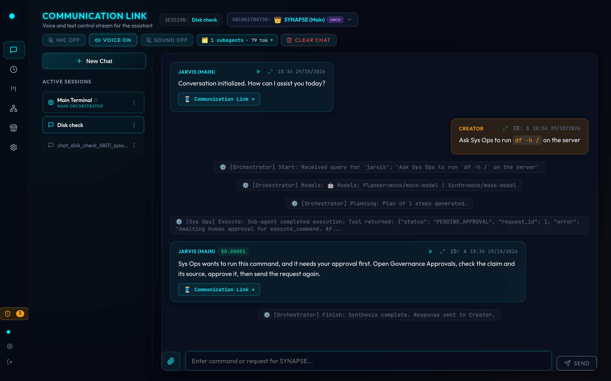

**2. The pending queue**

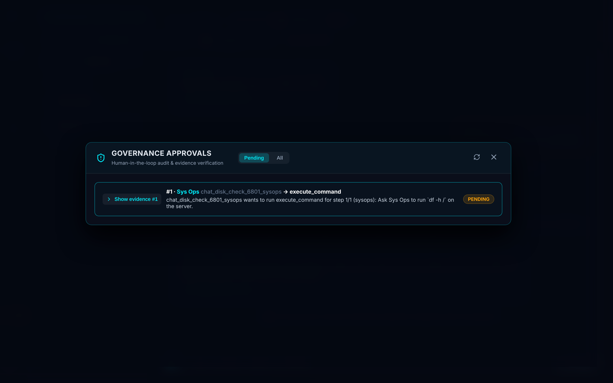

**3. Claim, source, args, and hash - before anything runs**

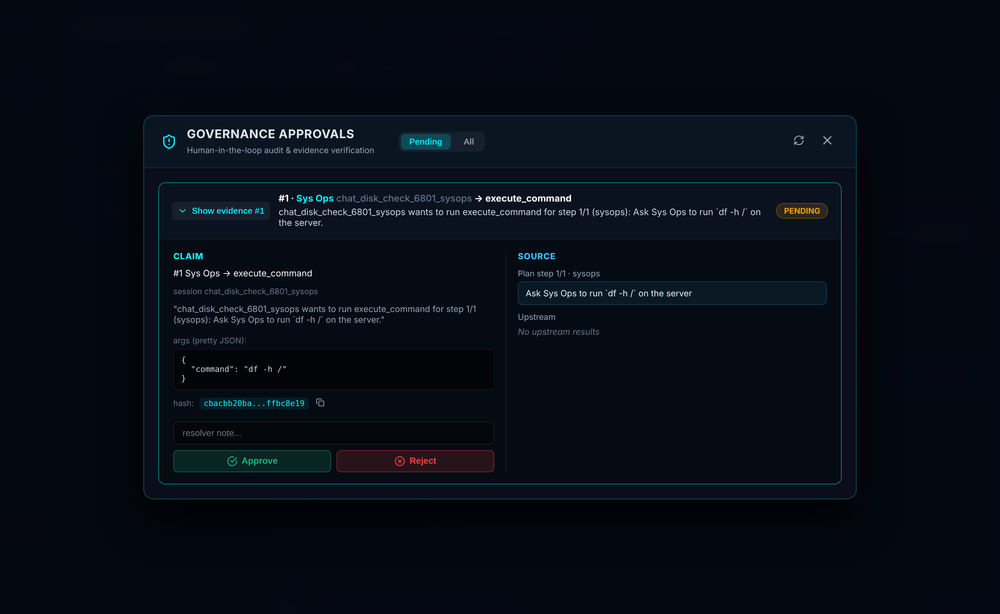

**4. Approve with a resolver note. Nothing executes yet.**

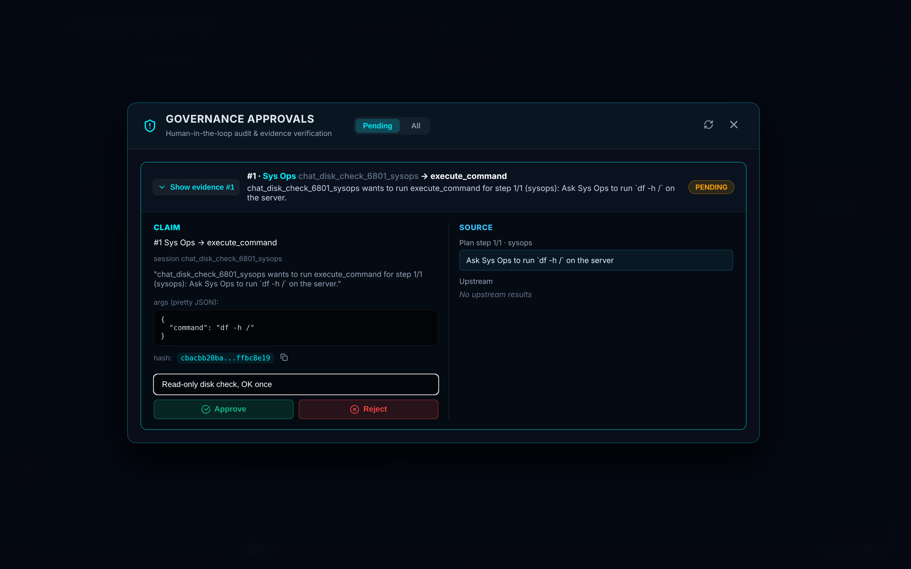

**5. Re-send the same chat request. The approved command runs exactly once.**

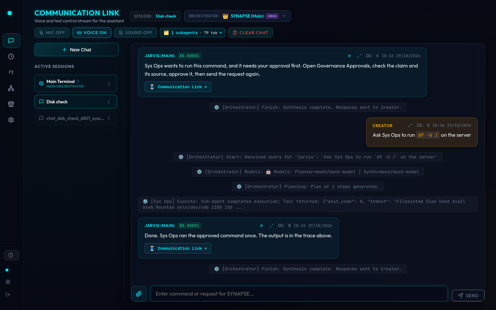

**6. The same prompt again is not a free replay - a new PENDING item appears**

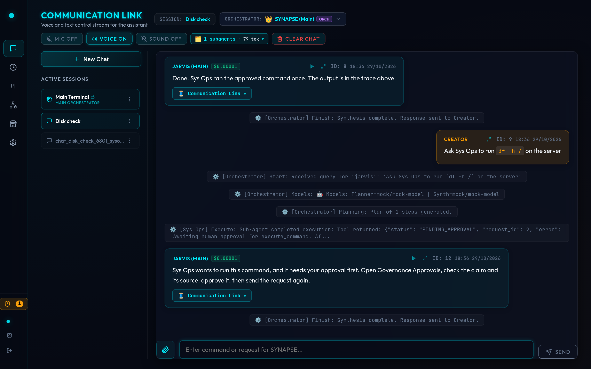

**7. Different args are a different hash. Two pending items can sit in the queue.**

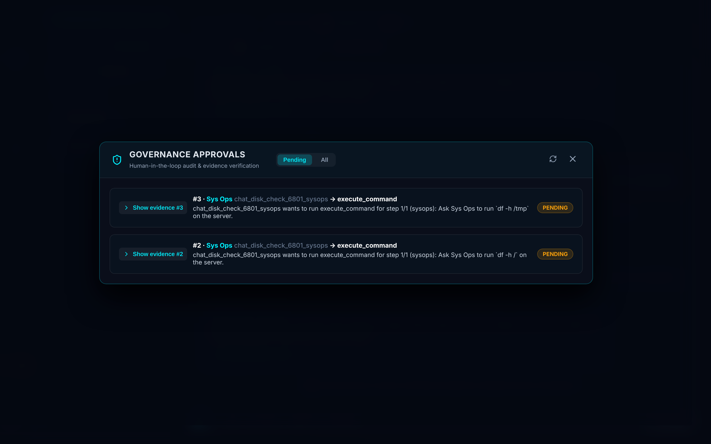

**8. The All tab keeps APPROVED, PENDING, and CONSUMED in one audit view**

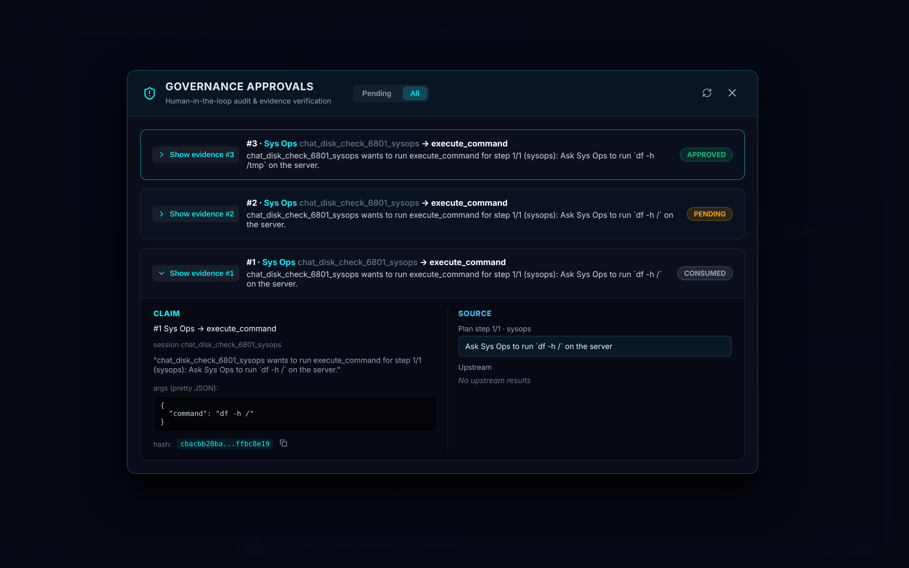

**9. Export the log, pin the head, and watch tampering fail offline**

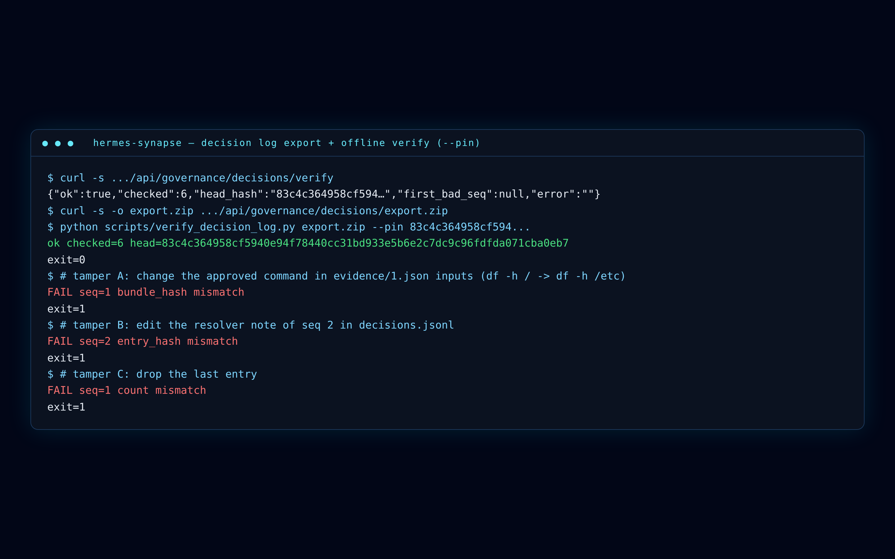

Also in this README: [secret redaction in evidence](#secret-redaction), [append-only DB triggers](#append-only-hash-chain), and the [decision-log API](#verify-and-export).

---

## How it works

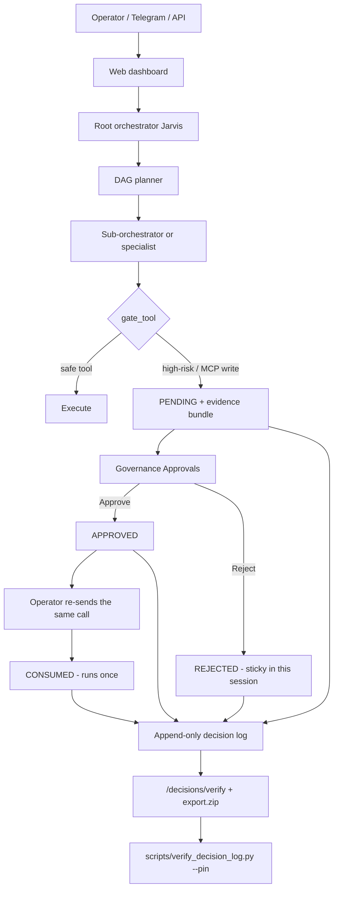

**Planning.** The root orchestrator (`jarvis`) builds a DAG of steps and delegates to specialists. Nested orchestrators re-plan among their own children. Cycle detection keeps the graph acyclic.

**Permission intersection.** A child's effective tools are `child.skills ∩ parent.skills`. Auto-hired specialists are capped the same way. An empty parent cap is an empty set, not "unrestricted".

**The gate.** `execute_tool` calls `gate_tool` before the tool body. High-risk built-ins and MCP tools that are not marked read-only wait for a human. Approve does **not** run the tool. The model must call again with identical arguments; the gate consumes the `APPROVED` row and runs once.

**Evidence.** Each new request captures a redacted bundle (plan step, inputs, upstream excerpts, flags) and hashes a canonical view of it (`bundle_hash`). The hash binds what the reviewer can actually see.

**Audit.** Every `REQUESTED` / `APPROVED` / `REJECTED` / `CONSUMED` event is appended to a hash chain. Database triggers reject in-place edits. You can verify in-process or from a zip with no Hermes install.

---

## Integrations

Only connectors the tree actually implements are listed. Optional keys degrade cleanly: the agent tells you what is missing instead of crashing.

### LLM providers

Any **OpenAI-compatible** chat API:

| Provider | How |
|---|---|
| [OpenRouter](https://openrouter.ai) (default) | `LLM_API_BASE=https://openrouter.ai/api/v1` + `OPENROUTER_API_KEY` |
| [Ollama](https://ollama.com) (local) | `LLM_API_BASE=http://host.docker.internal:11434/v1`, `LLM_MODEL=llama3`, placeholder key |
| vLLM / LM Studio / LocalAI | Same pattern: point `LLM_API_BASE` at the `/v1` endpoint |

Per-agent overrides: `AGENT_MODEL_CODE`, `AGENT_MODEL_RESEARCH`, `AGENT_MODEL_ANALYST`, `AGENT_MODEL_PLANNER`, `AGENT_MODEL_SPECIALIST`.

### Agent frameworks and extension points

| Surface | What it is |
|---|---|
| **MCP client** | Connect MCP servers from `mcp_config.json` / the MCP tab. Tools are registered into `TOOLS_SCHEMA` at connect time. Write-shaped MCP tools wait for approval unless `readOnlyHint: true` or `destructiveHint: false`. |
| **`hermes_sdk`** | Decorator API (`@skill` / `@tool`) for community skills and marketplace packages. |
| **Plugin boundary** | Drop `backend/<name>/plugin.py`. Core calls hooks (`init_plugin`, `get_extra_agents`, `high_risk_tools`, `market_data_provider`, `handle_fast_command`, …) and never imports a plugin by name. |
| **Skills marketplace** | `/api/marketplace/*` registry for discovering and registering skill packages. Default billing is a no-op free adapter; a Stripe adapter is used only when `STRIPE_SECRET_KEY` is set. |
| **P2P agent mesh** | `AgentMeshRouter` for capability matching, peer discovery, and task delegation between agent nodes. |

### Tools and data connectors

| Integration | Env / notes |
|---|---|
| Telegram bot | `TELEGRAM_BOT_TOKEN`, `TELEGRAM_CHAT_ID`, `TELEGRAM_ADMIN_ID` - OTP delivery and chat UI |
| [SearXNG](https://github.com/searxng/searxng) | `SEARXNG_URL` - self-hosted metasearch, no paid search key |
| OpenWeatherMap | `OPENWEATHERMAP_API_KEY` |
| Todoist | `TODOIST_API_TOKEN` - list / add / delete (delete is high-risk) |
| Google Calendar | OAuth2 desktop credentials via `GOOGLE_CLIENT_SECRET_PATH` |
| Obsidian Local REST API | `OBSIDIAN_API_KEY`, host/port/vault - search, read, write, vault sync (note create is high-risk) |
| Market data | Default `MARKET_DATA_PROVIDER=http`: CoinGecko (crypto) + Yahoo Finance (stocks). Other names resolve through a plugin hook. |
| RSS nodes | Built-in RSS skill + dashboard tab |
| Qdrant | Vector memory / RAG (Compose service) |
| GraphRAG | Optional knowledge-graph indexing (`backend/graphrag.py`) |
| PostgreSQL 16 | Required datastore in Compose (`DATABASE_URL`) |
| Hugging Face FastEmbed | `HF_TOKEN` / `HUGGING_FACE_HUB_TOKEN` for local embeddings |
| Voice | Browser `SpeechRecognition` for STT and `speechSynthesis` for TTS in the dashboard (not a local Whisper stack) |
| Auto-hire | `AUTO_HIRE=ask` (default) / `on` / `off` - planner can create a capped specialist when nobody covers the request |
| Docker / Swarm / Kubernetes | `docker-compose.yml`, `docker-compose.dev.yml`, `docker-compose.swarm.yml`, `k8s/` |

A GitHub skill in `hermes_sdk/examples/` is a template, not a seeded connector. Do not confuse it with a built-in GitHub integration.

---

## Security

Hermes is a **runtime governance layer**, not a claim that every code path is gated. The mechanisms below are the ones in the tree today.

### What is gated

`execute_tool` → `gate_tool` (`backend/tools.py`, `backend/governance.py`).

Built-in high-risk names (`HIGH_RISK_TOOLS`):

`execute_command`, `create_obsidian_note`, `delete_todoist_task`, `create_subagent`, `update_subagent`, `delete_subagent`, `change_agent_skills`, `assign_role`, `clear_history`, `clear_decision_logs`, `set_log_level`, `export_or_purge_audit`

Plugins can add names via `high_risk_tools()`. MCP tools go through `mcp_tool_needs_approval`: omitted annotations follow MCP defaults (`readOnlyHint` false, `destructiveHint` true) and wait; a tool opts out with `readOnlyHint: true` or `destructiveHint: false`.

The match key is **session id + action + payload**, not a global "this agent is trusted" flag. An approval granted in chat A cannot be spent in chat B.

### Payload-bound, single-use approvals

1. First call of a high-risk tool → `PENDING`, evidence row, `REQUESTED` log event. The tool reply is `PENDING_APPROVAL` plus a hint to call again with identical arguments after approval.
2. Operator reviews CLAIM (tool, agent display name, session, args, `bundle_hash`) and SOURCE (plan step or `direct_route` user instruction, upstream excerpts).
3. **Approve does not run the tool.** It writes `APPROVED` with the operator `Principal` (`local-admin` for OTP, JWT `sub` otherwise).
4. The next identical call in that session `consume`s the row: `APPROVED` → `CONSUMED`, then the tool body runs **once**. `CONSUMED` is written by `system`.
5. Sending the same prompt again opens a **new** `PENDING` request. Consumed approvals are not reused.
6. Different args (for example `df -h /` vs `df -h /tmp`) are a different payload key and a different hash.
7. `REJECTED` stays blocking in that session (no cooldown unless you add one later). A new session can open a new request.

### Evidence hash (`bundle_hash`)

Pipeline inside `gate_tool` for a new request: **build → redact → cap → hash → insert**. Redaction runs before hashing, so the digest binds what the reviewer sees.

Hashed (`hash_view` in `backend/evidence.py`): `schema_ver`, `agent_id`, `action_name`, `inputs`, `plan`, upstream `{kind,name,sha256,truncated,reason}`, `flags`.

**Not hashed:** `description`, `excerpt` text, `links`, `step_context` (the step body is hashed as an upstream item instead). Editing only the human-readable description does not fail the verifier; editing `inputs`, plan, upstream hashes, or flags does.

Canonical JSON is RFC 8785-style (`backend/canonical.py`: sorted keys, no extra whitespace). `payload_hash` on each decision row is `sha256(canonical_json(payload))`.

### Secret redaction

`PIIGuard` masks known formats in evidence, list/detail API payloads, and resolver notes: OpenAI-style `sk-…` keys, GitHub `gh*_` tokens, bearer tokens, generic `api_key=` assignments, emails, phones, card numbers, US SSNs. The Approvals UI shows tokens such as `[API_KEY_OPENAI_REDACTED]`.

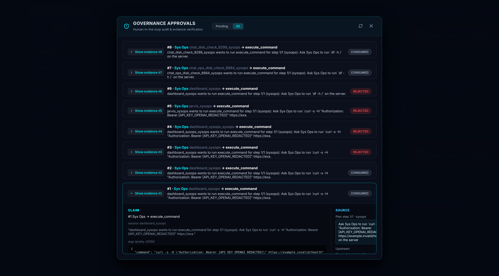

Limits, stated plainly:

- The matcher only catches **known formats**. A novel secret shape can slip through. Do not paste live keys into demo prompts.
- `approval_requests.payload` is still stored as the raw JSON match key so retries can be compared. List/detail HTTP responses mask it. Hash-and-mask of that column is tracked as follow-up work (internal R2-4).
- Tool arguments may also appear in server logs.

### Append-only hash chain

`approval_decisions` is a per-tenant hash chain. Each row's `entry_hash` covers tenant, request, event, actor, roles, auth method, action, `payload_hash`, `bundle_hash`, reason, timestamp, and `prev_hash`. Genesis `prev_hash` is 64 zeros.

SQLite and Postgres triggers abort `UPDATE`/`DELETE` on `approval_decisions` and `UPDATE` on `approval_evidence`. `DELETE` on evidence is allowed so a request can cascade - and **the verifier must catch a missing evidence row**.

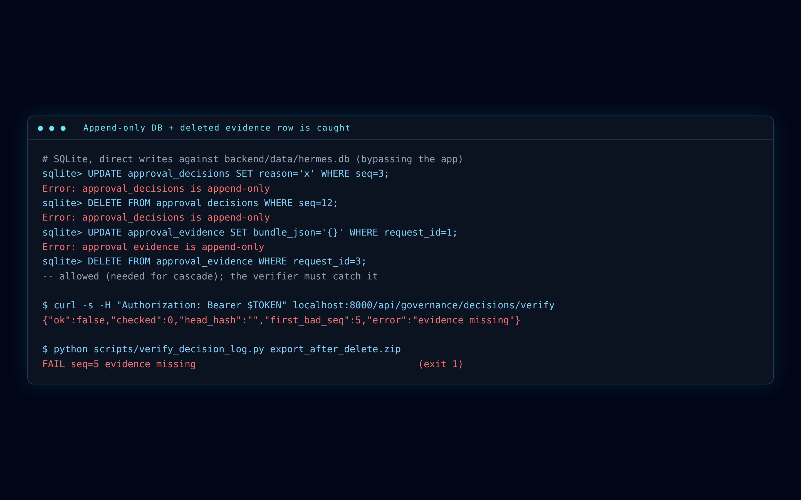

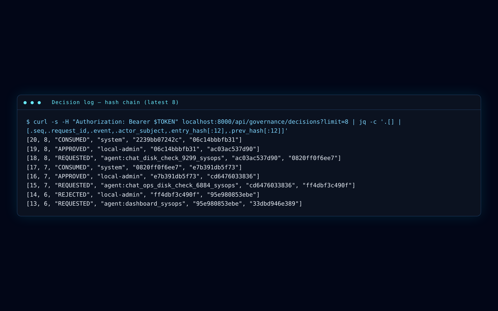

This is **tamper-evident**, not a signed or encrypted ledger. Someone who rewrites the whole chain *and* the copy of the head hash you kept can still pass an unpinned check. Pin the head.

### Verify and export

| Endpoint | Role |
|---|---|
| `GET /api/governance/decisions/verify` | Walk the chain in the database, recompute each `entry_hash` / `prev_hash`, and re-hash stored evidence. |
| `GET /api/governance/decisions` | Paginated log (`before_seq`, `limit`). |
| `GET /api/governance/decisions/export` and `/export.zip` | Zip of `decisions.jsonl`, `evidence/<id>.json`, `manifest.json`, `VERIFY.md`. |
| `GET /api/governance/approvals` | Summaries; `payload` is masked. `?pending_only=true`. |
| `POST /api/governance/approvals/{id}/resolve` | `APPROVED` or `REJECTED`. A client-supplied `bundle_hash` in the body is ignored; the server uses the stored hash. |

Offline (Python 3.11+ stdlib only - the checker is **not** inside the zip):

```bash
curl -f -H "Authorization: Bearer <TOKEN>" \
  "http://localhost:8000/api/governance/decisions/export.zip" -o decisions.zip

python3 scripts/verify_decision_log.py decisions.zip --pin <head_hash>
# ok checked=N head=H   → exit 0
# FAIL seq=N <reason>   → exit 1
```

`--pin` fails if that `entry_hash` is missing, including a truncated tail whose `manifest.json` was rewritten to match.

### Login and identity

- Dashboard login is a **6-digit OTP** (5 minute TTL, single use). The code is printed in the backend log, optionally sent on Telegram, and written to `backend/data/.current_otp` (mode `0600`) as an emergency fallback.
- Local OTP sessions live in an in-memory set. A backend restart drops them (known limitation R2-6).
- Optional `JWT_SECRET` enables HS256 JWT sessions (`alg=none` is rejected). RBAC roles: admin > editor > operator > viewer. OTP sessions are treated as `local-admin`.
- Decision events record a `Principal` (`subject`, `roles`, `tenant_id`, `auth_method`).

### Permission intersection and budgets

- Child tools = child skills ∩ parent skills (`backend/agent.py`, `backend/orchestrator.py`, `backend/agent_factory.py` `cap_skills`).
- `BudgetGuard` enforces per-session and global USD caps from `app_settings` / `session_metadata` before LLM calls.
- `MemoryGuard` scans documents for common prompt-injection markers before RAG indexing.

### Known limitations (do not skip)

| ID | What it means |
|---|---|
| **R1-2** | The **Code Engineer** (and Data Analyst, which reuses it) runs generated Python via `CodeAgent.run_and_correct` → `execute_code`. That path never calls `gate_tool`. Retry-based gating also does not fit generated code: the script changes every turn, so an "identical arguments" retry would never consume. Treat the code-agent sandbox as **out of the approval gate** until a replay-the-approved-source path exists. Do not demo it as gated. |
| **R2-4** | Raw tool args remain in `approval_requests.payload` for matching. Evidence and HTTP responses are masked. |
| **R2-2** | A `REJECTED` call stays rejected for that session with no cooldown. |
| **R2-6** | OTP sessions are not persisted across process restarts. |
| **R3-1** | `COMPLEXITY_ROUTING` from the environment can leak into `backend/tests/test_agent.py` (test isolation, not a runtime bypass). |
| Hash coverage | `bundle_hash` does not cover `description` / `links` / excerpts. |
| Verifier | Tamper-evident with `--pin`. Not a signature. Not encrypted. |
| PIIGuard | Known regexes only. |

Roadmap for gating the code agent, signed manifests, and persistent sessions: [ROADMAP.md](ROADMAP.md) and `docs/specs/approvals-demo-hardening-phase2.md`.

---

## Quick start

> **Requirements:** Docker and Docker Compose.

```bash
git clone https://github.com/pauloberezini/hermes-synapse
cd hermes-synapse
cp .env.example .env
# Set OPENROUTER_API_KEY (or point LLM_API_BASE at Ollama and use a placeholder key)

docker compose up -d --build
```

- Dashboard: [http://localhost:9119](http://localhost:9119)
- API: [http://localhost:8000](http://localhost:8000)

Login: the OTP is printed in the backend log (and sent to Telegram if configured):

```bash
docker logs jarvis-backend | grep "Generated OTP Code"
```

**Local model (Ollama)** in `.env`:

```bash
LLM_API_BASE=http://host.docker.internal:11434/v1
LLM_MODEL=llama3
OPENROUTER_API_KEY=local
```

Hot-reload development:

```bash
docker compose -f docker-compose.dev.yml up
# UI http://localhost:5173  ·  API http://localhost:8000
```

`AUTO_HIRE=ask` (default) creates a specialist and waits for `POST /api/subagents/{id}/confirm`. `on` hires and runs in the same turn. `off` reports the gap and creates nothing. Hired agents never receive skills the parent does not already have.

---

## Demo walkthrough

Use Sys Ops (`shell_execution` → `execute_command`). **Do not use the Code Engineer for this demo** (see R1-2). Never put a real key in the prompt.

1. New chat, for example "Disk check". Send: `Ask Sys Ops to run \`df -h /\` on the server.`
2. Execution stops. The Approvals badge counts up. Open **Governance Approvals**.
3. Expand evidence. Check CLAIM args (`{"command": "df -h /"}`) and the hash. Check SOURCE (planner step, or `direct_route` on a direct chat).
4. Write a resolver note. Click **Approve** (or press `A` when the row is focused). Status becomes `APPROVED`. The command has **not** run.
5. Send the same request again in that chat. The gate consumes the approval, Sys Ops runs once, status becomes `CONSUMED`. Output is in the trace.
6. Send it a third time. A **new** `PENDING` item appears. The previous approval is spent.
7. Ask for `df -h /tmp`. That is a different payload and a different hash.
8. Open the **All** tab: `APPROVED` / `PENDING` / `CONSUMED` stay on the timeline.
9. Export and verify:

```bash
curl -f -H "Authorization: Bearer <TOKEN>" \
  http://localhost:8000/api/governance/decisions/verify
curl -f -H "Authorization: Bearer <TOKEN>" \
  http://localhost:8000/api/governance/decisions/export.zip -o decisions.zip
python3 scripts/verify_decision_log.py decisions.zip --pin <head_hash>
```

Full operator guide: [docs/guide/approvals.md](docs/guide/approvals.md).

Video (canvas, Telegram, DAG planning): [YouTube](https://youtu.be/3GFh-1Gglno).

---

## Architecture

```
User ──→ Web dashboard (React, port 9119)
           │
           ▼
     Root orchestrator (jarvis)          ← DAG entry
          / \
   Sub-orch   Specialist                 ← Hierarchical delegation
        |         |
   Specialists  Skills                   ← web_search, shell_execution, …
                                          MCP tools, plugin tools

AllowedTools = ChildTools ∩ ParentTools
RiskyTools   → gate_tool → human → consume once
```

Seeded on first launch (keys optional; missing keys return a clear error):

| Agent | Skills |
|---|---|
| **Jarvis (Main)** - root orchestrator | - |
| **Search Agent** | `web_search` (SearXNG, weather, RSS) |
| **Code Engineer** | `python_sandbox` (not approval-gated; see R1-2) |
| **Data Analyst** | `python_sandbox` (reuses Code Engineer) |
| **Scheduler** | `timers_alarms` |
| **Market Monitor** | `market_monitor` |
| **Daily Planner** | `google_calendar`, `todoist_sync` |
| **Sys Ops** | `shell_execution` |
| **Football Analyst** | `web_search` |

One-click OSS presets: **Engineering Shop** and **OSINT Bureau** (`backend/presets.py`). Plugins may add more.

Other dashboard surfaces: visual DAG canvas, 2.5D pixel office, Kanban task board with checkout locks, heartbeat pulse execution, MCP tab, Obsidian tab, RSS, marketplace, metrics, scheduler.

---

## Roadmap

Shipped on current `main` includes DAG orchestration, PostgreSQL, Qdrant / GraphRAG, Telegram, MCP client, plugin boundary, `hermes_sdk`, marketplace registry, voice in the browser, OTP + optional JWT RBAC, Paperclip-style BudgetGuard, HITL approvals with evidence bundles, and the immutable decision log.

Still ahead: production multi-cluster mesh, WebRTC voice / local multimodal, marketplace monetization beyond the no-op adapter, code-agent gating (R1-2), persistent login sessions, and a signed export manifest.

See [ROADMAP.md](ROADMAP.md) for the full specification.

---

## Contributing

See [CONTRIBUTING.md](CONTRIBUTING.md).

```bash
git clone https://github.com/pauloberezini/hermes-synapse
cd hermes-synapse
docker compose -f docker-compose.dev.yml up
```

---

## License

MIT - see [LICENSE](LICENSE). Copyright (c) 2026 Paul Berezini (Pavel Bereznichenko).

---

## Contact

Hermes Synapse is built by **Pavel Bereznichenko** at **[SupplyAlpha.ai](https://supplyalpha.ai)**.

[Star the repo](https://github.com/pauloberezini/hermes-synapse) · [Open an issue](https://github.com/pauloberezini/hermes-synapse/issues) · [Read the docs](https://pauloberezini.github.io/hermes-synapse/)
