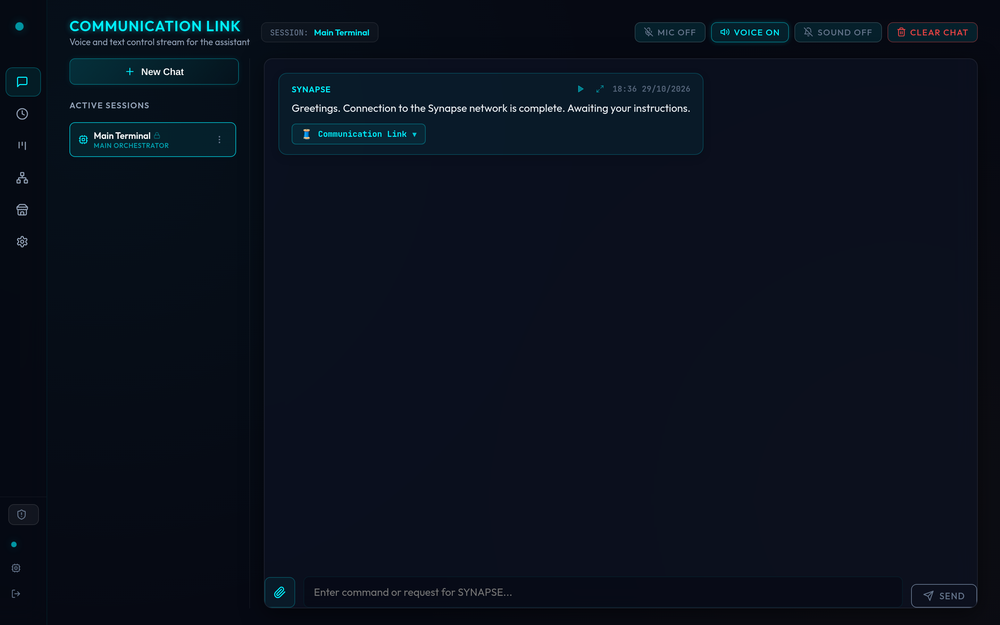

# Quick start

Hermes Synapse is a self-hosted **runtime governance layer** for AI agents: a DAG orchestrator, a human approval gate, and an append-only decision log. MIT licensed.

## Requirements

Docker and Docker Compose. That is enough.

## Install

```bash
git clone https://github.com/pauloberezini/hermes-synapse.git
cd hermes-synapse
cp .env.example .env
```

Set `OPENROUTER_API_KEY`, or point at a local model (below). Everything else is optional.

```bash
docker compose up -d --build
```

- **Dashboard:** [http://localhost:9119](http://localhost:9119)
- **API:** [http://localhost:8000](http://localhost:8000)

Login is a 6-digit OTP. It is printed in the backend log, optionally sent on Telegram, and written to `backend/data/.current_otp` as a fallback:

```bash
docker logs jarvis-backend | grep "Generated OTP Code"
```

After login you land on Communication Link (Main Terminal):

<figure class="shot">



<figcaption>Voice and text control stream. New chats, the DAG canvas, and Governance Approvals live in the sidebar.</figcaption>
</figure>

## Local model (Ollama)

```bash
LLM_API_BASE=http://host.docker.internal:11434/v1
LLM_MODEL=llama3
OPENROUTER_API_KEY=local
```

## Web search (SearXNG)

Hermes uses [SearXNG](https://github.com/searxng/searxng) as its metasearch backend. No paid search API key:

```bash
SEARXNG_URL=http://localhost:8080
```

## Auto-hire

When nobody on the staff covers a request, the planner can create a specialist under the orchestrator that owns the chat. Hired agents never receive skills the parent does not already have.

| `AUTO_HIRE` | Behavior |
|---|---|
| `ask` (default) | Create the agent and wait for `POST /api/subagents/{id}/confirm` |
| `on` | Hire and run in the same turn |
| `off` | Report the gap and create nothing |

## Development (hot reload)

```bash
docker compose -f docker-compose.dev.yml up
```

- UI: [http://localhost:5173](http://localhost:5173)
- API: [http://localhost:8000](http://localhost:8000)

Without Docker:

```bash
cd backend
python3 -m venv .venv
source .venv/bin/activate
pip install -r requirements.txt
python3 -m uvicorn backend.main:app --reload --port 8000
```

```bash
cd frontend
npm install
npm run dev
```

## First gated demo

Do **not** use the Code Engineer for this (see [Security - known limitations](./security.md#known-limitations)).

1. New chat. Send: `Ask Sys Ops to run \`df -h /\` on the server.`
2. Open **Governance Approvals**, read CLAIM and SOURCE, approve with a note.
3. Send the same request again. The command runs once (`CONSUMED`).
4. Send it a third time. A new `PENDING` item appears.

Full walkthrough: [Approvals](./approvals.md).

## Video

<YouTube id="3GFh-1Gglno" title="Hermes Synapse overview" />
