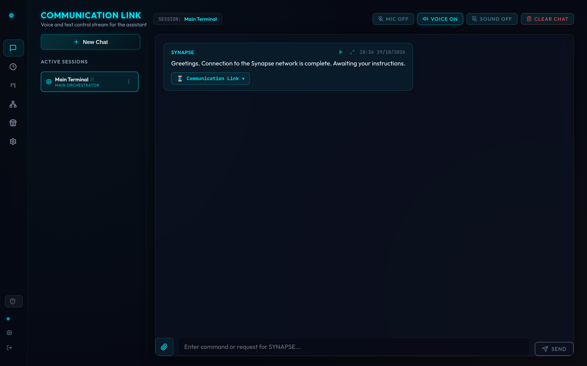

# Quick start

Hermes Synapse is a self-hosted **runtime governance layer** for AI agents: a DAG orchestrator, a human approval gate, and an append-only decision log. MIT licensed.

## Requirements

Docker and Docker Compose. That is enough.

## Install

```bash
git clone https://github.com/pauloberezini/hermes-synapse.git
cd hermes-synapse
cp .env.example .env
```

Set `OPENROUTER_API_KEY` (or a local model, below) and the three compose secrets:

```bash
# generate once; paste into .env
openssl rand -hex 32   # POSTGRES_PASSWORD
openssl rand -hex 32   # QDRANT_API_KEY
openssl rand -hex 32   # JWT_SECRET
```

`docker compose up` is the **pilot** stack: it fails fast if those secrets are missing or left as known defaults (`postgres`, `password`, `secret`, …).

```bash
docker compose up -d --build
```

- **Dashboard:** [http://127.0.0.1:9119](http://127.0.0.1:9119) (API is proxied at `/api`; nothing else is published)

For hot-reload without those secrets, use the [dev compose](#development-hot-reload) file.

Login is a 6-digit OTP. It is printed in the backend log, optionally sent on Telegram, and written to `backend/data/.current_otp` as a fallback:

```bash
docker logs jarvis-backend | grep "Generated OTP Code"
```

After login you land on Communication Link (Main Terminal):

<figure class="shot">



<figcaption>Voice and text control stream. New chats, the DAG canvas, and Governance Approvals live in the sidebar.</figcaption>
</figure>

## Local model (Ollama)

```bash
LLM_API_BASE=http://host.docker.internal:11434/v1
LLM_MODEL=llama3
OPENROUTER_API_KEY=local
```

## Web search (SearXNG)

Hermes uses [SearXNG](https://github.com/searxng/searxng) as its metasearch backend. No paid search API key:

```bash
SEARXNG_URL=http://localhost:8080
```

## Auto-hire

When nobody on the staff covers a request, the planner can create a specialist under the orchestrator that owns the chat. Hired agents never receive skills the parent does not already have.

| `AUTO_HIRE` | Behavior |
|---|---|
| `ask` (default) | Create the agent and wait for `POST /api/subagents/{id}/confirm` |
| `on` | Hire and run in the same turn |
| `off` | Report the gap and create nothing |

## Pilot deployment

Default `docker-compose.yml` is meant for a single-host enterprise pilot, not a wide-open laptop demo:

| Default | Why |
|---|---|
| Secrets required via env | No `postgres/postgres`, no empty JWT, no unauthenticated Qdrant |
| Dashboard on `127.0.0.1:9119` | Put the customer's TLS reverse proxy in front for remote access |
| Postgres and Qdrant unpublished | Reachable only on the compose network |
| Backend API unpublished | Clients go through nginx `/api` |
| Non-root users, `cap_drop: ALL`, `no-new-privileges`, read-only rootfs where practical | Shrink the blast radius of RCE in the app or sandbox |
| No `/var/run/docker.sock` | The backend does not use Docker. Opt in only with `docker-compose.docker-sock.yml` (host-root equivalent — never on a shared host) |

Existing installs that used `postgres/postgres` and published `5432`/`6333`/`8000`:

1. Set `POSTGRES_PASSWORD`, `QDRANT_API_KEY`, and `JWT_SECRET` in `.env`. Existing Postgres volumes keep the superuser they were initialized with — set `POSTGRES_USER=postgres` if that volume was created with the old default, then `ALTER USER` to a strong password.
2. Point any host-side tools at `127.0.0.1:9119` instead of `:8000`.
3. Recreate: `docker compose up -d --build`. Named volumes are kept. If backend/sandbox volumes were created as root, chown them to `10001` / `10002` after the first non-root start fails with a permission error.

Kubernetes and Swarm files under `k8s/` and `docker-compose.swarm.yml` are examples, not a pilot path.

## Development (hot reload)

`docker-compose.dev.yml` is **dev-only**: bind-mounts, SQLite, Qdrant without an API key, JWT optional, ports on loopback.

```bash
docker compose -f docker-compose.dev.yml up
```

- UI: [http://127.0.0.1:5173](http://127.0.0.1:5173)
- API: [http://127.0.0.1:8000](http://127.0.0.1:8000)

Without Docker:

```bash
cd backend
python3 -m venv .venv
source .venv/bin/activate
pip install -r requirements.txt
python3 -m uvicorn backend.main:app --reload --port 8000
```

```bash
cd frontend
npm install
npm run dev
```

## First gated demo

Do **not** use the Code Engineer for this (see [Security - known limitations](./security.md#known-limitations)).

1. New chat. Send: `Ask Sys Ops to run \`df -h /\` on the server.`
2. Open **Governance Approvals**, read CLAIM and SOURCE, approve with a note.
3. Send the same request again. The command runs once (`CONSUMED`).
4. Send it a third time. A new `PENDING` item appears.

Full walkthrough: [Approvals](./approvals.md).

## Video

<YouTube id="3GFh-1Gglno" title="Hermes Synapse overview" />
