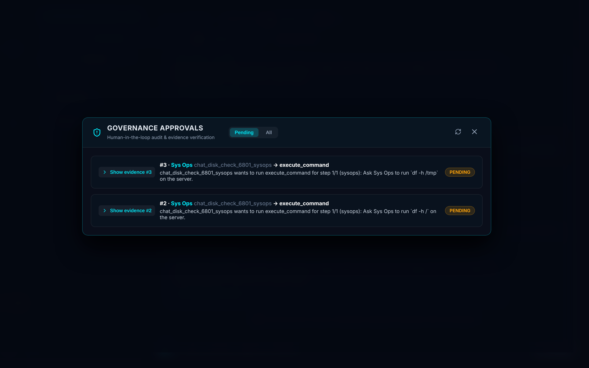
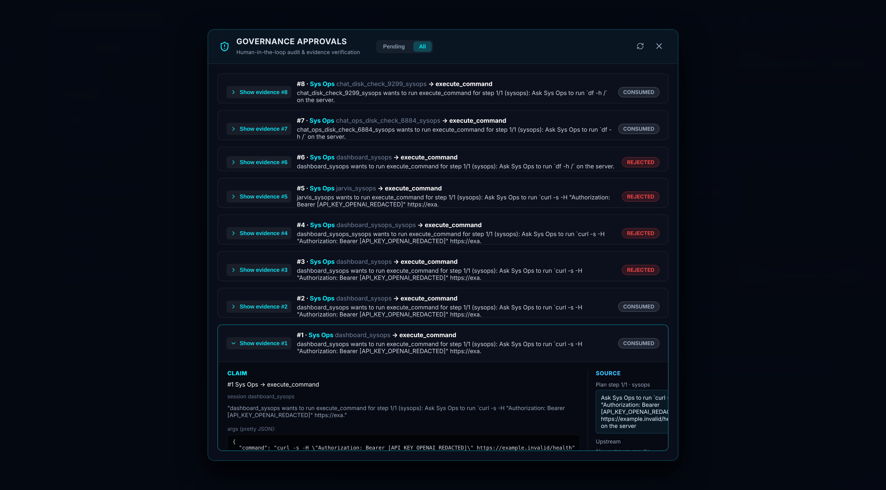
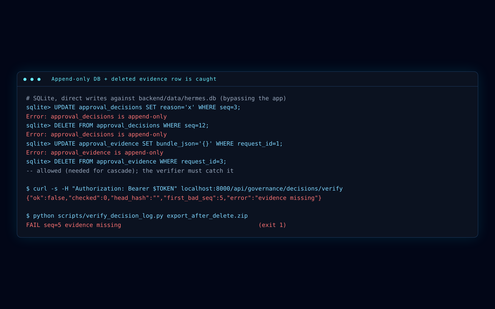
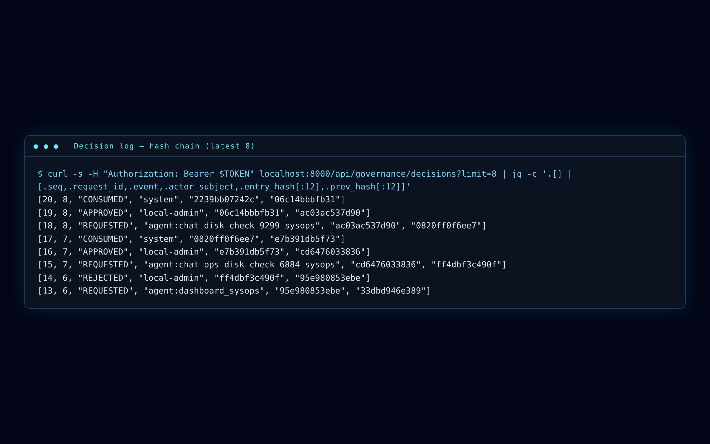
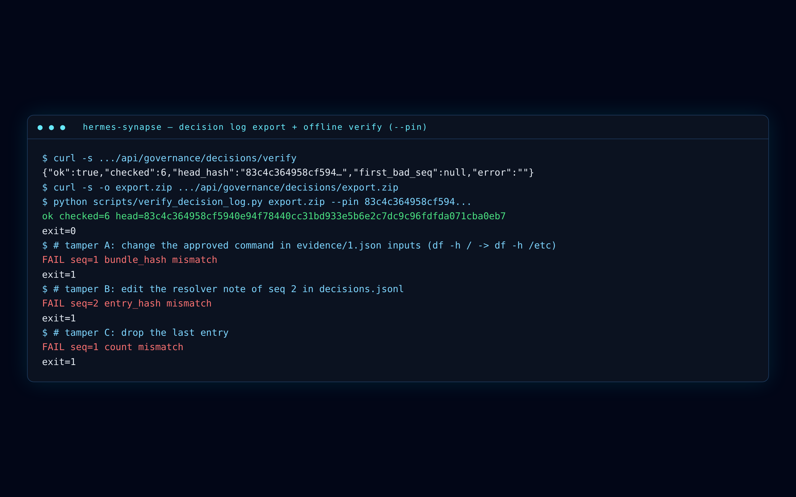

# Security model

Hermes Synapse is a **runtime governance layer** for AI agents: high-risk tool calls wait for a human, the approval is bound to a hash of the redacted payload, and every decision is appended to a chain you can verify without the app. It is not a claim that every code path is gated.

This page describes the mechanisms in the current tree. File references are the source of truth.

## What is gated

`execute_tool` calls `gate_tool` before the tool body (`backend/tools.py`, `backend/governance.py`).

Built-in high-risk names (`HIGH_RISK_TOOLS` in `backend/governance.py`):

- `execute_command`
- `create_obsidian_note`
- `delete_todoist_task`
- `create_subagent`, `update_subagent`, `delete_subagent`
- `change_agent_skills`, `assign_role`
- `clear_history`, `clear_decision_logs`, `set_log_level`
- `export_or_purge_audit`

Plugins extend that set through `high_risk_tools()`. MCP tools use `mcp_tool_needs_approval` (`backend/mcp_client.py`): omitted annotations follow MCP defaults (`readOnlyHint` false, `destructiveHint` true) and wait; a tool opts out with `readOnlyHint: true` or `destructiveHint: false`.

The match key is **session id + action + payload**. An approval granted in chat A cannot be spent in chat B. `agent_id` on the request is the session-scoped match key. The display name (for example Sys Ops) is shown in CLAIM and stored in unhashed `links.agent`.

## Payload-bound, single-use approvals

1. First high-risk call → `PENDING`, an `approval_evidence` row, a `REQUESTED` log event. The model sees `PENDING_APPROVAL` and a hint to call again with identical arguments after approval.
2. The operator opens **Governance Approvals**. CLAIM shows the tool, agent name, session, pretty-printed args, and `bundle_hash`. SOURCE shows the planner step, or the user instruction plus `direct_route` on a direct chat.
3. **Approve does not run the tool.** It writes `APPROVED` with the operator `Principal` (`local-admin` for OTP, JWT `sub` otherwise) (`backend/identity.py`).
4. The next identical call in that session runs `ApprovalQueue.consume`: `APPROVED` → `CONSUMED`, then the tool body runs **once**. `CONSUMED` is written by `system`.
5. Sending the same prompt again opens a **new** `PENDING` request. Consumed approvals are not reused.
6. Different args are a different payload key (`_payload_key` sorts JSON keys). `df -h /` and `df -h /tmp` never share an approval.
7. `REJECTED` stays blocking in that session (no cooldown today; tracked as R2-2).

<figure class="shot">



<figcaption>Different arguments produce different hashes and sit as separate PENDING items.</figcaption>
</figure>

## Evidence hash (`bundle_hash`)

For a new request, `gate_tool` runs **build → redact → cap → hash → insert** (`backend/evidence.py`). Redaction happens before hashing, so the digest binds what the reviewer can see.

Hashed (`hash_view`):

- `schema_ver`, `agent_id`, `action_name`, `inputs`
- `plan` (agent, instructions, step_index, step_count)
- upstream `{kind, name, sha256, truncated, reason}`
- `flags`

**Not hashed:** `description`, excerpt text, `links`, `step_context` (the step body is hashed as an upstream item instead). Editing only the human-readable description does not fail the verifier. Editing `inputs`, plan, upstream hashes, or flags does.

Canonical JSON is RFC 8785-style (`backend/canonical.py`: sorted keys, no extra whitespace). Each decision row also stores `payload_hash` = `sha256(canonical_json(payload))`.

## Secret redaction

`PIIGuard` (`backend/governance.py`) masks known formats in evidence, list/detail API payloads, and resolver notes: OpenAI-style `sk-…` keys, GitHub `gh*_` tokens, bearer tokens, generic `api_key=` assignments, emails, phones, card numbers, US SSNs. The UI renders tokens such as `[API_KEY_OPENAI_REDACTED]`.

<figure class="shot">



<figcaption>A curl with a mock key is stored and shown as API_KEY_OPENAI_REDACTED, not the raw secret.</figcaption>
</figure>

Limits:

- Known regexes only. A novel secret shape can slip through. Do not paste live keys into demos.
- `approval_requests.payload` is still stored as raw JSON so retries can be compared (R2-4). HTTP list/detail responses mask it.
- Tool arguments may also appear in server logs.

`MemoryGuard` scans documents for common prompt-injection markers before RAG indexing.

## Append-only hash chain

`approval_decisions` is a per-tenant chain (`backend/decision_log.py`). Each `entry_hash` covers tenant, request, event, actor, roles, auth method, action, `payload_hash`, `bundle_hash`, reason, timestamp, and `prev_hash`. Genesis `prev_hash` is 64 zeros.

SQLite and Postgres triggers abort `UPDATE`/`DELETE` on `approval_decisions` and `UPDATE` on `approval_evidence` (`backend/database.py`). `DELETE` on evidence is allowed so a request can cascade. `/decisions/verify` then reports `evidence missing`.

<figure class="shot">



<figcaption>Direct SQL cannot rewrite the chain. Deleting an evidence row is caught by the verifier.</figcaption>
</figure>

<figure class="shot">



<figcaption>Each row points at the previous entry_hash. APPROVED is the operator; CONSUMED is system.</figcaption>
</figure>

This is **tamper-evident**, not a signed or encrypted ledger. Someone who rewrites the whole chain *and* the copy of the head hash you kept can still pass an unpinned check. Pin the head with `--pin`.

## Verify and export

| Endpoint | Role |
|---|---|
| `GET /api/governance/decisions/verify` | Walk the chain, recompute `entry_hash` / `prev_hash`, re-hash stored evidence. |
| `GET /api/governance/decisions` | Paginated log (`before_seq`, `limit`). |
| `GET /api/governance/decisions/export` and `/export.zip` | Zip of `decisions.jsonl`, `evidence/<id>.json`, `manifest.json`, `VERIFY.md`. |
| `GET /api/governance/approvals` | Summaries; `payload` is masked. |
| `POST /api/governance/approvals/{id}/resolve` | `APPROVED` or `REJECTED`. A client-supplied `bundle_hash` in the body is ignored. |

The checker is **not** inside the zip. It lives at `scripts/verify_decision_log.py` (Python 3.11+ standard library only):

```bash
curl -f -H "Authorization: Bearer <TOKEN>" \
  "http://localhost:8000/api/governance/decisions/export.zip" -o decisions.zip

python3 scripts/verify_decision_log.py decisions.zip --pin <head_hash>
```

Exit 0 prints `ok checked=N head=H`. Exit 1 prints `FAIL seq=N <reason>`. A missing pin prints `pinned entry missing`.

<figure class="shot">



<figcaption>Tamper A (command in evidence), B (resolver note), C (dropped tail) each fail.</figcaption>
</figure>

## Login, identity, intersection, budgets

- Dashboard login is a 6-digit OTP (5 minute TTL, single use), printed in the backend log, optionally sent on Telegram, and written to `backend/data/.current_otp` (mode `0600`) as a fallback (`backend/auth.py`).
- Local OTP sessions live in an in-memory set. A backend restart drops them (R2-6).
- Optional `JWT_SECRET` enables HS256 JWT sessions (`alg=none` is rejected). Roles: admin > editor > operator > viewer.
- Child tools = child skills ∩ parent skills. Auto-hire uses the same cap (`backend/agent_factory.py`).
- `BudgetGuard` enforces per-session and global USD caps before LLM calls.

## Known limitations

Do not write "everything is gated." These items are open on `main`:

| ID | Meaning |
|---|---|
| **R1-2** | **Code Engineer** and **Data Analyst** run generated Python via `CodeAgent.run_and_correct` → `execute_code`. That path never calls `gate_tool`. Retry-based gating also does not fit generated code: the script changes every turn. Treat the code-agent sandbox as out of the approval gate until a replay-the-approved-source path exists. |
| **R2-4** | Raw tool args remain in `approval_requests.payload` for matching. Evidence and HTTP responses are masked. |
| **R2-2** | A `REJECTED` call stays rejected for that session with no cooldown. |
| **R2-6** | OTP sessions are not persisted across process restarts. |
| **R3-1** | `COMPLEXITY_ROUTING` from the environment can leak into `backend/tests/test_agent.py` (test isolation, not a runtime bypass). |
| Hash coverage | `bundle_hash` does not cover `description` / `links` / excerpts. |
| Verifier | Tamper-evident with `--pin`. Not a signature. |
| PIIGuard | Known regexes only. |

Demo guidance: use Sys Ops `execute_command`. Do not present the code agent as gated.

Operator walkthrough: [Approvals](./approvals.md). Product roadmap: [ROADMAP.md](https://github.com/pauloberezini/hermes-synapse/blob/main/ROADMAP.md).
