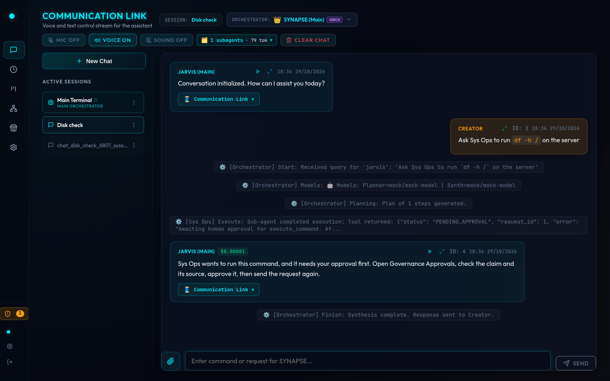
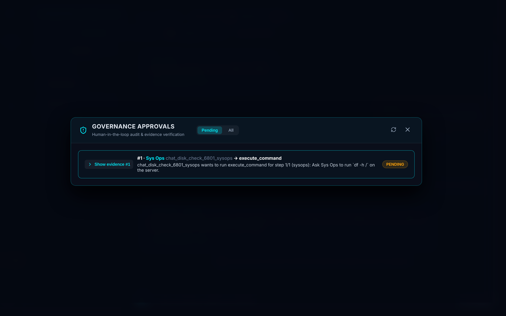
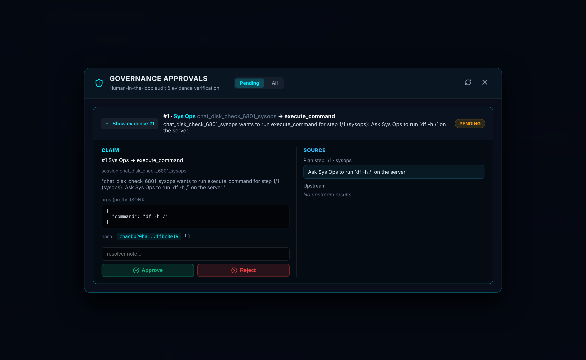
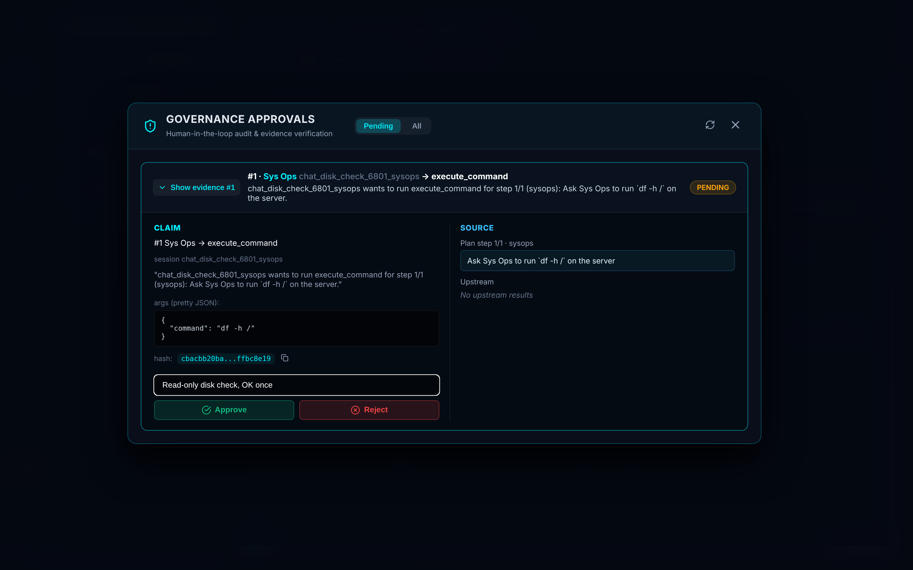
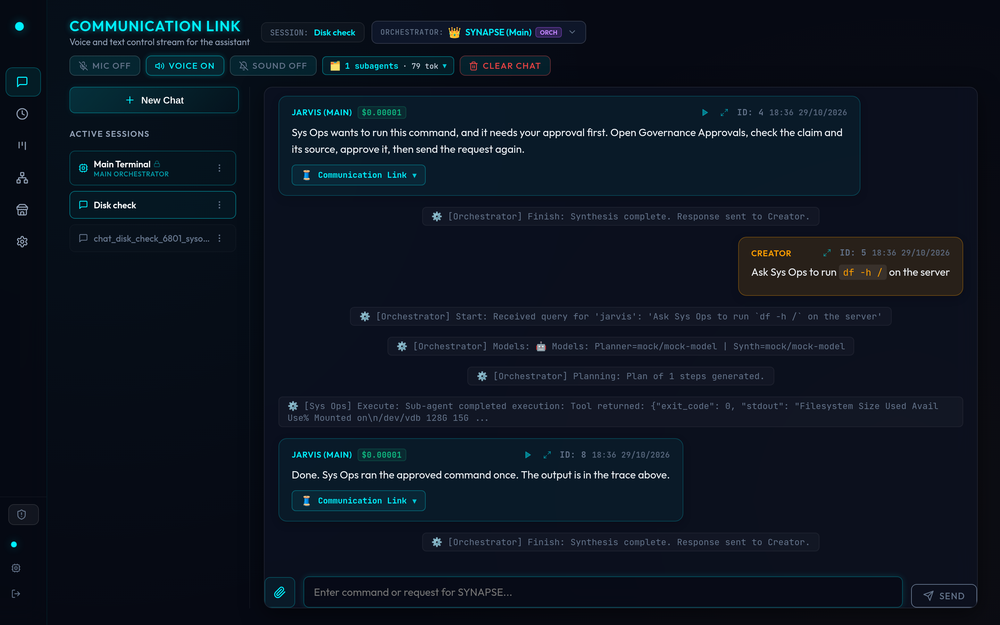
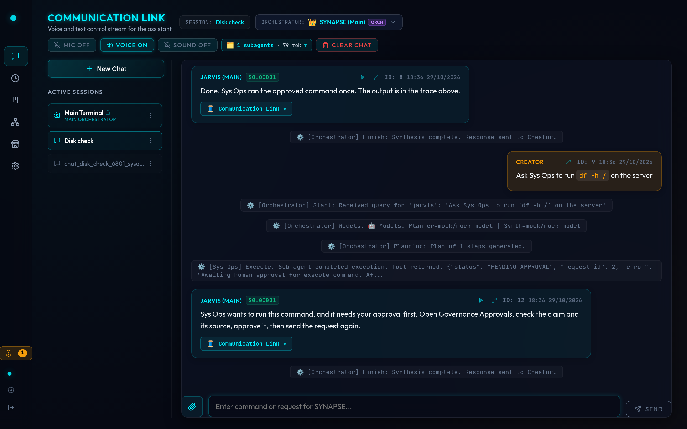
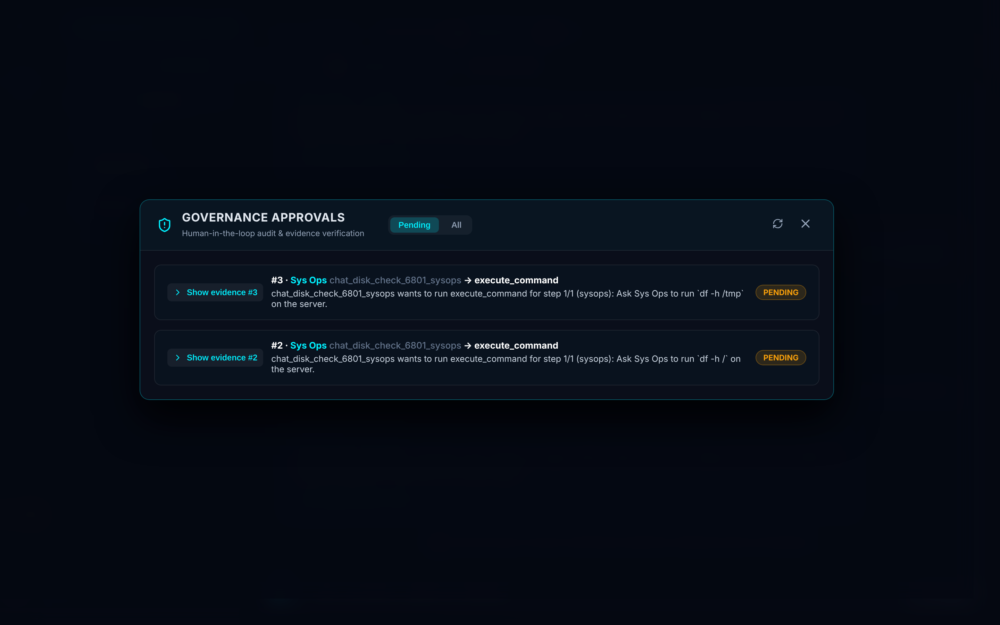
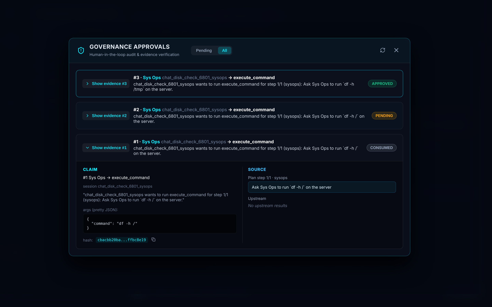
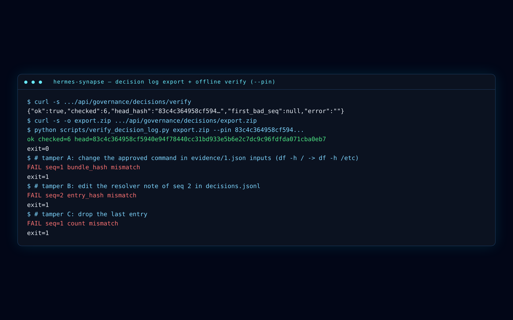

## Why Hermes Synapse

Most multi-agent stacks are either hardwired workflows or unbounded chat loops. Hermes sits in the middle, then adds the control plane those stacks leave as a TODO.

- A visual DAG of orchestrators and specialists. No cycles. Children inherit only the intersection of their skills and the parent's.
- Dynamic LLM planning, not a hardcoded pipeline.
- A real gate on risky tools: the operator reviews the claim and the source, approves a payload hash, then the agent must send the **same** call again before anything runs. A replay is a new `PENDING` request, not a free pass.
- An append-only, hash-chained decision log you can export and check with `scripts/verify_decision_log.py`. No Hermes install. No network.

Self-hosted. MIT. Docker Compose. Built by [Pavel Bereznichenko](https://github.com/pauloberezini) at [SupplyAlpha.ai](https://supplyalpha.ai).

<div class="cta-row">
  <a class="primary" href="https://github.com/pauloberezini/hermes-synapse">Get the code on GitHub</a>
  <a class="ghost" href="./guide/getting-started.html">Install with Docker Compose</a>
  <a class="ghost" href="./guide/approvals.html">Run the approvals demo</a>
</div>

## See it run

Rehearsal shots from 29 Oct 2026 on `main` (`f4f92d5`). The command is `df -h /`. No real secrets in these frames.

### A Sys Ops shell call stops at PENDING

<figure class="shot">



<figcaption>The Approvals badge counts up as soon as the gate writes PENDING. The model is told to wait.</figcaption>
</figure>

### The pending queue

<figure class="shot">



<figcaption>One card per request. Open evidence, then approve or reject.</figcaption>
</figure>

### Claim, source, args, and hash

<figure class="shot">



<figcaption>CLAIM is the tool, agent name, session, args, and bundle_hash. SOURCE is the planner step (or the user instruction on a direct chat).</figcaption>
</figure>

### Approve with a note. Nothing executes yet.

<figure class="shot">



<figcaption>Approve writes APPROVED and records the operator Principal. The original tool call already returned PENDING_APPROVAL.</figcaption>
</figure>

### Re-send. The approved command runs once.

<figure class="shot">



<figcaption>The gate consumes the APPROVED row, the tool body runs, and the log records CONSUMED.</figcaption>
</figure>

### The same prompt again is a new PENDING item

<figure class="shot">



<figcaption>Consumed approvals are not reused. A replay is a new request with a new id.</figcaption>
</figure>

### Different args, different hash

<figure class="shot">



<figcaption>df -h / and df -h /tmp are different payload keys. They never share an approval.</figcaption>
</figure>

### All tab: APPROVED, PENDING, CONSUMED

<figure class="shot">



<figcaption>The queue is an audit timeline, not a toaster that disappears after Approve.</figcaption>
</figure>

### Export, pin the head, watch tampering fail

<figure class="shot">



<figcaption>Change inputs in evidence, edit a resolver note, or drop the last entry. The stdlib verifier exits 1.</figcaption>
</figure>

## How it works

```
Operator / Telegram / API
        │
        ▼
 Web dashboard (React)
        │
        ▼
 Root orchestrator (jarvis)  ── DAG planner
        │
        ▼
 Specialist (Sys Ops, Search, …)
        │
        ▼
 execute_tool ──► gate_tool
                    │
        ┌───────────┼────────────┐
        │ high-risk / MCP write  │ safe
        ▼                        ▼
   PENDING + evidence          run
        │
        ▼
 Governance Approvals
   Approve  →  APPROVED  →  re-send identical args  →  CONSUMED (runs once)
   Reject   →  REJECTED (sticky in this session)
        │
        ▼
 approval_decisions hash chain
        │
        ▼
 /decisions/verify  ·  export.zip  ·  verify_decision_log.py --pin
```

Planning is a DAG. Nested orchestrators re-plan among their own children. Cycle detection keeps the graph acyclic. A child's effective tools are `child.skills ∩ parent.skills`. Auto-hired specialists are capped the same way.

Read the [approvals walkthrough](/guide/approvals) and the [security model](/guide/security) for the exact hash coverage, API, and known limitations.

## Integrations at a glance

Documented in full on [Integrations](/guide/integrations). What the tree actually supports:

| Kind | Connectors |
|---|---|
| LLMs | Any OpenAI-compatible API: OpenRouter (default), Ollama, vLLM, LM Studio, LocalAI |
| Protocols | MCP client (tools registered at connect time; write-shaped tools wait for approval) |
| Extension | `hermes_sdk` skills, `backend/<name>/plugin.py` hooks, skills marketplace (no-op billing by default) |
| Chat / voice | Telegram bot, browser Speech Recognition + speechSynthesis |
| Search / knowledge | SearXNG, Obsidian Local REST API, Qdrant RAG, GraphRAG, RSS |
| Productivity | Google Calendar, Todoist, OpenWeatherMap, timers |
| Markets | CoinGecko + Yahoo Finance HTTP provider (plugins can replace it) |
| Data plane | PostgreSQL 16, Qdrant |
| Deploy | Docker Compose, Swarm, Kubernetes |

## Security, in one page

Approvals are bound to **session + action + payload**. `bundle_hash` is SHA-256 over a canonical view of the redacted evidence (args, plan, upstream hashes, flags). `description` and `links` are not in that hash. Approve does not execute. Consume is one-shot. The decision log is append-only and tamper-evident when you pin the head hash. Secrets that match known formats are redacted in evidence.

The **Code Engineer** (and Data Analyst) `execute_code` path does **not** go through `gate_tool`. That is a known limitation (R1-2), not a footnote. Do not say "everything is gated."

Full write-up: [Security model](/guide/security).

## Quick start

```bash
git clone https://github.com/pauloberezini/hermes-synapse
cd hermes-synapse
cp .env.example .env
docker compose up -d --build
# Dashboard: http://localhost:9119
# docker logs jarvis-backend | grep "Generated OTP Code"
```

Step-by-step, Ollama, and auto-hire: [Getting started](/guide/getting-started).

## Built by SupplyAlpha.ai

Hermes Synapse is designed and maintained by **Pavel Bereznichenko** at **[SupplyAlpha.ai](https://supplyalpha.ai)**. MIT licensed. Issues and PRs welcome on [GitHub](https://github.com/pauloberezini/hermes-synapse).

<div class="cta-row">
  <a class="primary" href="https://github.com/pauloberezini/hermes-synapse">Star pauloberezini/hermes-synapse</a>
  <a class="ghost" href="./guide/security.html">Read the security model</a>
</div>
