# Approvals Demo Hardening, Phase 2 — Spec

**Status:** Draft
**Date:** 2026-10-29
**Scope:** Close the items from `FIX-SPEC-demo.md` that Phase 1 did not fix, plus two honest corrections to Phase 1's own claims.
**Related precedent:** `docs/specs/approvals-demo-hardening.md` (Phase 1, merged in PR #13), `docs/specs/roadmap/phase-1-approval-context.md`, `docs/guide/approvals.md`

---

## 1. Context & Objective

### Trigger point / Problem

Phase 1 fixed payload masking, the worker-thread broadcast, the `CONSUMED` colour, and the false guide claims. A line-by-line review of `FIX-SPEC-demo.md` against `main` shows nine items still open. Each is traced to code below.

| # | Source item | Symptom today | Root cause |
|---|---|---|---|
| G1 | P0-1 | `GET /api/governance/decisions/export.zip` returns 404; the curl example has no `-f`, so an error body is saved as `.zip` | No route at that path. Only `/export` exists (`backend/main.py:965`) |
| G2 | P1-1 (rest) | `APPROVED` is broadcast twice. The modal is mounted without `onResolved` | `ApprovalQueue.resolve` broadcasts, and so does the route (`backend/main.py:998:1006`). `App.tsx:2131:2134` passes no callback |
| G3 | P1-2 | CLAIM shows the session id (`dashboard`, `demo_orch_sysops`), not the agent | `gate_tool(chat_id, ...)` receives the session id as `agent_id` |
| G4 | P1-3 | A direct chat has `plan: null` and SOURCE says "No planner step attached" | `evidence_ctx` is set only on the orchestrator custom-sub-agent path (`backend/orchestrator.py:658:674`) |
| G5 | P1-4 | Nothing runs after Approve until the operator re-sends | `gate_tool` is retry-based; no continuation state exists |
| G6 | P1-5 | Tail truncation plus a rewritten `manifest.json` verifies; editing an `approval_evidence` row leaves `/decisions/verify` at `ok:true` | The manifest is unsigned; `approval_evidence` has no guard; `verify()` checks only the hash chain |
| G7 | P2-1 | A rejected call is blocked for ever in the same session | `gate_tool` returns the `REJECTED` row with no expiry |
| G8 | P2-2 | The count pill is clipped in the collapsed sidebar | The sidebar is `68px` with `overflow: hidden`; the badge renders a plain `<span>Approvals</span>` instead of a `sidebar-label` |
| G9 | P2-3 | Export `VERIFY.md` names a script that is not in the zip; the guide omits three facts | Text in `_VERIFY_MD`; guide gaps |

**G3 — the agent identity is the match key.** `gate_tool` keys the same-call lookup on `agent_id`, and that value is the session id:

```1926:1929:backend/tools.py
    from backend.governance import gate_tool
    blocked = gate_tool(chat_id, name, arguments or {})
    if blocked is not None:
        return blocked
```

The orchestrator builds a scoped session per step, so two sessions never share an approval:

```733:737:backend/orchestrator.py
                    scoped_subagent_session_id = f"{state.chat_id}_{child_agent['id']}"
                    subagent_kwargs = {
                        "parent_skills": step.get("skill_cap") if step.get("skill_cap") is not None else (None if parent_skills is None else active_skills),
                        "chat_id": scoped_subagent_session_id,
                    }
```

That scoping is a security property: an approval granted in one chat cannot be spent in another. `FIX-SPEC-demo.md` suggests passing the sub-agent id as `agent_id`. That would widen the match to every session that uses the same agent, so this spec does **not** do that. The key stays the session. The agent name is carried separately for display.

**G4 — where the direct route runs.** Tool dispatch happens in two places in `backend/agent.py`: `respond()` (default agent, dispatch at line 1262) and `_respond_as_subagent()` (dispatch at line 2434). Both reach `_dispatch_execute_tool_async`, which runs `execute_tool` in a worker thread via `asyncio.to_thread` (`backend/agent.py:39:68`). A `ContextVar` set before that call is visible in the thread, which is how `evidence_ctx` already works.

**G6 — what verification can and cannot prove.** `verify()` walks `approval_decisions` only:

```148:167:backend/decision_log.py
def verify(tenant_id: str = "default") -> VerifyResult:
    """Recompute the chain. The first broken seq fails the walk."""
    from backend.database import _execute

    placeholders = ", ".join(_COLUMNS)
    rows = _execute(
        f"SELECT {placeholders} FROM approval_decisions WHERE tenant_id = ? ORDER BY seq",
        (tenant_id,),
    )
    prev = GENESIS
    for raw in rows:
        row = dict(zip(_COLUMNS, raw))
        seq = int(row["seq"])
        if row["prev_hash"] != prev:
            return VerifyResult(False, 0, seq, "prev_hash mismatch", "")
        digest = entry_hash(row)
        if row["entry_hash"] != digest:
            return VerifyResult(False, 0, seq, "entry_hash mismatch", "")
        prev = digest
    return VerifyResult(True, len(rows), None, "", prev if rows else "")
```

It never reads `approval_evidence`. The offline script does check each bundle hash. The chain guard is a pair of triggers; `approval_evidence` has none:

```299:312:backend/database.py
    cursor.execute("""
        CREATE TRIGGER IF NOT EXISTS approval_decisions_no_update
        BEFORE UPDATE ON approval_decisions
        BEGIN
            SELECT RAISE(ABORT, 'approval_decisions is append-only');
        END
    """)
    cursor.execute("""
        CREATE TRIGGER IF NOT EXISTS approval_decisions_no_delete
        BEFORE DELETE ON approval_decisions
        BEGIN
            SELECT RAISE(ABORT, 'approval_decisions is append-only');
        END
    """)
```

### Corrections to Phase 1 and to the review

| Claim made earlier | Truth |
|---|---|
| "`broadcast_sync` records the loop at the first connect, not at startup, so an early broadcast is dropped" | Not a gap. With zero clients `ConnectionManager.broadcast` returns early anyway, and a client that connects later loads state by fetch. No startup hook is needed. `FIX-SPEC-demo.md` item P1-1.1 asked for one; this spec declines it. |
| "`onResolved` missing is a P1 gap" | Minor. The badge already refreshes from the WebSocket event. `onResolved` only matters when the socket is down. It is kept as a one-line fallback. |
| Phase 1 acceptance: "exactly one event per transition" | Not met: `APPROVED` is sent twice (G2). |

### Objective

- `export.zip` works, and following the guide verbatim exits 0.
- One WebSocket event per transition; the badge also moves with the socket down.
- CLAIM shows the agent name; the match key stays the session.
- SOURCE is never empty, and a reviewer can tell when no planner chose the step.
- A truncated export is detectable, and an edited evidence row is rejected and detected.
- Every guide claim is true again.

### Explicit scope decisions (please confirm before implementation)

| Decision | Rationale |
|---|---|
| Add a `/export.zip` alias that calls the same handler. | One decorator. Old links and the original guide keep working. Phase 1 chose docs-only; the alias costs less than a support question. |
| Remove the route's own `APPROVED` broadcast; keep the one in `ApprovalQueue.resolve`. | The queue is the single place every transition already emits from (`REQUESTED`, `CONSUMED`). `resolve` is called inside the request loop, so its event is delivered. |
| Keep `agent_id` as the session-scoped match key. Show the agent via `bundle.links.agent`, returned as `agent_name` in the list and detail responses. | Preserves per-session approval scope. `links` is already excluded from the bundle hash, so no hash change. No schema change. |
| Set the agent name and a direct-route evidence context with `ContextVar`s, in the two agent entry points. Do not touch `gate_tool`'s signature. | `ContextVar` already carries `evidence_ctx` into the worker thread. `gate_tool` stays callable from tests with no context. |
| Direct route gets a one-step plan and the flag `direct_route`, not `plan_missing`. | SOURCE shows the user's instruction. The flag tells the reviewer no planner chose the step, instead of looking like missing data. |
| Do not gate `CodeAgent`. Document it. | Unchanged from Phase 1. Gating the sandbox is a product decision. |
| **Do not sign the manifest.** Add `--pin <entry_hash>` to the offline verifier. | A stdlib-only verifier cannot check an asymmetric signature (no Ed25519 in the standard library). HMAC needs a shared secret, which defeats third-party verification. A pinned `entry_hash` that must appear in the chain detects tail truncation with zero crypto and zero dependencies. |
| Add an `UPDATE` trigger on `approval_evidence`. Do **not** add a `DELETE` trigger. | A delete trigger also blocks the `ON DELETE CASCADE` from `approval_requests`, which tests and operators rely on for cleanup (`backend/database.py:749`). Deleted evidence is already caught: the verifier reports `evidence missing`. |
| `verify()` recomputes each evidence bundle hash. | Closes the in-database blind spot. Reuses `backend.evidence.bundle_hash`. |
| No `REJECTED` TTL. Document it. | In a new session the same call already opens a new request, because the match key is the session. Within one session, "a human said no" staying final stops a model from re-asking. Add a TTL only when a customer asks. |
| Auto-resume stays out of the ordered steps. See the Open Question. | It needs a product choice, and persisted continuation state or a replay path. |
| Do not fix OTP/Telegram or in-memory login sessions here. | Auth concerns, not approvals. Listed under known constraints. |

### Scope

**In scope**
- `backend/main.py` (alias route, remove duplicate broadcast)
- `backend/agent.py` (agent name and direct-route evidence context)
- `backend/governance.py` (`agent_name` in read paths)
- `backend/decision_log.py` (`verify()` evidence check, `VERIFY.md` text)
- `backend/database.py` (evidence `UPDATE` trigger, SQLite and Postgres)
- `scripts/verify_decision_log.py` (`--pin`)
- `frontend/src/App.tsx`, `ApprovalsBadge.tsx`, `ApprovalsModal.tsx`
- `docs/guide/approvals.md`
- Tests for each item

**Out of scope**
- Signing or encrypting exports
- Auto-resume (pending the Open Question)
- Gating `CodeAgent`
- A `REJECTED` TTL
- OTP delivery, persistent login sessions
- Secrets at rest in `approval_requests.payload`

---

## 2. Architecture Diagram

See [`approvals-demo-hardening-phase2.dot`](./approvals-demo-hardening-phase2.dot) for the Graphviz source.

```dot
digraph ApprovalsHardeningPhase2 {
  graph [fontname="Helvetica" rankdir=LR splines=ortho]
  node  [fontname="Helvetica" shape=box style=rounded]
  edge  [fontname="Helvetica"]

  subgraph cluster_frontend {
    label="Frontend (React)" style=dashed color=gray
    UI_app    [label="App.tsx\n(changed: onResolved fallback)"]
    UI_badge  [label="ApprovalsBadge\n(changed: icon + count when collapsed)"]
    UI_modal  [label="ApprovalsModal\n(changed: shows agent_name)"]
  }

  subgraph cluster_agents {
    label="Agent runtime" style=dashed color=purple
    AG_resp   [label="respond()\n(changed: sets context)" shape=component]
    AG_sub    [label="_respond_as_subagent()\n(changed: sets context)" shape=component]
    AG_ctx    [label="ContextVars\nagent name, evidence_ctx" shape=component]
    AG_orch   [label="Orchestrator\nsets evidence_ctx (unchanged)" shape=component]
    AG_thread [label="asyncio.to_thread" shape=component]
  }

  subgraph cluster_api {
    label="FastAPI (/api/governance/*)" style=dashed color=steelblue
    EP_list   [label="GET approvals\nGET approvals/{id}\n(changed: agent_name)" shape=component]
    EP_res    [label="POST approvals/{id}/resolve\n(changed: no own broadcast)" shape=component]
    EP_exp    [label="GET decisions/export\n(+ alias export.zip)" shape=component]
    EP_ver    [label="GET decisions/verify\n(changed: checks evidence)" shape=component]
  }

  subgraph cluster_gov {
    label="Governance core" style=dashed color=darkgreen
    GV_gate   [label="gate_tool\n(unchanged signature)" shape=component]
    GV_queue  [label="ApprovalQueue\nsole broadcaster" shape=component]
    GV_log    [label="decision_log\nverify + export_zip" shape=component]
  }

  subgraph cluster_db {
    label="SQLite / Postgres" style=dashed color="#336699"
    T_req [shape=record, label="{ approval_requests | agent_id (session key) | payload (raw) }"]
    T_ev  [shape=record, label="{ approval_evidence | bundle_json | (new: UPDATE trigger) }"]
    T_dec [shape=record, label="{ approval_decisions | entry_hash | prev_hash }"]
  }

  subgraph cluster_tools {
    label="Offline + docs" style=dashed color=darkorange
    SC_ver  [label="scripts/verify_decision_log.py\n(changed: --pin)"]
    DOC     [label="docs/guide/approvals.md\n(changed)"]
  }

  AG_resp -> AG_ctx
  AG_sub -> AG_ctx
  AG_orch -> AG_sub
  AG_ctx -> AG_thread -> GV_gate
  GV_gate -> GV_queue
  GV_queue -> T_req
  GV_queue -> T_ev
  GV_queue -> T_dec
  GV_queue -> UI_app [label="approval_update (once)"]
  UI_app -> UI_badge
  UI_modal -> EP_res -> GV_queue
  UI_modal -> EP_list -> T_req
  EP_list -> T_ev [label="links.agent"]
  EP_ver -> GV_log
  GV_log -> T_dec
  GV_log -> T_ev [label="recompute bundle hash"]
  EP_exp -> GV_log
  SC_ver -> EP_exp [style=dotted label="export zip"]
  DOC -> EP_exp [style=dotted]
  DOC -> SC_ver [style=dotted]
}
```



### Data flow summary

```
Request (fixed):
  respond() / _respond_as_subagent()
    -> set agent-name ContextVar; if evidence_ctx is empty, set a 1/1 plan from the user message
       + flag direct_route
    -> asyncio.to_thread(execute_tool) -> gate_tool(session_id, ...)   [match key unchanged]
    -> build_bundle -> redact_bundle -> bundle.links.agent = name
    -> request_approval -> approval_requests (raw), approval_evidence (masked), REQUESTED
    -> broadcast_sync("approval_update", PENDING)    [one event]

Review:
  GET approvals[/{id}] -> masked payload + agent_name (from bundle.links.agent)
    -> modal CLAIM: "Sys Ops" + session id; SOURCE: plan (planner or direct_route)

Approve:
  POST .../resolve -> ApprovalQueue.resolve -> APPROVED -> broadcast (one event)
    -> window event -> badge refetch.  onResolved also fires the window event (socket-down fallback)
  Operator re-sends -> gate_tool -> APPROVED -> consume -> CONSUMED -> tool runs once

Export / verify:
  GET decisions/export | export.zip -> zip
    -> python3 scripts/verify_decision_log.py <zip> [--pin <entry_hash>]
         ok checked=N head=H            (exit 0)
         FAIL seq=N <reason>            (stderr, exit 1)   incl. "pinned entry missing"
  GET decisions/verify -> chain walk + evidence bundle hash recompute
  UPDATE approval_evidence -> trigger ABORT
```

---

## 3. API / Interface Contracts

No new endpoints. One alias, one behaviour change per read path, one verifier flag.

### 3.1 Export alias — `GET /api/governance/decisions/export.zip`

| Field | Value |
|---|---|
| Method | `GET` |
| Path | `/api/governance/decisions/export.zip` (same handler as `/export`) |
| Auth | Bearer token, same as `/export` |
| Request | Same query: `from`, `to`, `tenant` |
| Response | `200 application/zip`, identical bytes shape to `/export` |
| Errors | Same as `/export` |
| Delivery pattern | Synchronous in-memory zip |

**Frontend trigger:** none. Documentation and `curl` only. The guide example adds `-f`, so a 401 or 404 fails the command instead of saving JSON as a `.zip`.

### 3.2 Approval transition events — WebSocket `approval_update`

| Field | Value |
|---|---|
| Type | WebSocket server push |
| Path | `/api/ws` |
| Request | n/a |
| Response | `{ "type": "approval_update", "id": <int>, "status": "PENDING" \| "APPROVED" \| "REJECTED" \| "CONSUMED" }` |
| Errors | Best-effort |
| Delivery pattern | Fire-and-forget. **Exactly one event per transition.** The route no longer emits its own. |

**Frontend trigger:** `App.tsx` re-emits as a `window` event. `ApprovalsModal` `onResolved` also dispatches that event, so the badge refreshes with the socket down.

### 3.3 Approval read endpoints — `GET /api/governance/approvals`, `GET /api/governance/approvals/{id}`

| Field | Value |
|---|---|
| Method | `GET` |
| Path | unchanged |
| Auth | unchanged |
| Response | Same shape plus `agent_name` (string, may be empty). `agent_id` is still the session-scoped key. |
| Errors | unchanged |
| Delivery pattern | Synchronous. `agent_name` comes from the already-joined `bundle_json`. |

**Frontend trigger:** `ApprovalsModal` renders `agent_name` when present, else `agent_id`, and shows the session id beside it.

### 3.4 Offline verifier — `scripts/verify_decision_log.py`

| Field | Value |
|---|---|
| Type | CLI |
| Path | `python3 scripts/verify_decision_log.py <zip> [--pin <entry_hash>]` |
| Auth | n/a |
| Request | `--pin`: an `entry_hash` the operator recorded earlier |
| Response | `ok checked=N head=H` on stdout, exit 0 |
| Errors | `FAIL seq=<n> <reason>` on stderr, exit 1. New reason: `pinned entry missing`. Unchanged: usage error exits 1. |
| Delivery pattern | Local, standard library only |

**Invariant:** `--pin` is optional. Without it, behaviour is identical to today. With it, the chain must contain a row whose `entry_hash` equals the pin. A truncated tail that drops the pinned row fails, even when `manifest.json` was rewritten to match.

### 3.5 DTO shapes

**`ApprovalSummary` (after)**
```json
{
  "id": 7,
  "agent_id": "chat42_sysops",
  "agent_name": "Sys Ops",
  "action_name": "execute_command",
  "payload": "{\"command\":\"uname -a\"}",
  "status": "PENDING",
  "bundle_hash": "…",
  "flags": ["direct_route"]
}
```

**Direct-route bundle (after)**
```json
{
  "plan": { "agent": "jarvis", "instructions": "<user message, masked>", "step_index": 0, "step_count": 1 },
  "flags": ["direct_route"],
  "links": { "session_id": "chat42", "agent": "Jarvis" }
}
```

### Open Question — auto-resume after Approve (G5)

Pick one before implementation. Neither is in the ordered steps.

| Option | How | Gain | Cost |
|---|---|---|---|
| A. Re-prompt | On `APPROVED`, call `agent.respond(<parent chat>, "Approval #N granted. Retry with identical arguments.")` | No new state. The model synthesises the answer. | Relies on the model repeating identical arguments. Needs the parent chat id (the orchestrator scopes sessions as `<chat>_<agent>`), so `links` must carry it. |
| B. Replay | On `APPROVED`, run `consume` then `execute_tool` with the stored raw payload, post the result into the parent chat | Runs exactly what the human approved. No model variance. | The result lands without model synthesis. Needs the parent chat id. Executes from the stored raw args, so it is a new trust path to review. |
| C. Defer | Keep the documented retry step | Zero work. | Operators expect a resume. |

Recommendation: **C now, B when a customer asks.** B is the only option that keeps the "that exact call" guarantee without relying on the model.

---

## 4. Data Model & Implementation Plan

### 4.1 Entities

No new table or column.

| Object | Change | Notes |
|---|---|---|
| `approval_evidence` | New `BEFORE UPDATE` trigger raising `approval_evidence is append-only`. SQLite and Postgres twins. | `DELETE` stays allowed for the cascade. |
| `approval_evidence.bundle_json` | `links.agent` added to new bundles | `links` is excluded from the hash; old rows lack it and return an empty `agent_name`. |
| Bundle flags | New flag value `direct_route` | Replaces `plan_missing` only when a direct-route plan is set. |
| `approval_requests.agent_id` | Unchanged | Remains the session-scoped match key. Document that it is not an agent id. |

### 4.2 Implementation steps (ordered, no code)

Each step starts with a failing test, then the smallest change.

1. **Export alias (G1)** — `backend/main.py`: register `/api/governance/decisions/export.zip` on the existing `export_decisions_api` handler. Extend `backend/tests/test_decision_log_api.py` so both URLs return `200` with `application/zip` and the same verifiable archive.
2. **One broadcast per transition (G2)** — `backend/main.py`: delete the `manager.broadcast` block in `resolve_approval_api`. Test: resolve a request while a fake client is connected; assert exactly one `APPROVED` event. Extend `backend/tests/test_approval_ws_events.py`.
3. **`onResolved` fallback (G2)** — `frontend/src/App.tsx`: pass `onResolved` that dispatches the `approval_update` window event. Test in `App.test.tsx` or `ApprovalsModal.test.tsx`: after Approve with no socket event, the badge refetches.
4. **Agent name** — `backend/agent.py`: add one module-level `ContextVar` for the display name. Set it in `respond()` and `_respond_as_subagent()` before tool dispatch; reset in `finally`. `backend/governance.py` `gate_tool`: write it to `bundle.links["agent"]`; `get_pending`, `get_all`, `get_detail` return `agent_name` from `bundle_json`. `ApprovalsModal.tsx`: show it. Tests: a Sys Ops request returns `agent_name == "Sys Ops"` and `agent_id` still equals the session id; an approval in session A is not consumable in session B (regression guard).
5. **Direct-route evidence (G4)** — `backend/agent.py`: in the same two entry points, when `evidence_ctx.get()` is `None`, set an `EvidenceContext` with a 1/1 `PlanRef` from the user message and the flag `direct_route`; reset afterwards. Tests: a direct tool call yields a non-empty `plan` and `direct_route`, no `plan_missing`; an orchestrator step still carries the planner plan. `backend/tests/test_evidence_gate_wiring.py` calls `gate_tool` with no context and keeps asserting `plan is None`, so it is unaffected.
6. **Evidence guard (G6)** — `backend/database.py`: add `install_approval_evidence` for SQLite and a Postgres twin beside `install_approval_decisions`; call both where the table is created (`:750`, `:1274`). `backend/tests/conftest.py`: drop the new trigger in the same loop that drops the decision triggers. Test: `UPDATE approval_evidence` raises.
7. **In-DB verify (G6)** — `backend/decision_log.py` `verify()`: after the chain walk, recompute `bundle_hash` for each row that has one and compare with the stored evidence. Mismatch returns `VerifyResult(False, …, "bundle_hash mismatch")`. Test: tamper an evidence row (drop the trigger as the existing fixture does) and assert `ok: false`.
8. **Pin (G6)** — `scripts/verify_decision_log.py`: parse an optional `--pin`; after the walk, fail with `pinned entry missing` if no row has that `entry_hash`. Keep the no-`backend` import rule (`test_verify_script_has_no_backend_imports`). Test: drop the last two rows and rewrite the manifest; without `--pin` exit 0, with the pin of a dropped row exit 1.
9. **Collapsed badge (G8)** — `ApprovalsBadge.tsx`: give the "Approvals" span the `sidebar-label` class so it fades with the other labels; keep the icon and count pill outside it. Test: the count pill is in the DOM and not inside a `sidebar-label` element.
10. **Docs and export text (G9)** — `backend/decision_log.py` `_VERIFY_MD`: say the script lives in the repository at `scripts/verify_decision_log.py` and is not bundled; document `--pin`. `docs/guide/approvals.md`: add `export.zip` and `-f`; CLAIM shows the agent name; `direct_route`; the `CONSUMED` actor is `system` and `APPROVED` is the operator subject; identical calls share one `bundle_hash` because it binds content, not the request; a rejected call stays blocked in the same session and opens a new request in a new one; pinning a head hash. Update the guard test (`test_approvals_guide_drops_false_security_claims`) so it expects `export.zip` to appear and still bans `chain intact`, `encrypted`, `signed manifest`.
11. **Public export check** — run `scripts/export_oss.sh` in dry mode. All touched files are core paths.

### Known constraints carried over from investigation

| Issue | Location | Relevance here |
|---|---|---|
| Raw tool args are logged at INFO | `backend/tools.py:1931` | Still a second secret path, to logs. Not fixed. |
| Login sessions are in memory | `backend/auth.py:14` | A backend restart logs the browser out. Not approvals. |
| `/api/auth/request-code` reports an error without a Telegram bot, though the OTP is still logged | `backend/auth.py`, `backend/main.py` | Demo hygiene: have the bot configured, or read the emergency OTP file. Not fixed. |
| `CodeAgent` runs generated code with no approval | `backend/orchestrator.py:708:710` | Intentional. Document in the guide. |
| `PIIGuard` masks known formats only | `backend/governance.py` | Unknown key shapes pass through. Demo hygiene still applies. |
| Export is tamper-evident, not authenticated | `backend/decision_log.py:181:228` | `--pin` narrows the gap; an attacker who rewrites everything and the pin store still wins. |
| `resolver_note` is stored unmasked in `approval_requests` | `backend/governance.py` `resolve` | The decision log masks it; the request row does not. |
| Old evidence rows have no `links.agent` | `approval_evidence` | `agent_name` is empty for them; the modal falls back to `agent_id`. |
| `.sidebar-collapsed` CSS has no matching class in `App.tsx` | `frontend/src/index.css:675:680` | Dead rule. The collapsed state is the `68px` aside (`:110:120`). Not removed here. |

---

## 5. Verification

Unit and component tests carry items G1–G4, G6, G8, G9. A live-model run is still needed for the parts a stub cannot prove.

| # | Scenario | Pass condition |
|---|---|---|
| W1 | Follow the guide verbatim: `curl -f` on `export.zip`, then the verifier. | HTTP 200, `ok checked=N head=H`, exit 0. |
| W2 | Trigger a request, Approve, and watch the WebSocket. | One `PENDING`, one `APPROVED`, one `CONSUMED` per request. |
| W3 | Trigger a request from a direct chat and from an orchestrator Sys Ops step. | CLAIM shows the agent name and the session id. SOURCE is non-empty in both. Direct has `direct_route`. |
| W4 | Approve in chat A, repeat the same call in chat B. | Chat B opens a new `PENDING` request. |
| W5 | Export, record the head hash, drop the last two rows, rewrite the manifest, verify with and without `--pin`. | Without: `ok`. With: `FAIL … pinned entry missing`, exit 1. |
| W6 | Edit an `approval_evidence` row in the database. | The `UPDATE` is rejected. If the trigger is dropped and the row edited, `/decisions/verify` returns `ok:false`. |
| W7 | Collapsed sidebar with one pending request. | The count pill is visible without hover. |

---

## Demo script changes

- Say: "tamper-evident decision log; pin the head hash and truncation is detected". Do not say signed, encrypted, or tamper-proof.
- Show: orchestrator → Sys Ops → CLAIM with agent name and session → Approve → re-send → export → verify → verify with `--pin`.
- Say "now I ask it again" at the retry step, until the Open Question is decided.
- Do not show: backend logs, the `code` agent, a prompt that contains a key, or a login right after a backend restart.

---

## Storage

Save this spec to `docs/specs/approvals-demo-hardening-phase2.md` (+ `docs/specs/approvals-demo-hardening-phase2.dot`) before uploading anywhere.
