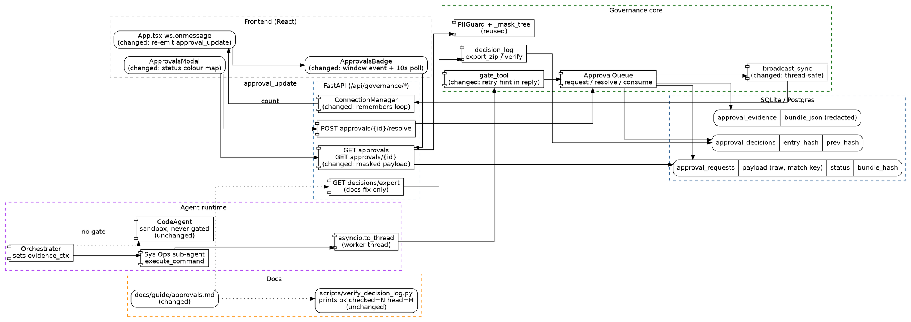

# Approvals Demo Hardening — Spec

**Status:** Draft
**Date:** 2026-10-29
**Scope:** Close the gaps found by a full demo run of the Governance Approvals flow: one secret leak in the approval UI, one dropped realtime event, one misleading status colour, and a guide that describes things the code does not do.
**Related precedent:** `docs/specs/roadmap/phase-1-approval-context.md` (evidence bundle, decision log), `docs/guide/approvals.md` (the demo script this spec corrects)

---

## 1. Context & Objective

### Trigger point / Problem

A demo run of the guide on `main` (commit `af66633`, not present in this checkout; local `HEAD` is `071a532`) passed end to end: same call + same args consumes once and the repeat opens a new request, a different arg gives a new hash, the CLAIM/SOURCE modal, Approve, key `A`, the decision log, offline verification against five forgeries, 358 tests green. The run used no Docker and a stub in place of the model, so real-model retry behaviour is **unverified** (section 5).

Findings, each traced to code:

| # | Symptom | Root cause |
|---|---|---|
| F1 | Guide URL `/decisions/export.zip` returns 404 | Route is `/api/governance/decisions/export` |
| F2 | Raw API key visible in CLAIM although the DB bundle is masked | UI renders `req.payload`, the raw column |
| F3 | Badge updates after ~10 s | Realtime event is dropped twice (backend thread, frontend listener) |
| F4 | `code` agent never raises an approval | `CodeAgent` never calls `execute_tool` |
| F5 | Nothing runs after Approve | Gate is retry-based by design |
| F6 | CONSUMED is red | Status style falls through to the error colour |
| F7 | Guide promises signed manifest and encrypted export | Neither exists |

**F2 — raw payload reaches the browser.** The row stores the raw args because `find_latest` compares them to decide "same call":

```258:276:backend/governance.py
        stored_hash = _bundle_hash(bundle) if bundle is not None else None
        bundle_json = None
        schema_ver = 1
        if bundle is not None:
            bundle_json = json.dumps(bundle.model_dump(mode="json"), ensure_ascii=False)
            schema_ver = bundle.schema_ver
            if not description:
                description = bundle.description
        backend = _get_backend()
        insert_sql = backend.translate_placeholder(
            "INSERT INTO approval_requests "
            "(agent_id, action_name, payload, description, status, created_at, bundle_hash, session_id) "
            "VALUES (?, ?, ?, ?, ?, ?, ?, ?)"
        )
        params = (
            agent_id,
            action_name,
            json.dumps(payload, ensure_ascii=False),
            description,
```

All three read paths (`get_pending`, `get_all`, `get_detail`) return that column unchanged, and the modal prints it:

```391:397:frontend/src/components/ApprovalsModal.tsx
                            {(() => {
                              try {
                                return JSON.stringify(JSON.parse(req.payload), null, 2);
                              } catch {
                                return req.payload;
                              }
                            })()}
```

The evidence bundle is masked by `redact_bundle` before storage (`backend/evidence.py:123-131`), so the DB's `approval_evidence` row is clean while `approval_requests.payload` is not. `GET /api/governance/approvals*` therefore leaks to any client, not just the modal.

**F3 — two independent drops.**

1. `gate_tool` runs inside a worker thread: `_dispatch_execute_tool_async` calls `asyncio.to_thread(...)` (`backend/agent.py:67`), which reaches `execute_tool` → `gate_tool` (`backend/tools.py:1927`) → `ApprovalQueue.request_approval`. Its broadcast uses `broadcast_sync`, which needs a running loop in the *current* thread and silently returns otherwise:

```56:63:backend/websocket_manager.py
def broadcast_sync(message: Dict[str, Any]) -> None:
    """Best-effort broadcast from synchronous code if an event loop is running."""
    import asyncio
    try:
        loop = asyncio.get_running_loop()
        loop.create_task(manager.broadcast(message))
    except RuntimeError:
        pass
```

   `resolve` is called from an `async` endpoint, so its event works. That asymmetry is why Approve feels instant and a new request does not.
2. `ApprovalsBadge` reads `wsRef.current` once, inside an effect whose dependencies never change (`frontend/src/components/ApprovalsBadge.tsx:27-50`). Child effects run before the parent's WebSocket effect (`App.tsx:605-621`), so the ref is `null` at that moment and no listener is ever attached. A reconnect also swaps the socket object. Only the 10 s poll (`:26-29`) keeps the count fresh.

**F4 — `code` agent.** `agent_type == "code"` runs `CodeAgent.run_and_correct`, a sandbox that executes generated Python (`backend/orchestrator.py:708-710`). It never goes through `execute_tool`, so `gate_tool` is never consulted. Only custom sub-agents (the `else` branch, `:730`) use the tool path, and only they get the orchestrator's `evidence_ctx` (set at `:658-674`), which is what fills SOURCE. A direct chat to a sub-agent has no context and gets the `plan_missing` flag (`backend/evidence.py:97-99`), which is the designed signal.

**F5 — no auto-resume.** `gate_tool` returns `PENDING_APPROVAL` to the model. The next identical call finds the `APPROVED` row, consumes it, and runs (`backend/governance.py:641-645`). Nothing parks the original tool call.

**F6 — colour.** The status chip maps PENDING → amber, APPROVED → green, and **everything else** → red (`ApprovalsModal.tsx:325-345`). CONSUMED is a normal terminal state.

**F7 — guide drift.** `export_zip` writes `decisions.jsonl`, `evidence/<id>.json`, a plain `manifest.json`, and `VERIFY.md` (`backend/decision_log.py:181-228`). No signature, no encryption. The verifier prints `ok checked=N head=H` and, on failure, `FAIL seq=N <reason>` to stderr with exit 1 (`scripts/verify_decision_log.py:133`, covered by `backend/tests/test_verify_script_unit.py:84`).

### Objective

- No raw secret leaves the server through any approvals endpoint or the modal.
- A new approval request moves the badge in under 1 s on a healthy socket, from any thread.
- CONSUMED reads as "done", not "error".
- The guide matches the code: URL, verifier output, redaction tokens, agent path, retry step, honest security claims.
- A real-model run of the scenario is specified so it can be executed on `jarvis` and signed off.

### Explicit scope decisions (please confirm before implementation)

| Decision | Rationale |
|---|---|
| Mask `payload` in the three `ApprovalQueue` read paths; keep the raw column in the DB. | `find_latest` needs the raw args to decide "same call" (`governance.py:523-541`). One server-side choke point also closes `GET /approvals*`, not just the modal. |
| Do not render `bundle.inputs` in the UI instead. | Fixes the modal only; the list API would keep leaking. |
| Reuse `evidence._mask_tree` + `PIIGuard.mask_pii`. | Already the redaction used for the stored bundle. No second masker to drift. |
| Fix the broadcast at the source (`broadcast_sync`), not by moving `gate_tool` out of the thread. | Every `ApprovalQueue` event (`REQUESTED`, `CONSUMED`) is emitted from the same thread. One fix covers all. |
| Frontend re-emits `approval_update` as a `window` event; badge and modal listen to that. | Survives reconnects and mount order. No socket prop plumbing. |
| Keep the 10 s poll. | Fallback when the socket is down. |
| Do not gate `CodeAgent`. | It is a sandbox, not `execute_command`. Gating it is a separate product decision. |
| Do not implement auto-resume. | Needs persisted tool-call continuation state. The guide documents the retry instead. |
| Remove "signed manifest" and "encrypted export" from the guide; do not build them. | Not requested, not in code. Add when a customer needs authenticity, not only tamper evidence. |
| Change the guide to match the verifier output, not the script to match the guide. | The script output is under test; the guide is prose. |

### Scope

**In scope**
- `backend/governance.py` (read-path masking, retry hint in the pending reply)
- `backend/websocket_manager.py` (thread-safe broadcast)
- `frontend/src/App.tsx`, `ApprovalsBadge.tsx`, `ApprovalsModal.tsx`
- `docs/guide/approvals.md`
- Tests for each item and a live-model runbook

**Out of scope**
- Encrypting or signing exports; external anchoring of `head_hash`
- Gating `CodeAgent`; auto-resume after Approve
- Masking secrets at rest in `approval_requests.payload`
- A demo seed script

---

## 2. Architecture Diagram

See [`approvals-demo-hardening.dot`](./approvals-demo-hardening.dot) for the Graphviz source.



### Data flow summary

```
Request (fixed):
  Orchestrator plan step -> Sys Ops sub-agent -> asyncio.to_thread(execute_tool)
    -> gate_tool -> find_latest (raw payload match) -> no match
    -> build_bundle -> redact_bundle -> cap_bundle -> request_approval
         -> INSERT approval_requests (raw payload), approval_evidence (masked), REQUESTED row
    -> broadcast_sync("approval_update")   [worker thread: hop to the server loop]
    -> ConnectionManager.broadcast -> App.tsx ws.onmessage
    -> window event "approval_update" -> ApprovalsBadge.refreshCount (<1 s)
    -> reply to model: PENDING_APPROVAL + "call again with identical arguments after approval"

Review (fixed):
  Badge click -> GET /api/governance/approvals?pending_only=true
    -> ApprovalQueue.get_pending -> payload masked via _mask_tree(PIIGuard.mask_pii)
    -> modal CLAIM shows masked args; SOURCE shows bundle.plan + upstream

Approve / repeat:
  POST .../resolve -> APPROVED row -> operator re-sends the same request
    -> gate_tool -> find_latest = APPROVED -> consume -> CONSUMED row -> tool runs once
    -> next identical call: CONSUMED rows are skipped -> new PENDING request

Export / verify:
  GET /api/governance/decisions/export -> zip -> python3 scripts/verify_decision_log.py <zip>
    -> "ok checked=N head=H" (exit 0) | "FAIL seq=N <reason>" (stderr, exit 1)
```

---

## 3. API / Interface Contracts

No new endpoints. Three contracts change in behaviour; one is a documentation fix.

### 3.1 Approvals read endpoints — `GET /api/governance/approvals`, `GET /api/governance/approvals/{id}`

| Field | Value |
|---|---|
| Method | `GET` |
| Path | `/api/governance/approvals`, `/api/governance/approvals/{id}`, plus `?pending_only=true` |
| Auth | Unchanged |
| Request | Unchanged |
| Response | Same shape. `payload` is now a JSON string with secrets masked (`[API_KEY_OPENAI_REDACTED]` etc.). All other fields unchanged. |
| Errors | Unchanged (`404` on unknown id) |
| Delivery pattern | Synchronous. Masking is a pure in-memory pass over a small dict. |

**Frontend trigger:** `ApprovalsModal` → `listApprovals` / `getApproval` in `frontend/src/api/governance.ts`. No frontend change for F2; the existing `req.payload` render is now safe.

**Invariant:** a payload that does not parse as JSON is masked as a plain string. The endpoint never returns the raw column.

### 3.2 Realtime event — WebSocket `approval_update`

| Field | Value |
|---|---|
| Type | WebSocket server push |
| Path | `/api/ws` |
| Auth | Unchanged |
| Request | n/a |
| Response | `{ "type": "approval_update", "id": <int>, "status": "PENDING" \| "APPROVED" \| "REJECTED" \| "CONSUMED" }` (unchanged) |
| Errors | Best-effort; a missing loop or zero clients is not an error |
| Delivery pattern | Fire-and-forget. **Now guaranteed to be scheduled on the server loop when emitted from a worker thread.** The 10 s poll stays as the fallback. |

**Frontend trigger:** `App.tsx` `ws.onmessage` re-dispatches `approval_update` as `window` `CustomEvent("approval_update")`. `ApprovalsBadge` and `ApprovalsModal` (when open) listen on `window` and refetch.

### 3.3 Tool reply while pending — `gate_tool` return value

| Field | Value |
|---|---|
| Type | Python return (JSON string to the model) |
| Path | `backend/governance.py` `gate_tool` |
| Auth | n/a |
| Request | n/a |
| Response | `{ "status": "PENDING_APPROVAL", "request_id": <int>, "error": "<text>" }`. `error` gains one sentence: after approval, call this tool again with the identical arguments. |
| Errors | n/a |
| Delivery pattern | Synchronous |

Existing tests assert on `status`, not on the `error` text (`backend/tests/test_governance_agent_wiring.py:100-139`); confirm before editing.

### 3.4 Export — documentation fix only

| Field | Value |
|---|---|
| Method | `GET` |
| Path | `/api/governance/decisions/export` (optional `?from=YYYY-MM-DD&to=YYYY-MM-DD&tenant=`) |
| Auth | Bearer token (as the guide) |
| Response | `application/zip`: `decisions.jsonl`, `evidence/<id>.json`, `manifest.json`, `VERIFY.md` |
| Errors | `404` for `/export.zip`. The route never existed. |
| Delivery pattern | Synchronous in-memory zip |

### 3.5 DTO shapes

**`ApprovalSummary.payload` (after)**
```json
{ "command": "curl -H 'Authorization: Bearer [BEARER_TOKEN_REDACTED]' https://example.test" }
```

**Status chip palette (UI contract)**

| Status | Meaning | Tone |
|---|---|---|
| `PENDING` | Waiting for a human | amber (unchanged) |
| `APPROVED` | Approved, not yet used | green (unchanged) |
| `CONSUMED` | Approved and used once | neutral slate |
| `REJECTED` | Human said no | red (unchanged) |
| any other | Unknown | neutral slate |

Red is reserved for `REJECTED`.

### Open Question

Raw args still sit in `approval_requests.payload` at rest. Matching could use a stored canonical hash of the payload instead, and the column could then hold the masked copy only. This changes the schema and migration path, so it is **not** in this spec. Decide whether a customer-facing claim like "secrets are never stored" is needed; if yes, this becomes a follow-up spec.

---

## 4. Data Model & Implementation Plan

### 4.1 Entities

No schema change. For reference:

| Table.Column | Type | Notes |
|---|---|---|
| `approval_requests.payload` | JSON text | Raw. Used only for `find_latest`. Never returned by an API after this change. |
| `approval_evidence.bundle_json` | JSON text | Already masked and capped. Source of SOURCE. |
| `approval_decisions.payload_hash` | text | Hash of the canonical raw payload. Not reversible. |

### 4.2 Implementation steps (ordered, no code)

1. **Mask read paths** — in `backend/governance.py` add one private helper that parses `payload` JSON and masks it via `evidence._mask_tree` with `PIIGuard.mask_pii`, falling back to masking the raw string. Call it in `ApprovalQueue.get_pending`, `get_all`, and `get_detail` after the row dict is built. Do not touch `find_latest`, `consume`, `resolve`.
2. **Thread-safe broadcast** — `backend/websocket_manager.py`: `ConnectionManager` records the server event loop on first `connect` (or an app startup hook). `broadcast_sync` keeps the running-loop path, and otherwise schedules `manager.broadcast` on the recorded loop with `asyncio.run_coroutine_threadsafe`. No recorded loop or no clients stays a silent no-op.
3. **Retry hint** — `ApprovalQueue`-facing `gate_tool` reply: extend `error` with the "call again with identical arguments" sentence.
4. **Frontend event bridge** — `frontend/src/App.tsx` `ws.onmessage`: on `data.type === "approval_update"` dispatch `window` `CustomEvent("approval_update")`.
5. **Badge** — `frontend/src/components/ApprovalsBadge.tsx`: replace the `wsRef` listener effect with a `window` listener for `approval_update`. Keep the `ws` / `wsRef` / `getWs` props only if `ApprovalsBadge.test.tsx` still uses them; otherwise remove. Keep the 10 s interval.
6. **Modal** — `frontend/src/components/ApprovalsModal.tsx`: replace the nested ternaries at `:325-345` with one status → colour lookup per the palette in 3.5. When open, refetch on the same `window` event.
7. **Guide** — `docs/guide/approvals.md`, edit list:
   - Export URL and the REST table row: `/api/governance/decisions/export`.
   - Verifier output: `ok checked=N head=H`; failure: `FAIL seq=N <reason>` on stderr, exit 1. Drop the `[VERIFY]` transcript.
   - Remove "encrypted", "signed manifest", and "signed with the operator's Principal" (the identity is recorded, not cryptographically signed).
   - Redaction token: `[API_KEY_OPENAI_REDACTED]` style, not `[REDACTED_API_KEY]`.
   - Step 1: do not use the `code` agent. Use the orchestrator with a Sys Ops step that holds `execute_command`. State that a direct chat to a sub-agent shows `plan_missing` by design.
   - Step 2: badge refreshes within a second; poll fallback is 10 s.
   - Step 4: after Approve, re-send the same request. A repeat after CONSUMED opens a **new** request (it is not "rejected").
   - Add a demo-hygiene box: never put real keys or tokens in demo prompts.
8. **Tests** (one per item, smallest possible):
   - Backend: seed a request with `{"command": "echo sk-or-v1-<20+ chars>"}`; assert none of `get_pending`, `get_all`, `get_detail` contain the raw key, and `find_latest` still matches the raw payload.
   - Backend: call `request_approval` from `asyncio.to_thread` with a connected fake client; assert the client receives `approval_update`.
   - Frontend: `ApprovalsBadge.test.tsx` dispatches `window` `approval_update`; count refetches without advancing timers.
   - Frontend: `ApprovalsModal.test.tsx` asserts CONSUMED is not the red tone.
   - Docs: extend `backend/tests/test_verify_script_unit.py` or a new tiny test that greps `docs/guide/approvals.md` for `export.zip`, `chain intact`, `encrypted`, `signed manifest` and fails if present.
9. **Public export check** — all touched files are core paths; run `scripts/export_oss.sh` in dry mode so the leak gate sees no broker or `BCM_` vocabulary in the new spec or the guide.

### Known constraints carried over from investigation

| Issue | Location | Relevance here |
|---|---|---|
| Raw tool args are logged at INFO | `backend/tools.py:1931` (`Executing tool ... with args`) | A second secret leak, to logs. Not fixed here. Do not show backend logs during a demo. |
| `PIIGuard` masks known formats only | `backend/governance.py:686-697` | An unknown key shape passes through. Demo hygiene is still required. |
| `resolver_note` stored unmasked in `approval_requests` | `governance.py` `resolve` | The decision log masks `reason`; the request row does not. Out of scope. |
| Export is tamper-evident, not authenticated | `backend/decision_log.py:181-228` | A party who rewrites the whole chain consistently passes the verifier. Pinning `head_hash` outside the system is the mitigation. Say "tamper-evident", not "tamper-proof". |
| Partial export does not check the first `prev_hash` | `scripts/verify_decision_log.py:106-109` | By design for date-range exports. |
| Phase-1 spec lists `format=jsonl` on export | `docs/specs/roadmap/phase-1-approval-context.md:456` | The route has no `format` parameter. Doc drift, not fixed here. |
| Bundle hash covers masked inputs only | `backend/evidence.py:163-188` | Two calls differing only inside a masked secret share a hash. Edge case. |
| `CodeAgent` executes generated code with no approval | `backend/orchestrator.py:708` | Intentional today. Worth a product decision. |

---

## 5. Live-model verification (not yet done)

The demo run used a stub, so this is the unproven part. Run on `jarvis` with a real model key and the full stack (Docker or local), after sections 4.2 steps 1-6.

| # | Scenario | Pass condition |
|---|---|---|
| V1 | Orchestrator prompt that routes to Sys Ops: run `uname -a`. | One request, `plan` present in SOURCE, no `plan_missing`. |
| V2 | Approve, then re-send the same prompt. | The model re-issues the call with **canonically equal** args; exactly one `CONSUMED` row; tool output returned. |
| V3 | Re-send once more. | A **new** `PENDING` request; same args give a different request id, same `bundle_hash` only if the plan step is identical. |
| V4 | Ask for `uname -s`. | New request, different hash. |
| V5 | Prompt with a fake key (`sk-or-v1-` + 24 random chars) in the command. | Key masked in modal, `GET /approvals*`, and the exported evidence. |
| V6 | Create a request while the modal is closed. | Badge shows 1 within 1 s; no 10 s wait. |
| V7 | Export, verify, edit one byte of `decisions.jsonl`, verify again. | `ok checked=N head=H`, then `FAIL seq=N ...` and exit 1. |

Record for V2 which of these the model did, because each is a demo risk:

- repeated the call with identical args (expected)
- changed args slightly (whitespace, `2>&1`, different flags), which opens a new request
- answered in prose without calling the tool
- reported success without a `CONSUMED` row

If the model changes args in more than occasional runs, the next step is a stricter retry instruction in the `PENDING_APPROVAL` reply, not fuzzy matching in `find_latest`. Fuzzy matching would weaken the "that exact call" guarantee.

---

## Demo script (what to say, what not to run)

- Show: orchestrator → Sys Ops → modal with CLAIM/SOURCE → Approve (button and `A`) → re-send → one run → decision log → export → offline verify.
- Pause after the request is created only if the badge fix is not yet merged (poll is up to 10 s).
- Do not show: any command that contains a key, backend logs, the `code` agent, CONSUMED before the colour fix, or any claim of signed or encrypted exports.
- Say: "tamper-evident decision log with offline verification".

---

## Storage

Save this spec to `docs/specs/approvals-demo-hardening.md` (+ `docs/specs/approvals-demo-hardening.dot`) before uploading anywhere.
