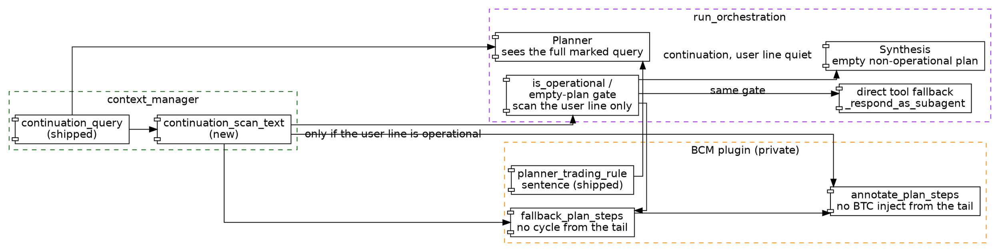

# Dialog Continuation Cycle Guard — Spec

**Status:** Draft
**Date:** 2026-10-23
**Scope:** A dialog continuation must not schedule `bcm_run_autonomous_cycle` because the previous assistant tail contains words like `market` or `trade`. The current user line is what the operational gates read.
**Related precedent:** [`dialog-followup-context.md`](./dialog-followup-context.md), `backend/context_manager.py` (`continuation_query`), `backend/orchestrator.py` (empty-plan gate), `backend/bcm/plugin.py` (`fallback_plan_steps`, `annotate_plan_steps`).

---

## 1. Context & Objective

### Trigger point / Problem

`continuation_query` is shipped. A short reply to an assistant question is planned as the previous-turn tail plus the current user line:

```225:225:backend/context_manager.py
        return f"[Dialog continuation]\n{tail}\n\n[Current user message]:\n{query}"
```

The planner prompt already says not to schedule the cycle for that marker unless the previous turn asked to execute a trade:

```485:487:backend/bcm/plugin.py
        f"- If the query contains `[Dialog continuation]`, plan the task asked in the previous assistant turn. "
        f"Do not schedule `{h['cycle']}` unless that turn asked to execute a trade. "
        f"The symbol is the one written in that turn. Do not substitute BTC."
```

That sentence is the only guard. Three code paths never read it. They classify the whole string, tail included.

Plan validation treats the query as operational when any marker substring hits. The plan list includes `market`:

```523:530:backend/orchestrator.py
                from backend.plugins import collect as _collect_markers
                _op_markers = ("scheduled task",) + tuple(_collect_markers("operational_query_markers", "plan"))
                is_operational = any(k in query.lower() for k in _op_markers)
                if len(plan_data["steps"]) == 0 and is_operational and len(allowed_agent_ids) > 0 and attempt < max_retries:
                    raise ValueError(
                        f"Operational or scheduled task '{query[:60]}...' must not return 0 steps when subagents are available. "
```

```160:163:backend/bcm/orchestrator_hooks.py
def operational_query_markers(kind="plan", **kwargs):
    if kind == "fallback":
        return ["autonomous", "hedge fund", "trade", "scan"]
    return ["autonomous", "hedge fund", "trade", "scan", "portfolio", "rebalance", "market"]
```

The incident question is "Would you like me to query similar historical market conditions for further insights?" The tail contains `market`. An empty plan is rejected and retried as if the user had asked for a desk run.

After retries, an empty plan still opens the cycle pipeline when the orchestrator has skills, or when the fallback markers hit the same string. The fallback list includes `trade`. A report that says "trade" qualifies. Skills alone also qualify:

```567:585:backend/orchestrator.py
        _q = query.lower()
        from backend.plugins import collect as _collect_markers
        _fb_markers = ("scheduled task",) + tuple(_collect_markers("operational_query_markers", "fallback"))
        _operational = bool(active_skills) or any(k in _q for k in _fb_markers)
        if len(state.steps) == 0 and _operational:
            from backend.plugins import hook as _plugin_hook
            default_steps = _plugin_hook("fallback_plan_steps", query, children, active_skills, gap=None, default=None)
            ...
            if len(state.steps) == 0:
                ...
                res = await agent_instance._respond_as_subagent(query, fallback_target, parent_skills=active_skills, chat_id=chat_id)
```

`fallback_plan_steps` repeats that rule and, when it fires, writes a trader step that calls `bcm_run_autonomous_cycle`:

```685:709:backend/bcm/plugin.py
def fallback_plan_steps(query, children, active_skills=None, gap=None):
    ...
    operational = bool(active_skills) or any(k in q for k in ("scheduled task", "autonomous", "hedge fund", "trade", "scan"))
    if not operational or len(children or []) < 2:
        return None
    ...
        default_steps.append({"agent": trader_id, "instructions": f"Execute the autonomous trading cycle using {h['cycle']}{sym_clause}.{query_context}"})
```

`annotate_plan_steps` computes the trading-task flag from the same full string. A tail that contains both "hedge fund" and "cycle" plus `is_operational` injects a bcm step that defaults the symbol to BTC:

```556:586:backend/bcm/plugin.py
    is_trading_task = (
        ("autonomous ai hedge fund" in q_lower or "hedge fund manager" in q_lower)
        and ("scheduled task" in q_lower or "trading cycle" in q_lower or "cycle" in q_lower)
    )
    ...
        exec_step = {
            "agent": "bcm",
            "instructions": f"Execute the autonomous trading cycle via {cycle} (defaulting to symbol='BTC'). ..."
        }
```

The same `is_operational` flag appends `[MANDATORY TOOL INSTRUCTION]` calling the cycle onto an execution step (`backend/bcm/plugin.py:614-630`).

Shipped behavior stops the planner prompt from demanding BTC. It does not stop these three paths. A continuation whose user line is `да проверь пожалуйста и отвечай мне на руском` can still become a cycle when the planner returns no steps, or when annotate sees hedge-fund language in the report tail.

### Objective

- Operational marker checks on a dialog continuation read the current user line only. The previous assistant tail is context for the planner, not an order.
- An empty plan on a continuation does not enter `fallback_plan_steps` or the direct tool fallback unless that user line itself matches an operational marker.
- `active_skills` does not make a continuation operational.
- `annotate_plan_steps` does not inject a bcm cycle step, and does not append a mandatory cycle instruction, from words that appear only in the tail.
- Queries that are not continuations keep today's gates, including the `active_skills` shortcut and the BTC default on a real cycle task.

### Explicit scope decisions (please confirm before implementation)

| Decision | Rationale |
|---|---|
| Close it in code. The shipped sentence does not bind `fallback_plan_steps` or the empty-plan gate. | Those paths schedule `bcm_run_autonomous_cycle` without another LLM call. |
| One splitter, `continuation_scan_text`, in `backend/context_manager.py`. Orchestrator and the plugin both call it. | The cut is the same string `continuation_query` already writes. A second copy of the delimiter will drift. Core must not import the private plugin. The plugin may call core. |
| Marker scans use the text after `[Current user message]:`. The tail is not scanned. | The incident question contains `market`. A trading report contains `trade`, `autonomous`, and often `cycle`. |
| A marked query with no delimiter scans as empty. | Fail closed. Scanning the whole string again would treat the tail as the order. |
| On a continuation, `active_skills` is not an operational signal. | `fallback_plan_steps` treats every skilled orchestrator as operational (`plugin.py:690`). The trading desk is skilled, so the tail fix alone still opens the cycle pipeline. |
| Do not parse the tail for "asked to execute a trade". | That exception stays the planner sentence from the parent spec. A phrase list over the report is the extra heuristic that spec refused. If the planner emits a cycle step, this spec does not delete it. |
| `annotate_plan_steps` recomputes its trading-task flag and its operational flag from the scan text when the query is a continuation. | The inject condition uses both a caller flag and a local read of the full query (`plugin.py:556-577`). Fixing only the caller leaves a direct call able to inject BTC. |
| Non-continuation queries are unchanged. | Scheduled prompts never receive the marker (`continuation_query` returns them as-is). Their empty-plan pipeline stays. |
| No mypy, black, or ruff setup. | That skip is a missing local tool, not this hole. |

### Scope

**In scope**

- `continuation_scan_text(query: str) -> str` in `backend/context_manager.py`.
- `run_orchestration`: both operational checks (`orchestrator.py` plan validation and the empty-plan gate) use the scan text. A continuation ignores `active_skills` for that gate.
- `fallback_plan_steps` and `annotate_plan_steps`: same scan. No cycle pipeline and no BTC inject from the tail.
- Unit tests in `backend/tests/` with no private-plugin import. Plugin cases in an existing BCM module that already imports these two functions.

**Out of scope / explicitly not requested**

- Editing `planner_trading_rule`. The sentence stays.
- Changing `continuation_query` gates (scheduled, symbol, `?`, 400 characters, 1500-character tail).
- Deleting a cycle step the planner actually returned.
- Changing `run_autonomous_cycle`'s BTC default when a real cycle call has no symbol.
- `include_history` on subagent steps.
- A historical-analog tool.
- Installing mypy, black, or ruff.

---

## 2. Architecture Diagram

See [`dialog-continuation-cycle-guard.dot`](./dialog-continuation-cycle-guard.dot) for the Graphviz source.



### Data flow summary

```
Continuation, user line "да проверь…", tail contains "market" / "trade" / "hedge fund" / "cycle":
  continuation_query (shipped)
    -> planner still sees the full marked query, including the sentence in planner_trading_rule
    -> continuation_scan_text returns only "да проверь…"
    -> plan-validation is_operational is false
    -> empty plan is accepted
    -> empty-plan gate is false (active_skills ignored)
    -> fallback_plan_steps is not called
    -> _respond_as_subagent tool fallback is not called
    -> synthesis runs on the marked query
    -> annotate_plan_steps, if called with steps, does not add a bcm step and does not append a cycle instruction

Continuation, user line itself operational ("run autonomous cycle on AUDUSD"):
  continuation_scan_text returns that line
    -> existing marker match applies to the line
    -> fallback_plan_steps and annotate keep today's behavior for that line
    -> symbol extraction still sees the full query, so a ticker that appears only in the tail remains available

Unmarked query (scheduled task, fresh request, ticker already in the message):
  continuation_scan_text returns the query unchanged
    -> is_operational, active_skills, fallback_plan_steps, annotate_plan_steps stay as they are today
```

---

## 3. API / Interface Contracts

No new HTTP route. The chat and cron entry points stay `JarvisAgent.respond`. The new contract is the splitter the orchestrator and the plugin call before any operational substring check.

### 3.1 Scan split — `continuation_scan_text`

| Field | Value |
|---|---|
| Method | In-process call |
| Path | `backend.context_manager.continuation_scan_text(query: str) -> str` |
| Auth | None. Callers are `run_orchestration`, `fallback_plan_steps`, and `annotate_plan_steps`. |
| Request | `query`: the string `run_orchestration` is planning, after `continuation_query`. |
| Response | The query unchanged when it does not start with `[Dialog continuation]\n`. Otherwise the substring after the first `\n\n[Current user message]:\n`. If that delimiter is absent, `""`. |
| Errors | None. This function does not read the database and does not raise. |
| Delivery pattern | Synchronous, same turn, before marker scans. The planner still receives the full marked query. Only the gates change input. |

**Frontend trigger:** None.

### 3.2 Empty-plan gate — `run_orchestration`

| Field | Value |
|---|---|
| Method | In-process branch, already in `run_orchestration` |
| Path | Plan-validation `is_operational` (`orchestrator.py` around the `operational_query_markers` "plan" collect) and the empty-plan `_operational` gate (the "fallback" collect plus `active_skills`). |
| Auth | None. |
| Request | Same `query` the planner sees. |
| Response | For a continuation, both flags are true only when `continuation_scan_text(query)` contains a marker from the existing list for that site. `active_skills` is not consulted. For any other query, both expressions stay as they are, including `bool(active_skills)`. |
| Errors | None. A false flag means an empty step list proceeds to synthesis, which is the existing non-operational path. |
| Delivery pattern | Synchronous, same turn. |

**Frontend trigger:** None.

### 3.3 Cycle pipeline — `fallback_plan_steps` and `annotate_plan_steps`

| Field | Value |
|---|---|
| Method | Plugin hooks already invoked from `run_orchestration` |
| Path | Plugin hooks `fallback_plan_steps` and `annotate_plan_steps` |
| Auth | Plugin present. No plugin means the hooks are not called. |
| Request | The full marked query, the same argument as today. No new parameter. |
| Response | `fallback_plan_steps` returns `None` when the query is a continuation and the scan text is not operational, even if `active_skills` is non-empty and the tail contains `trade` or `hedge fund`. `annotate_plan_steps` does not append the bcm inject step and does not append a `[MANDATORY TOOL INSTRUCTION]` that names `bcm_run_autonomous_cycle` unless the scan text itself makes the task operational. Steps the planner already returned are not removed. |
| Errors | None. `None` from the fallback hook means no canonical pipeline, which is the hook's current miss. |
| Delivery pattern | Synchronous, same turn. |

**Frontend trigger:** None.

### 3.4 DTO shapes

**Scan result (not stored)**

```json
{
  "query": "[Dialog continuation]\n…AUDUSD report ending with the question…\n\n[Current user message]:\nда проверь пожалуйста и отвечай мне на руском",
  "scan": "да проверь пожалуйста и отвечай мне на руском"
}
```

- `query` stays the planner and synthesis string. `messages.content` stays the raw user text.
- `scan` is not persisted. It exists only as the input to marker checks inside the turn.

### Open Question

None for the incident path. A continuation whose previous turn asked to execute a trade, and whose planner then returns no steps, synthesizes instead of forcing the cycle. The planner sentence still tells the model to emit the step. This spec does not add a tail parser to force that step in code. Add one only after a logged turn where the user accepted an execution question and the planner returned `{ "steps": [] }`.

---

## 4. Data Model & Implementation Plan

### 4.1 Entity: `messages` (unchanged)

No new table and no new column. This spec does not read `messages`. `continuation_query` already did.

| Column | Type | Notes |
|---|---|---|
| `content` | TEXT | Still the raw user text. The marker exists only on the in-memory planner query. |

### 4.2 Implementation steps (ordered, no code)

1. `backend/context_manager.py` — `continuation_scan_text(query: str) -> str`, contract in section 3.1. Prefix and delimiter are the literals `continuation_query` already writes. No database call.
2. `backend/orchestrator.py` — at the plan-validation marker check and at the empty-plan gate, classify `continuation_scan_text(query)` instead of `query`. When the query is a continuation, do not OR in `active_skills`. Leave the planner `user` message and the synthesis "Original query" on the full string.
3. `backend/bcm/plugin.py` — `fallback_plan_steps`: operational check uses the scan text; `active_skills` does not count on a continuation. `annotate_plan_steps`: `is_trading_task` and the local operational decision use the scan text on a continuation, so the BTC inject and the mandatory cycle instruction do not fire from the tail. Do not drop planner-authored steps.
4. `backend/tests/test_dialog_followup_context.py` — extend the existing module. No private-plugin import. Cases: marked incident query scans as the user line only; unmarked query scans as itself; marked query missing the delimiter scans as `""`; `run_orchestration` with a planner result of `{ "steps": [] }`, a marked query whose tail contains `market`, and a stubbed orchestrator that has `active_skills`, does not call `fallback_plan_steps` and does not call `_respond_as_subagent`.
5. BCM module that already imports `fallback_plan_steps` and `annotate_plan_steps` — continuation plus tail words `hedge fund`, `trade`, and `cycle`, user line `да проверь`, non-empty `active_skills`, at least two children: `fallback_plan_steps` returns `None`. Same query passed to `annotate_plan_steps` with `is_operational=True` and a quant/risk/compliance step list: no added bcm step, no instruction containing `bcm_run_autonomous_cycle`. A continuation whose user line is `run autonomous cycle` still builds the pipeline.
6. Manual check: replay the 12225 user line wrapped with a 12224-shaped tail that contains `market` and `Would you like me to query similar historical market conditions?`. An empty planner result synthesizes. It does not call the cycle. A prompt `Execute scheduled task: Autonomous AI Hedge Fund Manager` on `task_*` still takes today's pipeline.

### Known constraints carried over from investigation

| Issue | Location | Relevance here |
|---|---|---|
| Planner sentence cannot stop a code path. | `backend/bcm/plugin.py:485-487` | Already shipped. This spec is the code side of the same objective. |
| Plan markers include the bare word `market`. | `backend/bcm/orchestrator_hooks.py:163` | The incident question contains that word. Do not delete `market` from the list. Scan a smaller string. |
| Fallback markers include the bare word `trade`. Skills alone also open the gate. | `backend/bcm/plugin.py:690`, `backend/orchestrator.py:570` | Both have to change for a continuation. Changing only the substring check leaves the trading desk on the cycle path. |
| Annotate injects BTC when the query looks like a hedge-fund cycle. | `backend/bcm/plugin.py:556-586` | A long enough report tail can satisfy both halves of `is_trading_task`. |
| Mandatory cycle instruction is separate from the inject. | `backend/bcm/plugin.py:614-630` | An execution step plus a tail-derived operational flag still appends `bcm_run_autonomous_cycle`. |
| Symbol default BTC remains for a real cycle call with no symbol. | `backend/bcm/autonomous_trader.py` (unchanged by the parent spec) | Still correct when a scheduled or explicit cycle runs. This spec stops the continuation from starting that call. |
| `active_skills` makes every empty plan operational on a skilled orchestrator, even for "hello". | `backend/orchestrator.py:570` | Pre-existing for unmarked queries. Leave it. The exception is the continuation marker only. |
| mypy, black, and ruff are not installed in this environment. | `backend/pyproject.toml` has pytest, not those tools | Not part of this hole. Do not add them here. |

---

## Storage

Suggested save location: `docs/specs/dialog-continuation-cycle-guard.md` (+ `docs/specs/dialog-continuation-cycle-guard.dot`).
