# Dialog Follow-up Context — Spec

**Status:** Draft
**Date:** 2026-10-23
**Scope:** When a human chat reply answers the assistant's previous question, the orchestration query must carry that previous turn. Scheduled cycles stay context-free.
**Related precedent:** `backend/context_manager.py` (`sanitize_chat_history`, `build_subagent_messages`), `backend/skill_loop.py` (`_is_scheduled_automation_log`), `backend/bcm/plugin.py` (`planner_trading_rule`).

---

## 1. Context & Objective

### Trigger point / Problem

A human chat turn enters `JarvisAgent.respond` from `backend/bot.py` (`respond`, chat id = Telegram chat) or `backend/main.py` (`respond`, dashboard `chat_id`). The user message is saved first. Two paths then call `run_orchestration` with that string alone.

Session bound to the orchestrator agent:

```563:567:backend/agent.py
        if subagent:
            if subagent.get("agent_type") == "orchestrator" or subagent.get("id") == "orchestrator":
                from backend.orchestrator import run_orchestration
                start_time = time.time()
                orch_result = await run_orchestration(user_message, self.api_key, self.model, chat_id=session_id)
```

Complexity route `agent` / `orchestrate`. RAG hits may be appended. Chat history is not:

```661:678:backend/agent.py
        if complexity in ("agent", "orchestrate"):
            logger.info("Routing query to Agentic Orchestration graph...")
            from backend.orchestrator import run_orchestration
            from backend import rag
            hits = rag.search_memory(user_message, limit=3)
            context_query = user_message
            if hits:
                context_block = "\n\n[Context from your knowledge base for reference]:\n"
                for hit in hits:
                    context_block += f"- From document '{hit['title']}': \"{hit['content']}\"\n"
                context_query = f"{user_message}\n{context_block}"
            start_time = time.time()
            try:
                orch_result = await run_orchestration(context_query, self.api_key, self.model, chat_id=session_id)
```

History is loaded only on the `direct` branch (`JarvisAgent.get_history` at `backend/agent.py:859`). The planner message is `Query: {query}` (`backend/orchestrator.py:447-449`). Synthesis repeats that same string as `Original query` (`backend/orchestrator.py:881-884`).

Incident, 2026-10-23, messages 12224 → 12225 → 12230:

1. Assistant report on **AUDUSD** ends with "Would you like me to query similar historical market conditions for further insights?"
2. User: `да проверь пожалуйста и отвечай мне на руском`.
3. Assistant returns the autonomous-cycle report: **WAIT**, asset **BTC**, confidence 0.0%, veto score −0.26.

`да проверь` has no ticker. The trading planner rule tells the planner to call the cycle and default the symbol to BTC:

```483:484:backend/bcm/plugin.py
        f"- Explicitly instruct the execution agent to invoke `{h['cycle']}` (specifying target symbol or defaulting to 'BTC') "
        f"to place orders on the exchange and the risk agent to query `{h['balance']}` for live sizing."
```

`run_autonomous_cycle` does the same when the symbol is missing (`backend/bcm/autonomous_trader.py:3604-3605`). Subagent steps are called with `include_history=False` on session `{chat_id}_{child_id}` (`backend/orchestrator.py:713-725`). That isolation is intentional and tested. The parent chat never reaches the planner, so the cycle runs on BTC and the English report template is what the user sees. Ids 12226–12229 are step logs, not missing dialogue.

Scheduled work uses the same `respond` → `run_orchestration` pipe, with `session_id = task_{job_id}` and a prompt that starts `Execute scheduled task:` (`backend/scheduler.py:1208-1231`). Those runs must not pick up a human chat.

### Objective

- Detect a short human reply to an assistant question and prepend that question to the orchestration query before planning.
- Keep the symbol named in the previous assistant turn. Do not default it to BTC.
- Do not schedule `bcm_run_autonomous_cycle` for that reply unless the previous turn asked to execute a trade.
- Leave scheduled sessions and subagent `include_history=False` unchanged.
- Cover both orchestration call sites with one helper, called at the start of `run_orchestration`.

### Explicit scope decisions (please confirm before implementation)

| Decision | Rationale |
|---|---|
| Fix it. The incident is a wrong trade subject (BTC instead of AUDUSD), not a wording nit. | `run_orchestration` never reads `messages` for the parent chat. |
| Prepend context inside `run_orchestration`, not in each caller. | Both call sites (`agent.py:567` and `agent.py:678`) must behave the same. A caller-only patch misses the orchestrator-session path. |
| Do not set `include_history=True` on subagent steps. | `backend/orchestrator.py:725` and `test_it_respond_as_subagent_include_history_false_isolates_session` keep step sessions isolated. The planner query is the carrier. |
| Continuation only when all four gates pass: not scheduled, no ticker in the current message, previous assistant text contains `?`, current message ≤ 400 characters. | The incident is a 7-word answer to a question. A fresh request that names `AUDUSD` or `BTC` must stay a clean query. |
| Take the **tail** of the previous assistant message, 1500 characters. | `build_subagent_messages` already caps a history entry at 1500, but from the head (`context_manager.py:167-168`). The question in this incident is at the end of a long report. |
| Marker is the literal prefix `[Dialog continuation]`. | Planner and synthesis both echo `query`. One stable English token is enough for the trading rule to see. |
| Symbol check reuses `plugins.tool_hints()["symbol_pattern"]`. No new hook. | `backend/plugins.py:63-64` already exposes `tool_name_hints`. Core must not import the private plugin. With no plugin, the pattern is empty and the symbol gate stays open. |
| Scheduled gate is `session_id` starting with `task_` or containing `scheduled`, or the query starting with `Execute scheduled task:`. | Same session shape as `scheduler._trigger_agent_task`. Do not reuse `_is_scheduled_automation_log` wholesale: it also matches the substring `autonomous ai hedge fund manager`, which would suppress context when a human asks about that report. |
| Trading-rule exception is a sentence in `planner_trading_rule`, not a new planner. | The unconditional "defaulting to BTC" sentence is what turned 12225 into 12230. The helper's marker is useless if that sentence still wins. |
| No new historical-analog tool. | The offer in 12224 is model text. This spec only stops the wrong cycle. The planner uses skills that already exist. |

### Scope

**In scope**

- `continuation_query(query, chat_id) -> str` in `backend/context_manager.py`.
- Call it once at the start of `run_orchestration` before the planner messages are built.
- One extra sentence in `planner_trading_rule`.
- Unit test in `backend/tests/` (no private-plugin import). Plugin sentence covered by an existing BCM test module only if it imports `planner_trading_rule`.

**Out of scope / explicitly not requested**

- Flipping `include_history` for subagents.
- Changing `run_autonomous_cycle`'s BTC default for real cycle calls.
- A tool that searches historical market analogs.
- Copying the dashboard language directive into the planner. The user's language request is already inside the current message; the bug is that the message is planned as a fresh BTC cycle.
- The direct-path double user turn (`get_chat_history` already contains the just-saved user message, then `agent.py:894` appends it again).
- Banning the assistant from asking "Would you like me to…". `autonomy_steer` already says that to subagents; the synthesized parent reply can still ask.

---

## 2. Architecture Diagram

See [`dialog-followup-context.dot`](./dialog-followup-context.dot) for the Graphviz source.

```dot
digraph DialogFollowupContext {
  graph [fontname="Helvetica" rankdir="LR" splines="ortho"]
  node  [fontname="Helvetica" shape="box" style="rounded"]
  edge  [fontname="Helvetica"]

  subgraph cluster_entry {
    label="Entry" style="dashed" color="gray"
    CHAT [label="Human chat\nbot.py / main.py" shape="component"]
    CRON [label="scheduler._trigger_agent_task\nsession task_{job_id}" shape="component"]
  }

  subgraph cluster_agent {
    label="JarvisAgent.respond" style="dashed" color="steelblue"
    RESP [label="save user message\nthen orchestrate" shape="component"]
  }

  subgraph cluster_context {
    label="context_manager" style="dashed" color="darkgreen"
    CONT [label="continuation_query\n(new)" shape="component"]
  }

  subgraph cluster_orch {
    label="run_orchestration" style="dashed" color="purple"
    PLAN [label="Planner\nQuery: ..." shape="component"]
    SYNTH [label="Synthesis\nOriginal query" shape="component"]
    SUB [label="Subagent step\ninclude_history=false" shape="component"]
  }

  subgraph cluster_plugin {
    label="BCM plugin (private)" style="dashed" color="darkorange"
    RULE [label="planner_trading_rule\ncontinuation exception" shape="component"]
  }

  subgraph cluster_db {
    label="messages" style="dashed" color="#336699"
    MSG [shape="record" label="{ messages | id | session_id | role | content }"]
  }

  CHAT -> RESP
  CRON -> RESP
  RESP -> CONT
  CONT -> MSG [label="read parent session"]
  CONT -> PLAN
  RULE -> PLAN
  PLAN -> SUB
  SUB -> SYNTH
}
```



### Data flow summary

```
Human reply "да проверь…":
  bot.py / main.py
    -> JarvisAgent.respond(user_message, session_id=chat)
    -> save_message(chat, "user", …)
    -> run_orchestration(query, chat_id=chat)
    -> continuation_query(query, chat)
         gates: not scheduled, no symbol in query,
                previous assistant content contains "?",
                len(query) <= 400
         reads get_chat_history(chat), drops the trailing user row
         prepends "[Dialog continuation]" + tail(previous assistant, 1500)
    -> planner messages user = "Query: " + marked query
    -> planner_trading_rule: do not call bcm_run_autonomous_cycle,
       do not default the symbol to BTC; subject is the symbol in the tail
    -> step instructions carry that subject
    -> synthesis "Original query" is the marked query
    -> save_message(chat, "assistant", response)

Scheduled cycle:
  scheduler._trigger_agent_task
    -> respond(prompt, session_id="task_{job_id}")
    -> continuation_query returns the prompt unchanged
    -> existing planner rule and run_autonomous_cycle default stay in force
```

---

## 3. API / Interface Contracts

No new HTTP route. The chat and cron entry points stay `JarvisAgent.respond`. The new contract is the pure function the orchestrator calls before planning.

### 3.1 Continuation wrap — `continuation_query`

| Field | Value |
|---|---|
| Method | In-process call |
| Path | `backend.context_manager.continuation_query(query: str, chat_id: str) -> str` |
| Auth | None. Caller is `run_orchestration`. |
| Request | `query`: the string about to be planned (user text, plus RAG block if the caller already added one). `chat_id`: parent session id. |
| Response | Either `query` unchanged, or `"[Dialog continuation]\n" + tail + "\n\n[Current user message]:\n" + query`. |
| Errors | DB read failure returns `query` unchanged. No exception escapes. Same posture as `get_chat_history` (logs and returns `[]`). |
| Delivery pattern | Synchronous, inside the request that is already running `run_orchestration`. No job. The planner must see the tail in this same turn. |

**Frontend trigger:** None. The existing chat send (`backend/bot.py` respond, `backend/main.py` dashboard respond) is the only caller path. The user does not get a new button.

### 3.2 Trading-rule sentence — `planner_trading_rule`

| Field | Value |
|---|---|
| Method | In-process string, already appended in `run_orchestration` via `hook("planner_trading_rule")` |
| Path | Plugin hook `planner_trading_rule() -> str` |
| Auth | Plugin present. OSS core with no plugin keeps today's planner prompt. |
| Request | No new arguments. The function keeps returning one prompt block. |
| Response | Existing sentences, plus: if the query contains `[Dialog continuation]`, plan the task asked in the previous assistant turn; do not schedule `bcm_run_autonomous_cycle` unless that turn asked to execute a trade; the symbol is the one written in that turn; do not substitute BTC. |
| Errors | None. A missing plugin returns the hook default `""` (`orchestrator.py:412`). |
| Delivery pattern | Synchronous prompt text, same turn as planning. |

**Frontend trigger:** None.

### 3.3 DTO shapes

**`continuation_query` result (attached)**

```json
{
  "query": "[Dialog continuation]\n…tail of previous assistant message, ending with the question…\n\n[Current user message]:\nда проверь пожалуйста и отвечай мне на руском"
}
```

- `query` (not stored). The `messages` row stays the raw user text. The marker exists only in the planner/synthesis prompt.
- Previous-turn tail is read from `messages.content` where `role = assistant` and `session_id = chat_id`, the latest such row that sits before the current user row.

### Open Question

None for the incident path. If a later reply is longer than 400 characters and still anaphoric ("да" plus a paragraph, no ticker), this spec leaves it on today's path. Raise the cap when a real message of that shape shows up. Do not guess a second heuristic now.

---

## 4. Data Model & Implementation Plan

### 4.1 Entity: `messages` (read only)

No new table and no new column.

| Column | Type | Notes |
|---|---|---|
| `id` | INTEGER | `get_chat_history` already orders by `id ASC` after `ORDER BY id DESC LIMIT`. |
| `session_id` | TEXT | Parent chat id. Not `task_*` and not `{chat}_{child}`. |
| `role` | TEXT | Use `assistant` for the tail, skip a trailing `user` row equal to the current query. |
| `content` | TEXT | Tail source. Not rewritten. |

### 4.2 Implementation steps (ordered, no code)

1. `backend/context_manager.py` — `continuation_query(query: str, chat_id: str) -> str`. Gates in section 3.1. Scheduled check and the 400-character cap live here. Symbol check calls `plugins.tool_hints().get("symbol_pattern")` and `re.search`. History via `database.get_chat_history(chat_id, limit=20)`. On empty history or any exception, return `query`.
2. `backend/orchestrator.py` — `run_orchestration`: first line of the try-body, `query = continuation_query(query, chat_id)` before `planner_messages` is built. Do not pass the marked query into subagent `include_history`. Step text still comes from the planner, which now sees the marker.
3. `backend/bcm/plugin.py` — `planner_trading_rule`: append the continuation sentence from section 3.2. Leave the BTC default sentence in place for queries that do not contain the marker.
4. `backend/tests/test_dialog_followup_context.py` — one module, no private-plugin import. Cases: incident-shaped history returns the marker and the question tail; query containing a ticker from a stubbed pattern returns unchanged; `chat_id="task_abc"` returns unchanged; query starting `Execute scheduled task:` returns unchanged; previous assistant text with no `?` returns unchanged; query longer than 400 characters returns unchanged; `get_chat_history` raising returns the original query.
5. Manual check: replay 12225's text against a fixture of 12224. Planner input contains `AUDUSD` and `[Dialog continuation]`, and does not contain an instruction to default the symbol to BTC. A prompt `Execute scheduled task: Autonomous AI Hedge Fund Manager` on `task_*` is byte-identical to today.

### Known constraints carried over from investigation

| Issue | Location | Relevance here |
|---|---|---|
| Subagent steps ignore parent history on purpose. | `backend/orchestrator.py:725`, `backend/bcm/tests/test_docker_live_log_issues_2026_09_20_v2_it_cross.py` | Do not "fix" this. The marker has to be inside the planner query so step instructions are written with the right subject. |
| Cycle with no symbol is BTC. | `backend/bcm/autonomous_trader.py:3604-3605` | Still correct for a real cycle call. This spec stops the continuation from making that call. |
| `symbol_pattern` is uppercase tickers. | `backend/bcm/plugin.py` `tool_name_hints` | `проверь btc` does not match. The continuation tail is still labeled as context, and the current message still contains `btc`. Out of scope to widen the regex. |
| Language directive exists only on the direct branch. | `backend/agent.py:884-887` | Orchestrated continuations keep the user's own language sentence in `[Current user message]`. No second directive in this change. |
| Direct branch appends the current user message twice. | `backend/agent.py:543` then `backend/agent.py:888-894` | Irrelevant to the orchestration bug. Leave it. |
| `autonomy_steer` forbids confirmation questions; the parent synthesis still asked one. | `backend/bcm/plugin.py:460-463`, synthesis at `backend/orchestrator.py:881-892` | This spec answers the question that was asked. It does not add a new ban. |
| Synthesis may only report sub-agent results. | `backend/orchestrator.py:887` | The continuation still needs a plan step. The rule change tells the planner which step, and forbids the BTC cycle. It does not allow the synthesizer to invent the analog study. |

---

## Storage

Suggested save location: `docs/specs/dialog-followup-context.md` (+ `docs/specs/dialog-followup-context.dot`).
