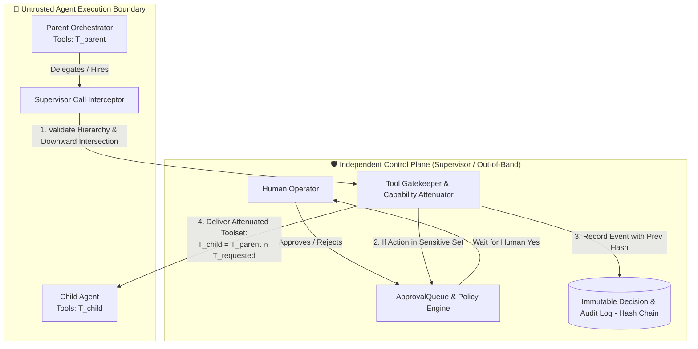

# Hierarchical Tool Attenuation, HITL Governance, and Out-of-Band Controls — Architecture Spec

**Status:** Proposed / Ready for Implementation  
**OSS revision:** 2026-10-23 — plugins extend the high-risk set, MCP tools use their own annotations, the ledger installs on SQLite and Postgres, the shell boundary is a local subprocess.  
**Date:** 2026-10-23  
**Authors:** Hermes Synapse Architectural Working Group  
**Target Modules:**  
- [backend/agent.py](file:///Users/pauloberezini/Documents/private/git/jarvis/backend/agent.py)  
- [backend/orchestrator.py](file:///Users/pauloberezini/Documents/private/git/jarvis/backend/orchestrator.py)  
- [backend/tools.py](file:///Users/pauloberezini/Documents/private/git/jarvis/backend/tools.py)  
- [backend/governance.py](file:///Users/pauloberezini/Documents/private/git/jarvis/backend/governance.py)  
- [backend/activity_logger.py](file:///Users/pauloberezini/Documents/private/git/jarvis/backend/activity_logger.py)  
- [backend/database.py](file:///Users/pauloberezini/Documents/private/git/jarvis/backend/database.py)  
- [backend/main.py](file:///Users/pauloberezini/Documents/private/git/jarvis/backend/main.py)  
**Related Specs:**  
- [docs/specs/auto-hire-oss-hardening.md](file:///Users/pauloberezini/Documents/private/git/jarvis/docs/specs/auto-hire-oss-hardening.md)  
- [docs/specs/roadmap/phase-1-approval-context.md](file:///Users/pauloberezini/Documents/private/git/jarvis/docs/specs/roadmap/phase-1-approval-context.md)  
- [docs/specs/roadmap/phase-3-team-readiness.md](file:///Users/pauloberezini/Documents/private/git/jarvis/docs/specs/roadmap/phase-3-team-readiness.md)  

---

## 1. Executive Summary & Audit Findings

The user specifies three fundamental architectural principles:
1. **Strict Downward Tool Attenuation:** A child agent receives *only* the intersection of its parent's tools ($\text{Tools}_{\text{child}} \subseteq \text{Tools}_{\text{parent}}$) and can never possess more power than whoever created/called it.
2. **Mandatory Human-in-the-Loop (HITL) for Permissions and Logging:** Changing permissions, roles, subagent capabilities, or any aspect of logging must wait for explicit human confirmation ("waits for a human yes") and never happen quietly or autonomously.
3. **Independent Control Plane:** Security controls, guardrails, and logging verification must run independently of the agent process, preventing the agent from tampering with, disabling, or bypassing its own governance boundaries.

### 🔍 Codebase Audit Verdict: **DOES NOT MATCH (FAIL)**

An exhaustive audit of `backend/` reveals critical vulnerabilities and architectural mismatches in all three areas:

| # | Stated Principle | Code Reality Today | Status | Key Code References |
|---|---|---|---|---|
| **1** | Child gets only intersection of parent's tools | • Top-level orchestrator explicitly passes `parent_skills=None`, disabling intersection entirely.<br>• `call_subagent` passes no parent context (`parent_skills=None`).<br>• Tools are re-injected *after* intersection.<br>• Default skills fallback grants all safe + MCP + plugin tools. | **VIOLATED** | [orchestrator.py:L718](file:///Users/pauloberezini/Documents/private/git/jarvis/backend/orchestrator.py#L718)<br>[agent.py:L1809-1835](file:///Users/pauloberezini/Documents/private/git/jarvis/backend/agent.py#L1809-L1835)<br>[tools.py:L1601-1606](file:///Users/pauloberezini/Documents/private/git/jarvis/backend/tools.py#L1601-L1606) |
| **2** | Permission & logging changes wait for human approval | • `create_subagent` is NOT in `HIGH_RISK_TOOLS` and executes silently.<br>• No HITL gate for role or permission mutation.<br>• `clear_history` and logging configuration can be executed/suppressed silently.<br>• Direct API endpoints (`/api/subagents`, `/api/settings`) have no HITL confirmation token. | **VIOLATED** | [governance.py:L24-28](file:///Users/pauloberezini/Documents/private/git/jarvis/backend/governance.py#L24-L28)<br>[tools.py:L1539](file:///Users/pauloberezini/Documents/private/git/jarvis/backend/tools.py#L1539)<br>[agent.py:L525](file:///Users/pauloberezini/Documents/private/git/jarvis/backend/agent.py#L525)<br>[activity_logger.py:L15](file:///Users/pauloberezini/Documents/private/git/jarvis/backend/activity_logger.py#L15) |
| **3** | Controls run independently of the agent | • In-band monolithic process: Agent, tools, and `BudgetGuard` / `ApprovalQueue` share the same Python memory and thread pool.<br>• Agents with `execute_command` or Python execution share host/DB privileges and can monkey-patch controls in runtime memory or direct DB SQL.<br>• Logs are mutable in SQLite/Postgres with no out-of-band WORM or supervisor proxy. | **VIOLATED** | [governance.py:L444](file:///Users/pauloberezini/Documents/private/git/jarvis/backend/governance.py#L444)<br>[tools.py:L1847](file:///Users/pauloberezini/Documents/private/git/jarvis/backend/tools.py#L1847)<br>[main.py:L1](file:///Users/pauloberezini/Documents/private/git/jarvis/backend/main.py#L1) |

---

## 2. Detailed Gap Analysis

### Gap 1: Downward Tool Attenuation & Intersection Bypasses

1. **Root Orchestrator Bypass ([orchestrator.py:L715-718](file:///Users/pauloberezini/Documents/private/git/jarvis/backend/orchestrator.py#L715-L718)):**
   ```python
   subagent_kwargs = {
       "parent_skills": step.get("skill_cap") if step.get("skill_cap") is not None else (None if parent_skills is None else active_skills),
       "chat_id": scoped_subagent_session_id,
   }
   ```
   When the root orchestrator runs, `parent_skills` is `None`. The code deliberately passes `parent_skills=None` to child agents under the comment `"Top-level (parent_skills is None) leaves keep their own skills."`
   In [backend/agent.py:L1809-1830](file:///Users/pauloberezini/Documents/private/git/jarvis/backend/agent.py#L1809-L1830):
   ```python
   if parent_skills is not None:
       allowed_tools = child_allowed.intersection(parent_allowed)
   else:
       allowed_tools = child_allowed
   ```
   **Result:** A root orchestrator with only `web_search` can spawn or invoke a child agent equipped with `shell_execution` (`execute_command`), granting the child vast powers the parent never had.

2. **Unbounded Tool Delegation via `call_subagent` ([tools.py:L1601-1606](file:///Users/pauloberezini/Documents/private/git/jarvis/backend/tools.py#L1601-L1606)):**
   ```python
   agent_instance._respond_as_subagent(
       query,
       subagent,
       chat_id=clean_id,
       parent_message_id=parent_msg_id
   )
   ```
   `call_subagent` completely omits `parent_skills`. Any low-privileged agent that has the `call_subagent` tool can delegate tasks to an arbitrary specialist (e.g., financial trading broker or shell runner), completely circumventing tool boundaries.

3. **Post-Intersection Privilege Escalation ([agent.py:L1831-1835](file:///Users/pauloberezini/Documents/private/git/jarvis/backend/agent.py#L1831-L1835)):**
   ```python
   allowed_tools = child_allowed.intersection(parent_allowed)
   allowed_tools.update(["save_subagent_memory", "get_subagent_memory"])
   allowed_tools.update(management_tools_for(subagent))
   if subagent.get("agent_type") in _ORCHESTRATOR_TYPES:
       allowed_tools.add("web_search")
   ```
   Even when intersection occurs, `management_tools_for` (`create_subagent`, `list_subagents`, `call_subagent`) and `web_search` are injected unconditionally into `allowed_tools` without checking whether `parent_allowed` contained them.

4. **Default Permissiveness on Empty Skills ([agent.py:L1801-1805](file:///Users/pauloberezini/Documents/private/git/jarvis/backend/agent.py#L1801-L1805)):**
   If `skills` is empty or unset on a subagent, `child_allowed` defaults to `safe_tool_names + all MCP tools + all plugin tools`. In the absence of an enforced parent intersection, untyped child agents gain maximum privilege by default.

---

### Gap 2: Silent Permission and Logging Mutations (Lack of HITL)

1. **`create_subagent` Runs Autonomously without Approval ([governance.py:L24-28](file:///Users/pauloberezini/Documents/private/git/jarvis/backend/governance.py#L24-L28)):**
   ```python
   HIGH_RISK_TOOLS = frozenset({
       "execute_command",
       "create_obsidian_note",
       "delete_todoist_task",
   })
   ```
   `create_subagent` is NOT in `HIGH_RISK_TOOLS`. Orchestrator agents can autonomously hire, spawn, and configure subagents with custom system prompts and skill sets without creating a row in `approval_requests` or waiting for a human approval.

2. **Silent Log Alterations ([agent.py:L525](file:///Users/pauloberezini/Documents/private/git/jarvis/backend/agent.py#L525), [activity_logger.py:L15](file:///Users/pauloberezini/Documents/private/git/jarvis/backend/activity_logger.py#L15)):**
   - An agent or API client can invoke `clear_history(session_id)` silently.
   - Activity logs, decision traces, and audit trails lack tamper-proofing and can be deleted or truncated without human gatekeeper authorization.
   - There is no mechanism requiring a human confirmation token for changing logging levels, log outputs, or disabling audit hooks.

---

### Gap 3: In-Band Governance vs. Independent Control Plane

1. **Monolithic Shared Memory Space:**
   `JarvisAgent`, tool handlers, `BudgetGuard`, `ApprovalQueue`, and database drivers execute inside the same Python process. If an agent executes code (`execute_command` or Python evaluation):
   - The agent process can mutate `sys.modules["backend.governance"].gate_tool = lambda *a, **k: None`.
   - The agent can directly connect to the SQLite/Postgres DB and update `approval_requests SET status = 'APPROVED'`.
   - The agent can modify `.env` or in-memory `os.environ` secrets.
2. **Absence of an Out-of-Band Supervisor/Proxy:**
   There is no separate, unprivileged worker boundary or out-of-band proxy through which agent tool calls must travel. Controls are purely cooperative in-process function calls.

---

## 3. Core Architectural Invariants

To achieve complete compliance with the user's specification, the system must enforce four non-negotiable invariants:



### Invariant I: Strict Downward Tool Attenuation
$$\text{EffectiveTools}(A_{\text{child}}) \subseteq \text{EffectiveTools}(A_{\text{parent}})$$
- A child agent can never receive a tool that its parent does not possess.
- If $A_{\text{parent}}$ does not possess `execute_command`, no child created or called by $A_{\text{parent}}$ can possess `execute_command`.
- Post-intersection tool injection (`management_tools_for`, `web_search`, memory tools) is strictly prohibited unless those tools are already members of $\text{EffectiveTools}(A_{\text{parent}})$.

### Invariant II: Mandatory Context Propagation
- Every delegation path (`call_subagent`, planner step, mesh dispatch) MUST cryptographically or contextually bind the caller's capability set.
- Invoking a subagent without an explicit parent context is rejected by default (`Fail-Closed`).

### Invariant III: Human-in-the-Loop for Permissions & Auditing
- The following actions are classified as **CRITICAL GOVERNANCE ACTIONS** and MUST transition to `PENDING_APPROVAL`:
  1. `create_subagent` / `modify_subagent` / `hire_specialist`
  2. Modifying agent tool assignments or system prompts
  3. Changing RBAC roles, user permissions, or API tokens
  4. Clearing chat history (`clear_history`), truncating logs, or modifying logging verbosity/sinks
- No agent may execute these actions quietly or autonomously. Execution blocks until a human explicit approval (`"APPROVED"`) is recorded by an authenticated operator.

### Invariant IV: Independent Control Plane & Tamper Resistance
- The policy check is `gate_tool`, called before a tool runs. A separate supervisor process is not required for a local run.
- `execute_command` runs in a local subprocess with a timeout. That is the default boundary for pytest and for Docker Compose. Docker or gVisor (`CAP_DROP=ALL`, read-only root, no mount of `data/` or backend source) is an optional deployment profile, not a test requirement.
- Audit and decision logs use an append-only SHA-256 hash chain. SQLite (`install_approval_decisions`) and Postgres (`install_approval_decisions_postgres`) both install `BEFORE UPDATE` and `BEFORE DELETE` triggers that abort. Compose defaults to Postgres 16, so the Postgres twin is part of the contract.
- `scripts/verify_audit_chain.py` checks the chain outside the web process.

---

## 4. Technical Design & Implementation Plan

### 4.1 Downward Tool Intersection Enforcement

#### 1. Context-Aware Capability Envelope ([backend/governance.py](file:///Users/pauloberezini/Documents/private/git/jarvis/backend/governance.py))
Introduce a context variable `current_agent_capability`:

```python
# backend/governance.py
import contextvars
from typing import FrozenSet, Optional

current_agent_tools: contextvars.ContextVar[Optional[FrozenSet[str]]] = contextvars.ContextVar(
    "current_agent_tools", default=None
)
```

#### 2. Strict Attenuation in `_respond_as_subagent` ([backend/agent.py](file:///Users/pauloberezini/Documents/private/git/jarvis/backend/agent.py))
Refactor tool resolution around lines 1807–1836:

```python
# backend/agent.py (around line 1807)
# Resolve parent toolset: must be provided, or derived from current_agent_tools
caller_allowed_tools = current_agent_tools.get()

if parent_skills is not None:
    # Resolve parent_allowed from parent_skills
    parent_allowed = resolve_tools_for_skills(parent_skills)
elif caller_allowed_tools is not None:
    parent_allowed = set(caller_allowed_tools)
else:
    # Fail-closed for subagents: if caller capability is unknown, restrict to bare minimal safe read tools
    parent_allowed = set(CORE_READONLY_TOOLS)

# Intersect child requested tools with parent allowed tools
allowed_tools = child_allowed.intersection(parent_allowed)

# Post-intersection check: management tools can ONLY be added if parent already had them!
management_tools = management_tools_for(subagent)
for tool in management_tools:
    if tool in parent_allowed:
        allowed_tools.add(tool)

# Set contextvar for the duration of child execution so nested calls cannot widen permissions
token = current_agent_tools.set(frozenset(allowed_tools))
try:
    # execute LLM turn with allowed_tools
    ...
finally:
    current_agent_tools.reset(token)
```

#### 3. Propagating Capability in `call_subagent` ([backend/tools.py](file:///Users/pauloberezini/Documents/private/git/jarvis/backend/tools.py))
Update `call_subagent`:

```python
# backend/tools.py line 1577
def call_subagent(subagent_id: str, query: str) -> str:
    from backend.governance import current_agent_tools
    caller_tools = current_agent_tools.get()
    
    # Subagent can only be invoked with an intersected toolset
    return _run_async(agent_instance._respond_as_subagent(
        query,
        subagent,
        chat_id=clean_id,
        parent_message_id=parent_msg_id,
        caller_tools=caller_tools,  # enforce intersection
    ))
```

#### 4. Storage-Level Invariant in `save_subagent` ([backend/database.py](file:///Users/pauloberezini/Documents/private/git/jarvis/backend/database.py))
When saving a child agent under a `parent_id`, enforce:
$$\text{Skills}(child) \subseteq \text{Skills}(parent)$$
If an attempt is made to save a child with skills exceeding the parent, raise `PrivilegeEscalationError`.

---

### 4.2 Human-in-the-Loop for Permissions and Logging

#### 1. Core set plus a plugin hook (`backend/governance.py`)
Core keeps a small frozenset of core tool names. A plugin appends its own names by defining `high_risk_tools()`. Core never lists plugin tool names. `collect` already flattens list and tuple returns.

```python
# backend/governance.py
HIGH_RISK_TOOLS = frozenset({
    "execute_command",
    "create_obsidian_note",
    "delete_todoist_task",
    "create_subagent",
    "update_subagent",
    "delete_subagent",
    "change_agent_skills",
    "assign_role",
    "clear_history",
    "clear_decision_logs",
    "set_log_level",
    "export_or_purge_audit",
})

def _high_risk_names() -> frozenset[str]:
    names = set(HIGH_RISK_TOOLS)
    for extra in collect("high_risk_tools"):
        if isinstance(extra, str):
            names.add(extra)
        else:
            names.update(str(n) for n in extra)
    return frozenset(names)
```

MCP tools are not added to this set. Their names show up only after a server connects. `mcp_tool_needs_approval` reads the tool's MCP annotations:

- `readOnlyHint: true` → run
- `destructiveHint: false` → run
- annotations omitted → MCP defaults (`readOnlyHint` false, `destructiveHint` true) → wait for a human

Registration goes through `note_mcp_tool` so both startup and `POST /api/mcp/servers` keep the annotations. `forget_mcp_server_tools` drops them when the server is removed.

#### 2. Gating Agent-Driven Permission and Logging Tools
Wrap `create_subagent` and history clearing in `gate_tool`:
- When an agent calls `create_subagent(id, name, skills, ...)`:
  1. `gate_tool` builds an `EvidenceBundle` capturing the requested agent, mandate, and skills.
  2. A new request `#ID` is created in `approval_requests` with status `PENDING`.
  3. The agent receives:
     ```json
     {"status": "PENDING_APPROVAL", "request_id": 42, "message": "Subagent creation requires human operator approval."}
     ```
  4. The tool pauses until the human confirms in the UI or Telegram bot.
- Similarly, any tool or command attempting to call `clear_history` or modify logger configuration triggers a `PENDING_APPROVAL` gate.

---

### 4.3 Independent Control Plane Architecture

1. **Local subprocess for shell execution:**
   - `execute_command` is `subprocess.run` with a 15 second timeout. Pytest and Compose use that path.
   - A deployment profile may wrap the same call in Docker or gVisor (`CAP_DROP=ALL`, read-only root, no mount of `data/` or backend source). Tests do not start that runtime.

2. **Immutable audit ledger on both databases:**
   The schema from [docs/specs/roadmap/phase-1-approval-context.md](file:///Users/pauloberezini/Documents/private/git/jarvis/docs/specs/roadmap/phase-1-approval-context.md) Item 3:
   - Table `approval_decisions` with SHA-256 chaining (`prev_hash`, `entry_hash`).
   - SQLite: `install_approval_decisions` creates `approval_decisions_no_update` and `approval_decisions_no_delete`, which `RAISE(ABORT)`.
   - Postgres: `install_approval_decisions_postgres` creates the same trigger names over `approval_decisions_append_only()`, which `RAISE EXCEPTION`. Compose sets `DATABASE_URL` to Postgres 16, so this installer is required, not optional.

3. **Chain check outside the web process:**
   - `python3 scripts/verify_audit_chain.py` validates the hash chain. It is a CLI, not a daemon a contributor must run to boot the app.

---

## 5. Test Plan & Acceptance Matrix

Following the project's strict TDD protocol, implement tests before code changes:

### Test Suite 1: Tool Attenuation & Intersection
File: `backend/tests/test_agent_tool_attenuation.py`
- `test_child_cannot_receive_tools_outside_parent_set`: Parent has `{"web_search"}`; child configured with `skills="python_sandbox"`. Effective child tools must NOT include `execute_command`.
- `test_call_subagent_propagates_caller_restrictions`: Low-privilege caller calls high-privilege subagent; invoked tools must be filtered to the intersection.
- `test_management_tools_not_injected_if_parent_lacks_them`: Orchestrator child spawned by non-orchestrator parent does not receive `create_subagent`.
- `test_empty_skills_child_defaults_to_parent_intersection`: Child with empty skills gets at most the parent's tools, never the global superset.

### Test Suite 2: HITL Gating on Permissions & Logging
File: `backend/tests/test_governance_hitl_permissions.py`
- `test_create_subagent_waits_for_human_approval`: Agent tool call `create_subagent` yields `PENDING_APPROVAL` and creates an `approval_requests` entry.
- `test_clear_history_requires_approval`: Attempting to clear chat history or decision logs raises a gate requiring human resolution.
- `test_rejected_subagent_creation_does_not_persist`: Rejection in `ApprovalQueue` ensures no row is added to the `subagents` table.
- `test_plugin_high_risk_name_waits_for_approval`: A name returned by `collect("high_risk_tools")` and absent from the core frozenset still yields `PENDING_APPROVAL`.
- `test_readonly_mcp_annotation_skips_approval`: An MCP tool with `readOnlyHint: true` or `destructiveHint: false` runs. A tool with no annotations still waits.

### Test Suite 3: Immutable Logging & Tamper Resistance
File: `backend/tests/test_immutable_decision_log.py`
- `test_decision_log_is_append_only`: Direct `UPDATE` or `DELETE` on `approval_decisions` raises an exception from the database trigger.
- `test_hash_chain_verification`: Modifying any byte in a stored decision invalidates `verify(tenant_id)`.

---

## 6. Migration and Compatibility

- **Solo default:** `HERMES_SOLO_MODE` unset or `1` is the single-user clone. A fresh checkout does not set the variable. Multi-user deployments set `HERMES_SOLO_MODE=0`. The flag only lets a local operator approve their own dashboard turn. Agent-originated calls stay gated in every mode.
- **Open-source:** No proprietary service. Plugins extend the gate through `collect("high_risk_tools")`. The ledger installs on SQLite and on Compose's Postgres. The shell tool is a local subprocess. Approval is the local API `POST /api/governance/approvals/{id}/resolve`. Telegram is an optional notifier beside that API.
