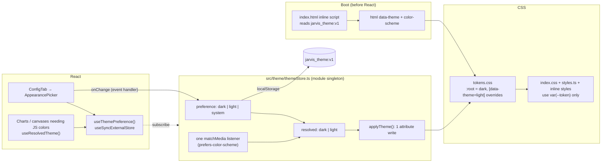

# Light Theme ("Daylight", Jira-style) — Spec

**Status:** Draft
**Date:** 2026-10-31
**Scope:** Add a user-selectable light appearance to the dashboard, styled after Jira / Atlassian Design System (flat white surfaces, navy text, blue accent, no glow). Choice lives in **Settings → Config**, next to Response Language. Current cyber/dark look stays the default.
**Related precedent:** `frontend/src/index.css` (`:root` tokens), `frontend/src/styles.ts` (shared inline style map), `frontend/src/components/ConfigTab.tsx` (instant-apply settings pattern), `frontend/src/App.tsx` (`getSafeStorageItem` / `jarvis_pixel_office_enabled` local-only setting), `frontend/src/components/PixelOfficeCanvas.tsx` (`OFFICE_THEMES` — a separate, canvas-only theme system).
**Guidelines applied:** `.agents/skills/react-best-practices` (rules cited inline as `rule-id`).

---

## 1. Context & Objective

### Trigger point / Problem

The UI has one theme, hard-wired to a dark cyberpunk palette. Partly tokenized, mostly not.

Tokens that exist (`index.css` `:root`):

```3:38:frontend/src/index.css
:root {
  /* Core Color System */
  --bg-deep: #060913;
  --bg-surface: #0c1122;
  --bg-card: rgba(16, 22, 42, 0.65);
  ...
  --accent-cyan: #00f0ff;
  ...
  --glass-blur: 16px;
  --glass-border-color: rgba(0, 240, 255, 0.08);
  ...
}
```

Scan results (`frontend/src`, test files excluded):

| Finding | Count | Why it blocks a light theme |
|---|---|---|
| `rgba(0,240,255,…)` literals (cyan accent + alpha) | 276 | Accent is not a token when alpha is applied |
| `rgba(255,255,255,…)` literals (white-alpha borders / fills) | 244 | Invisible on a white surface |
| `rgba(0,0,0,…)` / `rgba(6,9,19,…)` / `rgba(15,23,42,…)` dark fills | ~140 | Dark blocks on a light page |
| Hex literals, top: `#00f0ff` 76, `#fff` 67, `#94a3b8` 48, `#64748b` 33 | ~600 | `#fff` text becomes invisible |
| `style={{…}}` inline objects in TSX | ~1 000 (ScheduleTab 120, ChatTab 106, MCPTab 82, RSSTab 78, Marketplace 69, Metrics 64…) | Inline style beats any `[data-theme]` CSS selector — must be converted, cannot be overridden |
| `e.currentTarget.style.* = '#…'` hover mutations | 32 (ChatTab 18, utils.tsx 6) | Hard-codes colors on hover, bypasses CSS |
| `text-shadow` / glow / `backdrop-filter` usages | ~50 / ~45 | Neon look; reads as blur/smudge on white |
| Files with **zero** `var(--…)` despite colors: `RSSTab.tsx` (92), `ConfigTab.tsx` (11), canvases | — | Need full pass |
| Undefined tokens referenced: `--accent-purple` (MetricsTab), `--bg-secondary`, `--border`, `--border-color`, `--text-secondary` (ObsidianTab), `--accent-green`, `--error` | 7 | Already broken in dark; resolved by the new token set |

Other observations:

- `App.css` is **not imported** anywhere (Vite template leftover, uses `--accent`, `--text-h`, `--social-bg`). Ignore / delete in Phase 0.
- No `color-scheme` declared → native `<select>`, scrollbars, date pickers, autofill render dark-on-dark or light-on-light inconsistently.
- `styles.ts` mixes tokens and literals, e.g. `configForm.backgroundColor: 'rgba(12, 17, 34, 0.5)'`, `navBtnActive` cyan rgba.
- Markdown renderer (`utils.tsx`) hard-codes `#ffffff` for `<strong>` / headings and `#d4d4d4` for code blocks → white-on-white in chat.
- Pixel / Iso Office canvases have their own `OFFICE_THEMES` palette and draw to `<canvas>`; CSS vars don't reach them.
- Auth screen (`.cyber-auth-*`, `index.css` §"CYBERPUNK AUTH") is brand art, ~200 lines of literals.
- Settings pattern to follow: language select applies instantly (no submit). Office toggle persists to `localStorage` only.

### Objective

1. Settings has an **Appearance** control: `Dark (Cyber)` · `Light (Daylight)` · `System`.
2. Applying a theme is one DOM attribute write: `<html data-theme="light">`. All color comes from CSS custom properties. No React re-render of the app tree.
3. No flash of the wrong theme on reload.
4. Light theme looks like Jira: white cards on a `#F7F8F9` canvas, `#172B4D` text, `#0C66E4` primary, 1px neutral borders, small flat shadows, no glow, no blur, no scanlines, uppercase "lozenge" status badges.
5. Dark theme looks identical to today (pixel-diff tolerance on key screens).
6. A ratchet test stops new hard-coded colors from being added.

### Explicit scope decisions (please confirm before implementation)

| # | Decision | Proposed default |
|---|---|---|
| D1 | Persistence | `localStorage` only (`jarvis_theme:v1`), per-browser. Same as Pixel Office toggle. No backend change. Option: also POST to `/api/settings` later (§3 Open Question). |
| D2 | Default for new users | `dark` (unchanged look). Not `system` — avoid surprising existing users. |
| D3 | Pixel / Iso Office canvases | Stay dark in both themes (own `OFFICE_THEMES` switcher). Office **chrome** (toolbars, inspector panel) does follow the theme. |
| D4 | Auth / OTP screen | Stays dark cyber in both themes (brand moment, shown before settings are reachable). Wrap with `data-theme="dark"` on its container. |
| D5 | Font | Light theme switches `--font-sans` to the system stack (Jira uses system UI / Atlassian Sans). Outfit stays for dark. Keeps one Google Fonts request; no new font dependency. |
| D6 | Branding | "Jira-inspired" palette values only. No Atlassian logos, icons, fonts or `@atlaskit/*` packages. Theme name is **Daylight**, not "Jira". |
| D7 | Rollout | Option hidden behind nothing — ships when Phase 2 is done; Phase 3 tabs are fixed before release so no tab is unreadable. |

### Scope

**In:**
- Token layer (semantic CSS custom properties) + dark and light values.
- Theme store, pre-paint script, Settings UI.
- Migration of `index.css`, `styles.ts`, `utils.tsx`, `App.tsx` shell, every tab and drawer/modal listed in §4.2.
- `color-scheme`, scrollbars, focus rings, selection color per theme.
- Ratchet test + unit tests for the store.

**Out:**
- Canvas rendering inside Pixel/Iso Office (D3).
- Auth screen restyle (D4).
- Backend persistence (D1).
- High-contrast theme, per-user accent color picker (future: token layer makes them cheap).
- Introducing Tailwind, CSS-in-JS libs, or a component library.

---

## 2. Architecture Diagram



Graphviz version: `docs/specs/light-theme-jira-style.dot`.

### Data flow summary

1. **Page load.** Inline `<script>` in `index.html` (runs before CSS paint and before the module bundle) reads `jarvis_theme:v1`, resolves `system` via `matchMedia`, sets `document.documentElement.dataset.theme` and `style.colorScheme`. Wrapped in `try/catch` (`rendering-hydration-no-flicker`, `client-localstorage-schema`).
2. **Store init.** `themeStore.ts` reads the same key once at module load and caches it (`js-cache-storage`, `advanced-init-once`). If preference is `system`, it registers **one** `matchMedia('(prefers-color-scheme: dark)')` `change` listener for the whole app (`client-event-listeners`).
3. **User picks a theme.** `AppearancePicker` calls `setThemePreference(next)` directly in the `onChange` handler — no state + effect (`rerender-move-effect-to-event`). The store writes `localStorage`, recomputes resolved theme, does one `dataset.theme` write (`js-batch-dom-css`: swap one attribute, never per-element styles), notifies subscribers.
4. **Re-render surface.** Only components that call `useThemePreference()` / `useResolvedTheme()` re-render (the picker, plus any chart that needs JS colors). `App.tsx` (2 141 lines, dozens of state hooks) does **not** hold theme state and does not re-render on switch (`rerender-defer-reads`, `rerender-derived-state`).
5. **Paint.** Everything else updates through the CSS cascade because all colors resolve via `var(--…)`. Transition: a `.theme-switching` class on `<html>` for one frame disables transitions to avoid 300 ms of mixed colors from existing `transition: all` rules.

---

## 3. API / Interface Contracts

### 3.1 Theme store — `frontend/src/theme/themeStore.ts` (new)

```ts
export type ThemePreference = 'dark' | 'light' | 'system';
export type ResolvedTheme = 'dark' | 'light';

export const THEME_STORAGE_KEY = 'jarvis_theme:v1';

export function getThemePreference(): ThemePreference;          // cached, no storage read after init
export function getResolvedTheme(): ResolvedTheme;
export function setThemePreference(next: ThemePreference): void; // persist + apply + notify
export function subscribe(listener: () => void): () => void;     // for useSyncExternalStore

// hooks (same file or theme/useTheme.ts)
export function useThemePreference(): [ThemePreference, (t: ThemePreference) => void];
export function useResolvedTheme(): ResolvedTheme;
```

Rules:
- Unknown / corrupt stored value → `'dark'`.
- `localStorage` access always in `try/catch` (private mode). Reuse the pattern of `getSafeStorageItem` (move both helpers to `src/lib/storage.ts`; App.tsx imports them).
- `setThemePreference` is a no-op if value is unchanged (no notify, no write).
- `matchMedia` listener attached only while preference is `system`; detached otherwise.
- `useSyncExternalStore(subscribe, getSnapshot, () => 'dark')` — snapshot returns a primitive string so React bails out on equal values (`rerender-derived-state`).
- No React Context provider. Theme is global DOM state; a provider would re-render its subtree on change.

### 3.2 Pre-paint script — `frontend/index.html`

Inline, in `<head>`, **before** any stylesheet link:

```html
<meta name="color-scheme" content="dark light">
<script>
  (function () {
    try {
      var p = localStorage.getItem('jarvis_theme:v1');
      if (p !== 'light' && p !== 'system') p = 'dark';
      var t = p === 'system'
        ? (matchMedia('(prefers-color-scheme: light)').matches ? 'light' : 'dark')
        : p;
      var d = document.documentElement;
      d.dataset.theme = t;
      d.style.colorScheme = t;
    } catch (e) { document.documentElement.dataset.theme = 'dark'; }
  })();
</script>
```

- Duplicates ~10 lines of resolve logic from the store by design (must run before the bundle). A unit test asserts both use the same key and the same fallback.
- `nginx.conf` sets no CSP today. If a CSP is added later, this script needs a hash (`script-src 'sha256-…'`). Note in `nginx.conf` comment.

### 3.3 Settings UI — `ConfigTab` → new `AppearancePicker`

- New `glass-panel` block **above** "Response Language" in `ConfigTab.tsx`, label "Appearance", lucide `Palette` icon.
- `role="radiogroup"` with three `role="radio"` cards (native `<input type="radio">` visually hidden, label as card). Each card shows a small CSS-only preview (sidebar strip + card + accent bar) painted with that theme's tokens via a scoped `data-theme` attribute on the preview element — no images.
- Instant apply, help text: "Applies immediately on this device. Pixel Office canvas and sign-in screen keep their own style."
- Keyboard: arrow keys move selection (native radio behavior); visible focus ring uses `--focus-ring`.
- Component lives in `components/settings/AppearancePicker.tsx` and calls `useThemePreference()` itself. **No new props on `ConfigTab`**, no change to `App.tsx` wiring (avoid threading through the 2 141-line parent).
- The options array is a module-level constant (`rendering-hoist-jsx`).

### 3.4 Token contract — `frontend/src/theme/tokens.css` (new, imported first in `main.tsx`)

Semantic names. Components may **only** reference these (plus layout values). Old names are kept as aliases during migration and removed in Phase 4.

| Token | Dark (current look) | Light / Daylight (Jira-style) |
|---|---|---|
| `--surface-canvas` (page bg) | `#060913` | `#F7F8F9` |
| `--surface-sunken` | `#0c1122` | `#F1F2F4` |
| `--surface-raised` (cards, panels) | `rgba(16,22,42,.65)` | `#FFFFFF` |
| `--surface-raised-hover` | `rgba(22,32,60,.8)` | `#F7F8F9` |
| `--surface-overlay` (modals, drawers, menus) | `#0c1122` | `#FFFFFF` |
| `--surface-sidebar` | `rgba(6,9,19,.85)` | `#FFFFFF` (+ right border) |
| `--surface-input` | `rgba(6,9,19,.6)` | `#FFFFFF` |
| `--surface-code` | `rgba(0,0,0,.4)` | `#F7F8F9` |
| `--text-primary` | `#f1f5f9` | `#172B4D` |
| `--text-muted` | `#94a3b8` | `#44546F` |
| `--text-dim` | `#64748b` | `#626F86` |
| `--text-inverse` (on accent bg) | `#060913` | `#FFFFFF` |
| `--text-strong` (md headings / bold) | `#ffffff` | `#172B4D` |
| `--accent` | `#00f0ff` | `#0C66E4` |
| `--accent-hover` | `#00f0ff` | `#0055CC` |
| `--accent-subtle` (selected bg) | `rgba(0,240,255,.08)` | `#E9F2FF` |
| `--accent-border` | `rgba(0,240,255,.25)` | `#85B8FF` |
| `--accent-secondary` (was blue) | `#1e90ff` | `#1D7AFC` |
| `--accent-discovery` (purple) | `#a855f7` | `#6E5DC6` |
| `--accent-warm` (was orange) | `#ff9f00` | `#C25100` |
| `--border-subtle` | `rgba(0,240,255,.08)` | `#DCDFE4` |
| `--border-strong` | `rgba(0,240,255,.15)` | `#B7BEC6` |
| `--border-neutral` (replaces white-alpha) | `rgba(255,255,255,.08)` | `#091E4224` |
| `--fill-neutral` (replaces white-alpha fills) | `rgba(255,255,255,.05)` | `#091E420F` |
| `--fill-neutral-hover` | `rgba(255,255,255,.1)` | `#091E4224` |
| `--success` / `--success-subtle` / `--success-text` | `#10b981` / `rgba(16,185,129,.12)` / `#34d399` | `#22A06B` / `#DCFFF1` / `#216E4E` |
| `--warning` / `--warning-subtle` / `--warning-text` | `#f59e0b` / `rgba(245,158,11,.12)` / `#fbbf24` | `#E2B203` / `#FFF7D6` / `#7F5F01` |
| `--danger` / `--danger-subtle` / `--danger-text` | `#ef4444` / `rgba(239,68,68,.12)` / `#f87171` | `#C9372C` / `#FFECEB` / `#AE2E24` |
| `--info` / `--info-subtle` / `--info-text` | `#38bdf8` / `rgba(56,189,248,.12)` / `#7dd3fc` | `#1D7AFC` / `#E9F2FF` / `#0055CC` |
| `--shadow-raised` | `0 8px 32px rgba(0,0,0,.5)` | `0 1px 1px #091E4240, 0 0 1px #091E424F` |
| `--shadow-overlay` | `0 8px 32px rgba(0,0,0,.6)` | `0 8px 12px #091E4226, 0 0 1px #091E424F` |
| `--glow` / `--glow-strong` | current cyan glows | `none` |
| `--text-glow` (for `.glow-text-*`) | `0 0 8px rgba(0,240,255,.5)` | `none` |
| `--blur` | `16px` | `0px` |
| `--radius-sm` / `--radius-md` / `--radius-lg` | `6px` / `8px` / `12px` | `3px` / `4px` / `8px` |
| `--focus-ring` | `0 0 0 2px rgba(0,240,255,.5)` | `0 0 0 2px #388BFF` |
| `--selection-bg` | `rgba(0,240,255,.25)` | `#CCE0FF` |
| `--scrollbar-thumb` / `--scrollbar-track` | current | `#091E4224` / `transparent` |
| `--body-gradient` | current radial gradients | `none` |
| `--font-sans` | `'Outfit', …` | `-apple-system, BlinkMacSystemFont, 'Segoe UI', Roboto, 'Noto Sans', Ubuntu, sans-serif` |

Alpha variants: use `color-mix(in srgb, var(--accent) 12%, transparent)` instead of new `rgba()` literals. Already used in `index.css` (iso office); supported by all evergreen browsers. For hot paths prefer the named `*-subtle` tokens.

Aliases kept during migration (Phase 1 → removed Phase 4): `--bg-deep → --surface-canvas`, `--bg-surface → --surface-sunken`, `--bg-card → --surface-raised`, `--accent-cyan → --accent`, `--accent-blue → --accent-secondary`, `--accent-orange → --accent-warm`, `--glass-*`, `--glow-*`. Also define the currently-undefined `--accent-purple`, `--bg-secondary`, `--border`, `--border-color`, `--text-secondary`, `--accent-green`, `--error` as aliases so those components render correctly in both themes immediately.

### 3.5 Jira-style component treatment (light only, via tokens + a few `[data-theme="light"]` rules)

| Element | Dark today | Daylight |
|---|---|---|
| Sidebar | Glass, blur, cyan active border | White, 1px right border `--border-subtle`; active item: `--accent-subtle` bg, `--accent` text, 2px left indicator bar (Jira nav) |
| Cards (`.glass-panel`) | Translucent + blur + glow border on hover | White, `--shadow-raised`, radius 4px, hover border `--border-strong` |
| `.btn-primary` | Outlined cyan, uppercase, glow on hover | Solid `--accent` bg, white text, sentence case, no letter-spacing, hover `--accent-hover`, no translate |
| Secondary buttons | Ad-hoc | `--fill-neutral` bg, `--text-primary`, hover `--fill-neutral-hover` (Jira "default" button) |
| `.form-input` / select | Dark fill, cyan focus glow | White, 2px `--border-neutral` → focus 2px `--accent`, no glow |
| Status badges | Neon text + glow | "Lozenge": `*-subtle` bg, `*-text` color, 11px bold uppercase, radius 3px |
| Headings `.glow-text-cyan` | Cyan + text-shadow | `--text-primary`, no shadow (class keeps working via `--text-glow: none`) |
| Tables (md, logs) | Cyan header tint | `--surface-sunken` header, `--border-subtle` row lines |
| Modals / drawers | Blur backdrop `rgba(5,8,18,.85)` | Backdrop `#091E427A`, no blur, `--shadow-overlay` |
| Scanlines / HUD loader | On | `display: none` / neutral spinner |

---

## Open Question

1. **Server-side persistence** — should the theme follow the user across devices (POST `theme` to `/api/settings`, like `language`)? Needs backend field + test in `backend/tests/test_language_setting.py` neighbor. Proposed: not now (D1).
2. **Default `system`?** Proposed `dark` (D2). Switch later once light is polished.
3. **Pixel Office chrome vs canvas** — acceptable that a dark canvas sits inside light chrome (D3)? Alternative: add a `daylight` entry to `OFFICE_THEMES` and auto-select it when the app theme is light.

---

## 4. Data Model & Implementation Plan

### 4.1 Entities

| Store | Key | Values | Notes |
|---|---|---|---|
| `localStorage` | `jarvis_theme:v1` | `"dark"` \| `"light"` \| `"system"` | Versioned key (`client-localstorage-schema`). Absent = `dark`. |
| DOM | `html[data-theme]` | `"dark"` \| `"light"` | Resolved value only, never `system`. |
| DOM | `html.style.colorScheme` | same | Native controls, scrollbars, autofill. |

No backend entities. No migration of existing keys.

### 4.2 Implementation steps (ordered, no code)

**Phase 0 — groundwork (no visual change)**
1. Delete unused `src/App.css` (confirm with `grep`; not imported).
2. Move `getSafeStorageItem` / `setSafeStorageItem` from `App.tsx` to `src/lib/storage.ts`.
3. Add ratchet test `src/theme/colorLiterals.test.ts`: counts hex / `rgb(a)` literals per file under `src/components`, `src/App.tsx`, `src/styles.ts`, `src/utils.tsx`, `src/index.css`; compares to a checked-in baseline JSON; **fails if any file's count goes up**, prints a hint when it goes down so the baseline is lowered. Allow-list: `PixelOfficeCanvas.tsx`, `IsoOfficeCanvas.tsx`, `isoOffice.ts`, `officeCanvasEngine.ts`, `theme/tokens.css`, `.cyber-auth-*` block.

**Phase 1 — foundation (dark looks identical)**
4. Create `src/theme/tokens.css` with the full dark set + aliases (§3.4). Import first in `main.tsx`. Remove the color part of `:root` from `index.css`.
5. Add `[data-theme="light"]` block with Daylight values.
6. Create `themeStore.ts` + hooks (§3.1) and unit tests (default, corrupt value, set/notify, no-op on same value, `system` reacting to a mocked `matchMedia`, storage throwing).
7. Add pre-paint script + `<meta name="color-scheme">` to `index.html` (§3.2).
8. Global CSS in `index.css`: `body` (bg, gradient token), scrollbar, `::selection`, `.glass-panel` (blur via `--blur`, `@supports` fallback uses `--surface-sunken`), sidebar block (lines ~105–335), `.btn-primary`, `.form-input`, `.glow-text-*`, animations using cyan, responsive block, approvals modal backdrop. Add `:focus-visible { box-shadow: var(--focus-ring) }`.
9. `.theme-switching *` `{ transition: none !important }` helper; store adds the class, forces one frame, removes it.
10. **Gate:** screenshot diff of Chat, Config, Tasks, Schedule in dark before/after = no visible change.

**Phase 2 — shared primitives + Settings**
11. `styles.ts`: replace every literal (38 lines) with tokens; `navBtnActive`, `modelTag`, `configForm`, `formSelect`, log/metrics styles.
12. `utils.tsx` markdown renderer: `<strong>`/headings → `--text-strong`; code block → `--surface-code` / `--text-primary`; links → `--accent`; tables → §3.5. Replace the 6 `currentTarget.style` hover mutations with CSS classes (`.md-link:hover`).
13. Extract repeated inline UI into small CSS classes in `index.css` instead of more inline objects: `.lozenge` (+ `--success|warning|danger|info|neutral` modifiers), `.toggle-switch` (from ConfigTab's inline switch), `.btn-secondary`, `.panel-subtle`. These remove most duplicate literals in later phases.
14. `AppearancePicker` (§3.3) + mount in `ConfigTab`. Convert ConfigTab's 11 literals (icon `#00f0ff` → `var(--accent)`, toggle → `.toggle-switch`).
15. `App.tsx` shell (23 literals): header, chat list, status box, mobile bar. Auth container gets `data-theme="dark"` (D4).

**Phase 3 — tab sweep (ordered by traffic, one PR per row is fine)**

| # | File(s) | Literals | Notes |
|---|---|---|---|
| 16 | `ChatTab.tsx` | 114 | 18 `currentTarget.style` hovers → CSS `:hover` classes |
| 17 | `TaskBoardTab.tsx`, `ScheduleTab.tsx` | 31 + 87 | Column headers, cron badges → `.lozenge` |
| 18 | `SubagentsTab.tsx`, `SubagentsHeaderBar.tsx`, `SubagentTreeDrawer.tsx`, `AgentSelect.tsx` | 29 + 22 + 82 + 25 | Drawer → `--surface-overlay`, `--shadow-overlay` |
| 19 | `ApprovalsModal.tsx`, `ApprovalsBadge.tsx` | 81 + 5 | Evidence/diff colors → `--success/danger-subtle` |
| 20 | `MarketplaceTab.tsx`, `ToolsTab.tsx`, `MCPTab.tsx` | 99 + 9 + 27 | |
| 21 | `MetricsTab.tsx` | 47 | Remove `textShadow` glows; fix undefined `--accent-purple` |
| 22 | `NetworkTab.tsx` | 56 | Graph is inline `<svg>` (line ~701): set `stroke`/`fill` via `style={{ stroke: 'var(--…)' }}` — CSS vars work in SVG, no JS theme read needed |
| 23 | `RSSTab.tsx` | 92, 0 vars | Full pass |
| 24 | `ObsidianTab.tsx`, `MemoryTab.tsx`, `LogsTab.tsx`, `ActivityTab.tsx` | 25 + 11 + 7 + 5 | Obsidian's undefined tokens resolved by aliases |
| 25 | `architecture/*` (NodeInspectorDrawer, NodePalette, LayerSandboxDrawer, OrchestratorLayerBar) | 70 + 52 + 25 + 18 | |
| 26 | `OfficeTab.tsx` chrome + office CSS sections in `index.css` (~lines 658–1330) | — | Chrome follows theme; canvas wrapper keeps dark bg (D3) |

Each row: convert literals → tokens / classes, lower ratchet baseline, manual check in both themes.

**Phase 4 — cleanup**
27. Remove alias tokens; rename leftover `--accent-cyan` etc. in code.
28. Update `.agents/code_map.md` (`python3 scripts/generate_code_map.py`), `frontend/README.md` (how to add a token), `CHANGELOG.md` entry + version bump (public hygiene test checks they match).

### 4.3 Verification

- `npm --prefix frontend run test` — store tests, ratchet test, existing suites (`App.test.tsx`, `ChatTab.test.tsx`, `ApprovalsModal.test.tsx`, …) stay green.
- `npm --prefix frontend run build` and `npm --prefix frontend run lint`.
- New RTL test: render `ConfigTab`, click "Light", assert `document.documentElement.dataset.theme === 'light'` and `localStorage['jarvis_theme:v1'] === 'light'`; assert `App` render count did not increase (spy) — guards `rerender-*` intent.
- Manual / Chrome DevTools pass, both themes, on: Chat (with markdown table + code block), Tasks, Schedule, Subagents drawer, Approvals modal, Config, Metrics, Marketplace, mobile width 375 px.
- Contrast: all `--text-*` on `--surface-*` pairs ≥ 4.5:1 in light (Atlassian values satisfy this; re-check `--text-dim` on `--surface-sunken`). Run DevTools / Lighthouse a11y on Config and Chat.
- Reload with each preference: no flash (record performance trace, first paint already in target theme).
- `System` mode: toggle OS appearance → UI follows without reload.

### Known constraints carried over from investigation

- Inline `style={{}}` beats `[data-theme]` selectors. Literals must be **replaced** with `var(--…)`; overriding from CSS is not an option (no `!important` sweeps).
- `transition: all` on many elements → theme switch animates for ~0.3 s unless step 9 is done.
- `backdrop-filter` on light white surfaces costs GPU for no visual gain → `--blur: 0px` and the light `.glass-panel` drops `backdrop-filter` entirely.
- Canvas components cannot read CSS vars per pixel; they must sample tokens once via `getComputedStyle(document.documentElement)` when `useResolvedTheme()` changes.
- `App.tsx` is large and stateful. Keep theme state out of it.
- No new runtime dependencies (OSS guardrail: no vendor lock-in, nothing proprietary; Atlassian palette values are plain hex, no `@atlaskit` packages).

---

## Storage

Suggested save location: `docs/specs/light-theme-jira-style.md` (+ `docs/specs/light-theme-jira-style.dot`).
