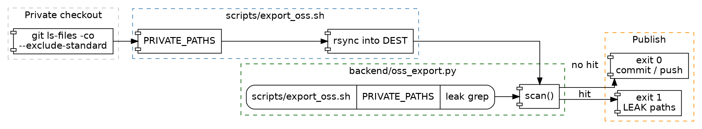

# OSS Export Leak Gate — Spec

**Status:** Implementing
**Date:** 2026-10-23
**Scope:** One scanner shared by `scripts/export_oss.sh` and pytest, and the public-spec wording that currently fails it.
**Related precedent:** `scripts/export_oss.sh` leak grep; `backend/tests/test_public_hygiene.py`

---

## 1. Context & Objective

### Trigger point / Problem

`scripts/export_oss.sh` copies every git-visible file that is not on `PRIVATE_PATHS`, then aborts if the copy matches the leak grep.

```22:24:scripts/export_oss.sh
PRIVATE_PATHS='^(backend/bcm/|\.github/workflows/private-ci\.yml$|backend/openapi/|scripts/ctrader_lookup\.py$|docs/specs/bcm-|docs/specs/dred-judge\.|docs/specs/plugin-boundary-plan\.md$|\.cursor/|[^/]*_TRADE_AUDIT_[^/]*\.md$)'
FILES="$(mktemp)"
git -C "$SRC" ls-files -co --exclude-standard | grep -vE "$PRIVATE_PATHS" > "$FILES"
```

```36:41:scripts/export_oss.sh
# Leak gate. backend/oss_export.py parses the grep line below; do not delete it.
# This file is not scanned (it contains the pattern).
# grep -rIl -E '…' "$DEST" --exclude-dir=.git --exclude-dir=node_modules --exclude=export_oss.sh
if ! ( cd "$DEST" && PYTHONPATH="$DEST" python3 -c 'from backend.oss_export import main; raise SystemExit(main())' ); then
    exit 1
fi
```

The pattern argument on that grep line is omitted here on purpose. This file is itself exported. Pasting the pattern would make the spec fail the gate it describes.

`docs/specs/bcm-*`, `docs/specs/dred-judge.*`, and `docs/specs/plugin-boundary-plan.md` are excluded. These public files are not, and they contain a token the grep rejects:

- `docs/specs/dialog-followup-context.md` — dotted private-plugin import, including the hook path in section 3.2.
- `docs/specs/dialog-continuation-cycle-guard.md` — same, in the scope table and section 3.3.
- `docs/specs/roadmap/phase-2-approval-fatigue.md` — a commercial MCP host and two broker env keys in the connection example.

`docs/specs/roadmap/phase-3-team-readiness.md` and `phase-4-ecosystem.md` use that broker's name as the sample MCP server. The grep does not reject the lowercase name. A public example still should not be one vendor.

`backend/tests/test_public_hygiene.py` checks a few core modules for desk vocabulary. It does not walk the file list the publisher copies, so a spec can go red only at publish time.

### Objective

- Public specs name hooks and a fake broker, not a commercial host or a dotted private import.
- `backend/oss_export.py` reads `PRIVATE_PATHS` and the leak grep from `scripts/export_oss.sh` and reports the same hits the publisher would.
- `scripts/export_oss.sh` calls that module instead of an inline grep.
- `backend/tests/test_oss_export.py` fails if the current checkout would fail the publish.

### Explicit scope decisions

| Decision | Rationale |
|---|---|
| Do not paste the leak pattern into this spec. | This file is on the public side of `PRIVATE_PATHS`. The pattern lives only in `scripts/export_oss.sh`, which the scanner skips. |
| Do not add `docs/specs/roadmap/` or the dialog specs to `PRIVATE_PATHS`. | Those docs describe core behavior. The fix is wording, not hiding them. |
| Slash paths such as `backend/bcm/plugin.py` stay. | The leak pattern is a dotted import, not a directory slash. Implementers still need the file. |
| Sample MCP server id becomes `example_broker`. | One commercial product must not be the architecture's example. |
| The scanner does not widen the pattern. | A broader ban belongs in a later change. This change makes the existing gate testable. |
| No new database table. | The input is the git file list. |

### Scope

**In scope**

- Wording in the two dialog specs and roadmap phases 2, 3, and 4.
- `backend/oss_export.py`, its pytest module, and the publish script calling it.
- The sample MCP server id in `backend/tests/test_governance_agent_wiring.py`.

**Out of scope**

- Editing files already excluded by `PRIVATE_PATHS`.
- The coupling-smell counter in `scripts/export_oss.sh` (plugin tool-name prefixes under `backend/*.py`).
- Stripping env lines from `.env.example` and `docker-compose.yml`. That `sed` stays in the shell script and runs before the scan.

---

## 2. Architecture Diagram

See [`oss-export-leak-gate.dot`](oss-export-leak-gate.dot) for the Graphviz source.



**Data flow summary**

```
Publish: scripts/export_oss.sh
  -> git -C SRC ls-files -co --exclude-standard
  -> drop paths matching PRIVATE_PATHS
  -> rsync that list into DEST
  -> sed private env keys out of DEST/.env.example and DEST/docker-compose.yml
  -> cd DEST && PYTHONPATH=DEST python3 -c "backend.oss_export.main()"
       -> load_rules(DEST/scripts/export_oss.sh)
       -> git ls-files -co --exclude-standard
       -> scan(): skip scripts/export_oss.sh, skip PRIVATE_PATHS, skip NUL bytes
       -> exit 1 and print "LEAK:" plus paths, or exit 0
  -> on exit 0, git add / commit / optional push
```

---

## 3. API / Interface Contracts

### 3.1 CLI — `python -m` is not required

| Field | Value |
|---|---|
| Method/Type | Process exit code |
| Path | `backend.oss_export.main(argv: list[str] \| None = None) -> int` |
| Auth | None. Local file read and `git ls-files`. |
| Request | `--root` optional, default cwd. The publish script runs it with cwd and `PYTHONPATH` set to `DEST`. |
| Response | `0` when no public file matches. `1` when at least one does. Stderr starts with `LEAK: private references found in export:` and then one repo-relative path per line. |
| Errors | `ValueError` if `scripts/export_oss.sh` has no `PRIVATE_PATHS='…'` line or no `grep -rIl -E '…'` line. `subprocess.CalledProcessError` if `git ls-files` fails. A missing file in the git list is skipped. |
| Delivery pattern | Synchronous, in the publish process, after rsync and before `git add`. A failed scan must not commit. |

**Frontend trigger:** None.

### 3.2 Library

| Field | Value |
|---|---|
| Method/Type | `load_rules(script: Path) -> ExportRules` |
| Path | `backend/oss_export.py` |
| Auth | None. |
| Request | Path to the export script. |
| Response | `ExportRules.private_paths` and `ExportRules.leak`, both `re.Pattern[str]`, compiled from that file. |
| Errors | `ValueError` when either line is absent. `FileNotFoundError` when the script path does not exist. |
| Delivery pattern | Synchronous. |

| Field | Value |
|---|---|
| Method/Type | `scan(root: Path, rels: list[str], rules: ExportRules) -> list[str]` |
| Path | `backend/oss_export.py` |
| Auth | None. |
| Request | Checkout root, repo-relative paths, compiled rules. |
| Response | Paths whose decoded text matches `rules.leak`. Order follows `rels`. |
| Errors | None from a single unreadable path: the path is skipped when it is not a file. |
| Delivery pattern | Synchronous. Tests call this with a temp directory so they do not need a second git repo. |

| Field | Value |
|---|---|
| Method/Type | `find_leaks(root: Path) -> list[str]` |
| Path | `backend/oss_export.py` |
| Auth | None. |
| Request | Checkout root that contains `scripts/export_oss.sh` and a `.git` directory. |
| Response | `scan` over `git ls-files -co --exclude-standard`. |
| Errors | Same as `load_rules` and `git`. |
| Delivery pattern | Synchronous. The checkout test calls this on the repo root. |

**DTO shapes**

- `ExportRules.private_paths` — compiled from the `PRIVATE_PATHS='…'` assignment. Matched against the repo-relative path, not the file body.
- `ExportRules.leak` — compiled from the single-quoted argument of `grep -rIl -E`. Matched against file text.
- Skip name — `scripts/export_oss.sh`. Not a field. The rules file contains the pattern, so scanning it would always fail.

### Open Question

None. The publish tree is a git clone, so `find_leaks(DEST)` sees tracked paths plus untracked rsync additions. Deleted working-tree paths are skipped because they are not files.

---

## 4. Data Model & Implementation Plan

### 4.1 Entity

No new table.

| Column | Type | Notes |
|---|---|---|
| path | repo-relative text | From `git ls-files -co --exclude-standard`. |
| body | file bytes | NUL byte means binary. Skipped, same idea as `grep -I`. |

### 4.2 Implementation steps (ordered, no code)

1. `docs/specs/dialog-followup-context.md` and `docs/specs/dialog-continuation-cycle-guard.md` — replace the dotted private import with "the private plugin" or the hook name (`planner_trading_rule`, `fallback_plan_steps`, `annotate_plan_steps`). Leave slash paths.
2. `docs/specs/roadmap/phase-2-approval-fatigue.md` — operator-policy example and the MCP JSON use server id `example_broker`, host `https://mcp.example.test/trading`, and header placeholders `${MCP_READ_TOKEN}` and `${MCP_WRITE_TOKEN}`. The plugin row says "A plugin marks its broker tools."
3. `docs/specs/roadmap/phase-3-team-readiness.md` — provenance example `mcp:example_broker/get_positions`.
4. `docs/specs/roadmap/phase-4-ecosystem.md` — gateway diagram node and the namespacing example use `example_broker`.
5. `backend/tests/test_governance_agent_wiring.py` — the sample MCP server id is `example_broker`. The assertion is approval behavior, not the id.
6. `backend/oss_export.py` — `ExportRules`, `load_rules`, `scan`, `find_leaks`, `main`. Stdlib only.
7. `scripts/export_oss.sh` — keep the `PRIVATE_PATHS` assignment and one `grep -rIl -E '…'` line as the pattern source. Run `main()` against `DEST` instead of the inline grep. Still skip committing when the exit code is `1`.
8. `backend/tests/test_oss_export.py` — temp-dir cases for a public hit, a `docs/specs/bcm-` miss, a slash path, the rules file, a NUL file, and a script with no rules. One case runs `find_leaks` on this repo and expects an empty list. Build sample tokens by concatenation so the test file does not contain a forbidden spelling.

### Known constraints carried over from investigation

| Issue | Location | Relevance here |
|---|---|---|
| Excluded specs may keep the dotted import. | `docs/specs/dred-judge.md`, `docs/specs/plugin-boundary-plan.md`, `docs/specs/bcm-*` | `PRIVATE_PATHS` already drops them. Do not rewrite them for this gate. |
| Hygiene test is a different word list. | `backend/tests/test_public_hygiene.py` | Leave it. It does not see specs. This scanner covers the publish list. |
| mypy, black, and ruff are not project dependencies. | `backend/pyproject.toml` | Run them if the interpreter has them. Do not add them to the project for this gate. |

---

## Storage

Save this spec to `docs/specs/oss-export-leak-gate.md` (+ `docs/specs/oss-export-leak-gate.dot`).
