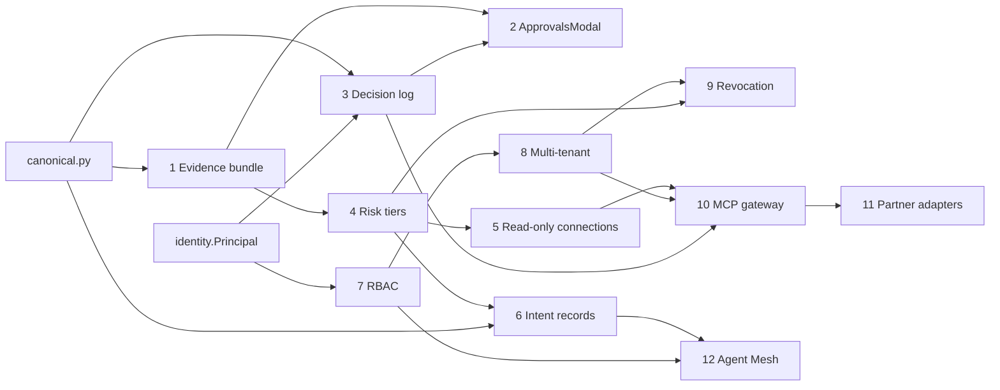

# Hermes Synapse roadmap: engineering spec

Design spec for the 12 roadmap items. It sticks to the current code: every "current state" claim names a file and symbol. Each item spells out its tests first (TDD), then the minimal implementation that makes them pass.

| Phase | File | Items |
| --- | --- | --- |
| 1. Context for approvals (2–4 weeks) | [phase-1-approval-context.md](./phase-1-approval-context.md) | 1 Evidence bundle · 2 ApprovalsModal · 3 Immutable decision log |
| 2. Less approval fatigue (1–2 months) | [phase-2-approval-fatigue.md](./phase-2-approval-fatigue.md) | 4 Risk tiers · 5 Read-only connections · 6 Intent records |
| 3. Team readiness (2–3 months) | [phase-3-team-readiness.md](./phase-3-team-readiness.md) | 7 RBAC · 8 Multi-tenant · 9 Mid-session revocation |
| 4. Ecosystem | [phase-4-ecosystem.md](./phase-4-ecosystem.md) | 10 MCP gateway · 11 Partner integrations · 12 Agent Mesh |

The evidence bundle design is already written in `docs/specs/approval-evidence-bundle.md` on branch `origin/cursor/approval-evidence-bundle-84db` (commit `88ed008`). Phase 1 does not redo that design. It turns it into test-first work packages and adds the parts the branch leaves open.

---

## 1. Current baseline (verified 2026-10-21)

| Concern | Where | Behaviour today |
| --- | --- | --- |
| Gate | `backend/tools.py::execute_tool` → `backend/governance.py::gate_tool` | Runs before every tool body. Gates `HIGH_RISK_TOOLS` (`execute_command`, `create_obsidian_note`, `delete_todoist_task`) **and every MCP tool** (`_requires_approval` checks `mcp_tool_to_server`). |
| Queue | `governance.py::ApprovalQueue` | `approval_requests` row. Statuses `PENDING / APPROVED / REJECTED / CONSUMED`. Payload-keyed (`_payload_key`, `sort_keys=True`), single use (`consume`). |
| Description | `gate_tool` | `description=action_name`. It only repeats the tool name. |
| REST | `backend/main.py` L853–871 | `GET /api/governance/approvals`, `GET …/count`, `POST …/{id}/resolve`. Behind the global Bearer middleware (`auth_middleware`, L232). |
| UI | `frontend/src/components/ApprovalsModal.tsx` | Exists, but `App.tsx` never imports it. |
| Identity | `backend/auth.py` | Local OTP session → roles `["admin"]`, no subject. HS256 JWT → roles from `roles` / `realm_access.roles` / `groups`. `ROLE_HIERARCHY` admin 100 > editor 50 > operator 30 > viewer 10. `check_rbac_permission` exists, but no route calls it. |
| Resolver identity | `ApprovalQueue.resolve` | Only `resolver_note` is stored. **Who** approved is not recorded. |
| Tenancy | none | No `tenant_id` anywhere. |
| MCP | `backend/mcp_client.py` | Client only. Config in `backend/data/mcp_config.json`. Tools are registered into `TOOLS_SCHEMA` when the server connects. No read/write split. |
| Mesh | `backend/mesh.py::AgentMeshRouter` | DB-backed registry plus a heartbeat in the `main.py` lifespan. `dispatch_mesh_task` **does not call the peer**: it returns a `dispatched` stub. No auth between peers. |
| Planner state | `backend/orchestrator.py::AgentState` | `steps`, `current_step_idx`, `results`, `traces`, all in memory during the turn. |
| Test harness | `backend/tests/conftest.py` | Isolated temp SQLite, per-test `DELETE FROM` list (new tables **must** be added there). FastAPI `TestClient(app)` + `create_session()` for API tests. Frontend: vitest + @testing-library/react + jsdom. |

> [!CAUTION]
> `backend/data/mcp_config.json` contains a literal `Authorization: Bearer eyJ…` for the cTrader MCP. Item 5 adds `${ENV}` interpolation. Until that lands, rotate the token and keep the file out of OSS exports. Committed credentials also break the local-reproducibility rule.

---

## 2. TDD protocol (applies to every item)

1. **Red.** Write the test file listed under the item's *Test plan* first. Run it and confirm it fails **for the right reason** (missing symbol, or an assertion on behaviour). An import error in an unrelated module does not count.
2. **Green.** Write the smallest code that makes it pass. Do not add behaviour without a test for it.
3. **Refactor.** Tidy names and remove duplication, with the suite green.
4. **Regression gate.** Before the PR:
   ```bash
   pytest backend/tests/ -q
   npm --prefix frontend run test
   npm --prefix frontend run build
   python3 scripts/generate_code_map.py
   ```
5. **Existing contracts stay green.** `test_high_risk_tool_waits_for_human_then_runs_once` (`backend/tests/test_governance_agent_wiring.py`) must pass unchanged after each phase.

### Where TDD applies and where it does not

| Applies (unit / integration test first) | Test-after or manual |
| --- | --- |
| Hashing, canonical JSON, redaction, hash chain, verify | Visual layout and colour of the modal |
| Risk classifier, policy precedence | LLM-generated wording quality |
| State machines (approval, intent step) | Real partner sandboxes (Sumsub / Radware) |
| RBAC permission matrix, tenant scoping of every query | Multi-node mesh over real network (one smoke test) |
| REST contract (status codes, shapes) via `TestClient` | Load / soak |
| React component behaviour (fetch, render, click → POST) | |

### Test naming

Files: `backend/tests/test_<item>_<scope>.py`. Scopes: `unit`, `api`, `wiring` (agent → gate), `cross` (two or more subsystems). Frontend tests sit next to the component as `*.test.tsx`.

---

## 3. Cross-cutting building blocks

These blocks come up in more than one phase. Each one is introduced the **first** time a phase needs it, and the later phases only extend it.

### 3.1 `backend/identity.py`: `Principal` (introduced in Phase 1, item 3)

The decision log needs *who*. RBAC (7) and tenancy (8) extend the same object.

```python
@dataclass(frozen=True)
class Principal:
    subject: str            # "local-admin" for OTP sessions, JWT "sub" otherwise
    roles: tuple[str, ...]  # lower-case
    tenant_id: str = "default"
    auth_method: str = "otp"  # "otp" | "jwt" | "service"

def principal_from_token(token: str) -> Principal: ...
def current_principal(request: Request) -> Principal: ...  # FastAPI dependency
```

`auth_middleware` stores the principal in `request.state.principal`, so every handler can read it.

### 3.2 Migrations

`init_db` has two parallel schema paths: SQLite around L637 and Postgres around L1146. Every new table and column goes into **both**. New columns use the same idempotent `ALTER TABLE … ADD COLUMN` guard the repo already uses for `session_metadata`. Every new table goes into the `conftest.py` truncation list.

### 3.3 Canonical JSON and hashing (`backend/canonical.py`, Phase 1)

```python
def canonical_json(obj) -> str:
    return json.dumps(obj, ensure_ascii=False, sort_keys=True, separators=(",", ":"), default=str)

def sha256_hex(s: str | bytes) -> str: ...
```

This is the one function that bundle hashes, decision-log chain hashes, idempotency keys and mesh signatures all depend on. Its tests are the first ones written.

### 3.4 Context variables

| Var | Module | Set by | Read by |
| --- | --- | --- | --- |
| `budget_session` | `governance.py` (exists) | agent / orchestrator | `BudgetGuard` |
| `evidence_ctx` | `backend/evidence.py` (P1) | `run_orchestration`, `_respond_as_subagent`, ReAct loop | `gate_tool` |
| `intent_ctx` | `backend/intents.py` (P2) | intent executor | `gate_tool`, `execute_tool` |
| `tenant_ctx` | `backend/tenancy.py` (P3) | middleware, scheduler, bot | every repository query |

The rule: use **contextvars, not thread-locals**, and copy them explicitly with `contextvars.copy_context()` when the code hops to a thread. That is the same pattern `_CallContextProxy` in `tools.py` uses.

---

## 4. Dependency graph



---

## 5. OSS guardrail notes

Each item was checked against `.agents/rules/guardrail.md`:

- **Items 1–10, 12.** No new proprietary dependency. Storage stays SQLite/Postgres behind `DatabaseBackend`. Identity stays OIDC/JWT, so any IdP works (Keycloak, Authentik, Auth0).
- **Item 11 (Sumsub, Radware).** Both are closed, paid services. **Core must not depend on them.** Phase 4 defines two interfaces, `StepUpVerifier` and `McpCallInspector`. Each ships with an OSS default: TOTP / WebAuthn step-up, and a local rule-based inspector. Sumsub and Radware become **optional adapters** loaded through `backend/plugins.py`, outside the default install, and the default tests run without them. CrewAI is MIT-licensed, and the importer only parses its YAML, so it adds no runtime dependency.
- **Credentials.** No item may add a secret to a committed file. Config values use `${ENV_NAME}` interpolation (item 5).
- **Dependencies.** Code must not rely on a package that is only installed transitively. As of 2026-10-22, `PyYAML` 6.0 and `cryptography` 49.0 sit in `backend/.venv` but are missing from `backend/pyproject.toml`. Item 4 (YAML policy files) adds `pyyaml>=6`. Item 11 or 12, whichever lands first, adds `cryptography>=42`. Optional extras: `hermes[webauthn]` (py_webauthn, BSD). Every new dependency must use an OSI-approved license.

---

## 6. Definition of done (per item)

- [ ] Every test in the item's *Test plan* exists and passes. The red run was observed.
- [ ] SQLite and Postgres schema paths are updated, and `conftest.py` truncation is updated.
- [ ] The REST changes are additive, with no breaking change to existing response keys.
- [ ] `docs/` has a user-facing page or a section update.
- [ ] `.agents/code_map.md` is regenerated.
- [ ] `export_oss.sh` exclusions are reviewed. Nothing from `backend/bcm/` is referenced.
